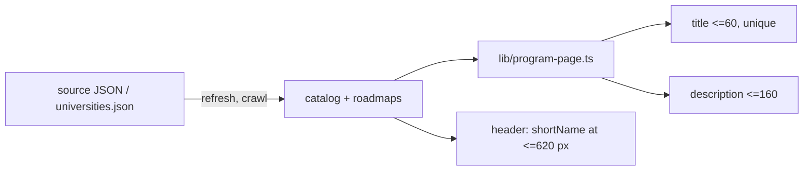

# Short program names in titles (#117)

<!-- managed by ycm-harness wiki. id: work-lite-2026-11-13-117-short-titles -->

# work-lite run: short program names in titles (#117, B6)

This run ships short program names in page titles, course descriptions that fit 160 characters, a narrow-screen header and an intro on `/`. It came from `pull-tickets` 2026-11-12 (rank 3, score 110). PR #131 waits for an owner merge.

## Goal
Meet the 6 acceptance criteria of #117: a short label stored with the catalog; titles of 60 characters or less for at least 90%, all unique; course descriptions of 160 or less; college and program shown on phones; an intro on `/`; a sitemap test.

## Shipped
- PR #131, branch `fix/117-short-titles`. Product commits: `6ae4c7f`, `2ee3c7f`, `4df9f52`, `26fe44a`, then review round 1 `4e602f4` and round 2 `37baa36`.
- Short names: Seattle in `catalog-service/sources/neu-mscs-seattle.json`, Map tier in `catalog-service/universities.json` `crawl.shortNames`. The crawl writes them into roadmaps, so a re-crawl keeps them.
- Title and description rules live in `lib/program-page.ts` (`clip`, `titleName`, `pageTitle`).

## Verify
- `npm run typecheck` exit 0, `npm test` exit 0 (355/355), `npm run build` exit 0 at `37baa36`. PR CI passes.
- 357 of 357 sitemap titles are 60 characters or less and unique (before: 4 of 357). 335 course descriptions are 160 or less.

## Review
- tech_lead: PASS in rounds 1, 2 and 3. Round 1 M1 (a re-crawl drops `shortName`) and M2 (bad fallback titles) were fixed in `4e602f4`.
- project_manager: PASS in rounds 1 and 2.
- user_advocate: PASS in rounds 1 and 2. M1 (the header wrapped to 2 lines) and L2 (`It…` endings) were fixed in `37baa36`.
- Records: `docs/reviews/2026-11-13-pr131-*.md`.

## Architecture
- Report: `artifacts/architecture-117-short-titles.html`. No spec-backed candidates.
- Top recommendation: keep the shape. Move `shortName` to one shared program config when the Coursedog (#84) or Acalog (#85) adapter lands.

## Leftovers
- #132: `npm run deploy` ships without the tests.
- #133: 3 Back presses from a course page to home. This existed before the PR.
- #134: low snippet and copy findings.
- Owner: merge PR #131 (it closes #117). Deploy is a separate owner step.

