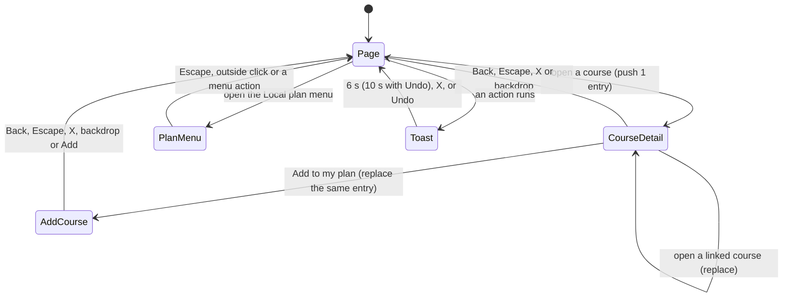

# UI/UX review and fixes, 2026-11-08

Branch: `ui/ux-polish-2026-11-08`. Base: `master` at `f8ad949`.
Scope: the whole app (picker, Overview, Explore, Plan, Courses, Paths, dialogs, toasts).
Method: read every page component and `app/globals.css`, then walk each page in Chromium at 1440 px and 400 px (touch), before and after.
Runtime: vinext dev server (`vite dev --port 3101`), the production runtime of this app.

Line numbers in the "Where" column are on the base commit `f8ad949`.

## Navigation and overlay map (after the fix)

At most one layer is open at a time. A dialog adds at most one history entry. Back from a dialog closes it. The next Back leaves the page.

## Findings

| # | Issue | Where | Severity | Status and evidence |
|---|---|---|---|---|
| 1 | Blocking `window.confirm()` before reset of the plan | `components/app-provider.tsx:290` | High | Fixed. Reset runs at once. The toast has Undo. Undo also puts back unreadable saved data, then blocks saving again. Browser walk: reset, Undo, 5 terms back, 0 native dialogs. |
| 2 | Blocking `window.confirm()` before removal of a term | `components/planner-board.tsx:320` | High | Fixed. Removal runs at once, with Undo. Walk: 5 terms, remove, 4 terms, Undo, 5 terms. `after-desktop-undo-toast.png` |
| 3 | Blocking `window.confirm()` before restore of a backup | `components/plan-backup.tsx:100` | High | Fixed. Restore saves first (no change), then the toast gives Undo to the earlier plan. |
| 4 | Blocking `window.confirm()` before reset of the Paths suggestions | `components/pathways-workspace.tsx:109` | High | Fixed. Reset runs at once. Undo restores the on-screen and the saved suggestions. |
| 5 | Remove a course from a term had no undo | `components/planner-board.tsx:320` | Medium | Fixed. Toast "CS 5010 removed from Fall 2026." with Undo. |
| 6 | Mark completed or waived removes planned copies, with no undo | `components/app-provider.tsx:349` | Medium | Fixed. The toast has Undo. |
| 7 | Toast never closed by itself; green check icon also on failures | `components/app-shell.tsx:98` | Medium | Fixed. One `Toast`: it replaces the old toast, hides after 6 s (10 s with Undo), waits on hover or focus. Failures use the warning tone and icon. Walk: toast gone after 7 s. |
| 8 | Duplicate messages for one event (toast plus inline banner) | `components/pathways-workspace.tsx:99`, `components/plan-backup.tsx:101`, `components/app-provider.tsx:320` | Medium | Fixed. Success goes to the toast only. A failure shows in place, next to the control. |
| 9 | Catalog load error shown twice (top banner and empty state) | `components/app-shell.tsx:91` | Medium | Fixed. Without a catalog, only the in-place state shows the error. The banner covers a failed refresh only. |
| 10 | Catalog error state had no retry when refresh is off (production); copy "No course information has been invented" | `components/catalog-state.tsx:11` | High | Fixed. "The course catalog did not load", the reason, and a "Try again" button (`reloadCatalog`). |
| 11 | Back did not close the course dialog; Back left the page with the dialog open | `components/ui.tsx:13` | High | Fixed. `useBackCloses` in the one `Modal`. Walk: open, Back closes, URL unchanged; Escape removes the entry; detail to Add course reuses one entry. |
| 12 | Local plan menu did not close on Escape, outside click, or after an action | `components/app-shell.tsx:79` | Medium | Fixed. Walk: Escape closes and returns focus; outside click closes. |
| 13 | A new top search on Courses pushed one history entry per search | `components/app-shell.tsx:43` | Low | Fixed. `router.replace` when Courses is already open. |
| 14 | Headings rendered as body text (Tailwind preflight resets h1 to h4) | `app/globals.css:50` | High | Fixed. Each heading level has a size and weight. `after-desktop-overview.png` |
| 15 | Icons above their labels in cards (preflight makes `svg` a block) | `app/globals.css` (no rule) | Medium | Fixed. `.lucide` is inline. `after-desktop-plan.png` |
| 16 | 40+ font sizes, many under 10 px (0.58rem = 9.3 px) | `app/globals.css` (214 places) | High | Fixed. 8-step type scale (`--fs-2xs` 11 px to `--fs-3xl` 30 px). Walk: 0 text nodes under 11 px outside the graph canvas. |
| 17 | Spacing values with no scale (0.08rem, 0.62rem, 0.85rem ...) | `app/globals.css` (551 places) | Medium | Fixed. All padding, margin and gap values snap to one 13-step scale. |
| 18 | 12 font weights (500 to 800) | `app/globals.css` | Low | Fixed. 4 weights: 500, 600, 700, 800. |
| 19 | 10 border radii (5 px to 22 px) | `app/globals.css` | Low | Fixed. `--radius-sm`, `--radius`, `--radius-lg`, pill and circle. |
| 20 | Muted text failed contrast: `#8a93a0` is 3.1:1 on white, 2.9:1 on paper | `app/globals.css:10` | High | Fixed. `#646d7b` is 4.8:1 on white, 4.5:1 on soft grey. Amber text is now 5.5:1 on its tint. |
| 21 | Focus ring was 28% pink, hard to see | `app/globals.css:51` | High | Fixed. 2 px solid blue `:focus-visible` on every element; search fields show the ring on `:focus-within`. `after-desktop-focus.png` |
| 22 | Touch targets 31 px, 32 px, 36 px | `app/globals.css:145`, `:152` | High | Fixed. 44 px for every control on a touch screen or a window up to 860 px. Walk at 400 px: 0 controls under 44 px (inline text links excepted). |
| 23 | Plan page scrolled sideways at 1440 px (sr-only text escaped the term board; term header did not fit 248 px) | `app/globals.css:536` | High | Fixed. Term header in 2 rows; `position: relative` on the column. Walk: 0 px overflow on all 6 pages at 1440 px and 400 px. |
| 24 | Tracked all-caps labels ("WHY IS THIS BLOCKED?", "CORE", "STATUS") | `app/globals.css:180` and 8 more rules; `components/planner-board.tsx:206`, `:233`; `lib/pathway-overlay.ts:9` | Medium | Fixed. Sentence case everywhere. Test updated for "Critical ★". |
| 25 | Middle-dot meta strings ("2026-2027 · refreshed", "Take together · corequisites", 25 more) | 11 components and 3 pages | Low | Fixed. Commas, colons or parentheses. Text built in `lib/` that tests check stays as it is. |
| 26 | Cream gradient and beige fills (`#fffefa` to `#f3f1ec`, `#eeece6`, `#e8e6df`) | `app/globals.css:195` and 3 more | Low | Fixed. Neutral tokens only. 30 hard-coded colors now use tokens. |
| 27 | Decorative "01 / 02" numbers on Paths groups (not a sequence) | `components/pathways-workspace.tsx:135` | Low | Fixed. Removed. Term numbers on Plan stay, because terms are a sequence. |
| 28 | Roadmap selector pushed the map below the first phone screen | `components/roadmap-selector.tsx:84` | Medium | Fixed. A closed disclosure "Other university roadmaps". It opens by itself when a roadmap is open or a load failed. `after-phone-explore.png` |
| 29 | No transitions; spinner flashed on fast loads | `app/globals.css` | Medium | Fixed. Page fade (220 ms), dialog and drawer entrance, toast and menu entrance, press feedback. Loading state waits 300 ms. Only transform and opacity move. Reduced motion: walk shows 0.01 ms durations. |
| 30 | Vague copy: "Make room for what's next.", "Finding your direction", "Build My Plan" | `components/course-dialogs.tsx:82`, `components/ui.tsx:29`, `components/planner-board.tsx:302` | Low | Fixed. "Add a course", "Loading the course map", "Build your plan". |
| 31 | Course drawer on a phone left a 36 px gap (UA `max-width` on dialog) | `app/globals.css` | Low | Fixed. Drawer is full width at 400 px. `after-phone-course-detail.png` |

## Not changed, with the reason

- Dark theme: the app has no theme. It declares `color-scheme: light`. The brief asks for dark only when themes exist.
- Typeface: the app keeps the system font stack. A web font needs a network fetch at build or run time. That is a new dependency for a small gain.
- No business, data, auth or payment logic changed. Undo uses the existing `setPlan`, `restorePlan` and `writeCatalogValue` paths.

## Checks

| Check | Result |
|---|---|
| `npm run typecheck` | Pass |
| `npm test` (clean worktree) | 335 of 335 pass |
| `npm run build` | Pass, 127 prerendered routes |
| Native dialogs during the walk | 0 |
| Horizontal overflow, 6 pages x 2 widths | 0 px |
| Controls under 44 px at 400 px (touch) | 0 |

Note: in the main checkout, 19 tests fail on `master` too. The cause is an ignored local folder `data/catalogs/neu-mscs-seattle/`. A clean worktree passes all tests, and CI on `master` passes.

## Screenshots

Before: [desktop explore](ux-review-2026-11-08/before-desktop-explore.png), [desktop plan](ux-review-2026-11-08/before-desktop-plan.png), [desktop overview](ux-review-2026-11-08/before-desktop-overview.png), [desktop courses](ux-review-2026-11-08/before-desktop-courses.png), [desktop paths](ux-review-2026-11-08/before-desktop-paths.png), [phone explore](ux-review-2026-11-08/before-phone-explore.png), [phone plan](ux-review-2026-11-08/before-phone-plan.png).

After: [desktop explore](ux-review-2026-11-08/after-desktop-explore.png), [desktop plan](ux-review-2026-11-08/after-desktop-plan.png), [desktop overview](ux-review-2026-11-08/after-desktop-overview.png), [desktop courses](ux-review-2026-11-08/after-desktop-courses.png), [desktop paths](ux-review-2026-11-08/after-desktop-paths.png), [undo toast](ux-review-2026-11-08/after-desktop-undo-toast.png), [course drawer](ux-review-2026-11-08/after-desktop-course-detail.png), [add course](ux-review-2026-11-08/after-desktop-add-course.png), [focus ring](ux-review-2026-11-08/after-desktop-focus.png), [phone explore](ux-review-2026-11-08/after-phone-explore.png), [phone plan](ux-review-2026-11-08/after-phone-plan.png), [phone plan menu](ux-review-2026-11-08/after-phone-plan-menu.png), [phone course drawer](ux-review-2026-11-08/after-phone-course-detail.png).
