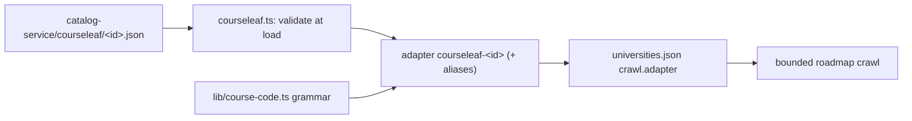

# Add a CourseLeaf college

The generic CourseLeaf adapter reads every CourseLeaf catalog. One JSON config per college tells it where the pages are and how to read them (#78).

## 1. Write the config file

1. Make sure that the college catalog is CourseLeaf. Look for `courseleaf` in the page source. Record the evidence in `platformEvidence` in `catalog-service/universities.json`.
2. Copy `catalog-service/courseleaf/northeastern.json` to `catalog-service/courseleaf/<id>.json`.
3. Set `id` to the directory id of the college, for example `georgia-tech`. The adapter id becomes `courseleaf-<id>`.
4. Set `aliases` to `[]`. Only Northeastern needs an alias (`northeastern-acalog`).
5. Set `programRoots` to the path prefixes of program pages, for example `"/graduate/"`.
6. Set `nonProgramPaths` to the path segments that are not programs, for example `"course-descriptions"`.
7. Set `courseDescriptionUrl` to the HTTPS URL of one subject page. Write `{subject}` where the lower-case subject goes.
8. Set `creditUnit` to the word on the course title line: `semester-hours` or `quarter-hours` ("Hours"), `credits` ("Credits"), or `units` ("Units").
9. Set each selector in `selectors`. Use the selectors of the college HTML, not of Northeastern.
10. Add one import line for the file in `COURSELEAF_CONFIGS` in `catalog-service/courseleaf.ts`.

The loader rejects the config when it has an unknown key, a URL that is not HTTPS, or a selector that does not parse.

| Field | Northeastern value | What it controls |
|---|---|---|
| `selectors.programIndexLinks` | `#azindex a[href], …` | Program links on an HTML index (a sitemap needs no selector) |
| `selectors.programRequirements` | `#programrequirementstextcontainer` | Requirements container on a program page |
| `selectors.programName` | `h1` | Program name |
| `selectors.codeLink` | `a.code` | Course-code links in the requirements |
| `selectors.credits` | `td.hourscol` | Credit cells in requirement tables |
| `selectors.courseBlock` | `div.courseblock` | One course on a subject page |
| `selectors.courseTitle` | `p.courseblocktitle` | "CODE. Title. (4 Hours)" line |
| `selectors.courseDescription` | `p.cb_desc` | Course description |
| `selectors.courseExtra` | `p.courseblockextra` | Prerequisite and corequisite lines |

## 2. Add the code grammar

1. Set `codeGrammar` to a key of `CODE_GRAMMARS` in `lib/course-code.ts`.
2. If the course codes have a new shape, add a grammar there. Do not give its patterns the `g` or `y` flag. A test fails when a pattern has one.
3. Add `"courseleaf-<id>"` to the adapter map in `lib/course-code.ts`, with the same grammar. The adapter throws at load when the two grammars differ.

## 3. Add fixtures

1. Save one program page and one subject page from the college under `tests/fixtures/<id>/`. Get them by hand, one request each, and obey `robots.txt`.
2. Write a test that runs `getAdapter("courseleaf-<id>")` on the fixtures. Pin the course count, one known prerequisite chain and the code format.
3. Run `npx tsx --test tests/<id>.test.ts`. This is the dry run. It does not use the network.

## 4. Enable the college

1. In `catalog-service/universities.json`, add a `crawl` block with `"adapter": "courseleaf-<id>"`, the discovery source, `robotsUrl`, `allowedOrigins` and `requestDelayMs` of 750 or more.
2. Set `"support": "supported"` and `"enabled": true` only after the fixture test passes.
3. Run a bounded crawl: `npm run catalog:refresh -- --crawl-roadmaps --limit=5 --university=<id>`.
4. Read the roadmap files and their `warnings`. Then add the catalog key to `data/published.json` and `CATALOGS` in `lib/catalog-key.ts`.
5. Run `npm run typecheck`, `npm test` and `npm run build`. Commit the output on a branch and open a PR.

## Limits

- The roadmap path (Map tier) is generic. The audit parser (`parseProgramRequirements`) reads the Northeastern MSCS table layout only. A new college starts at Map tier.
- When a college layout differs in more than selectors, credit unit and URLs, it needs code changes, not only a config.
