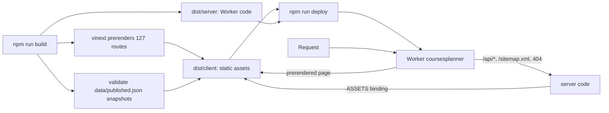
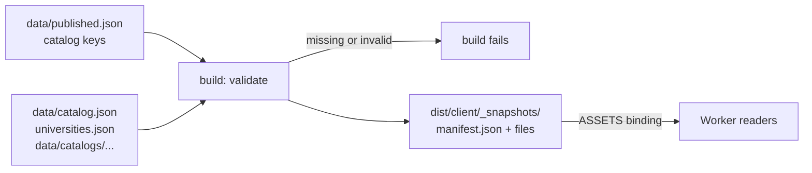
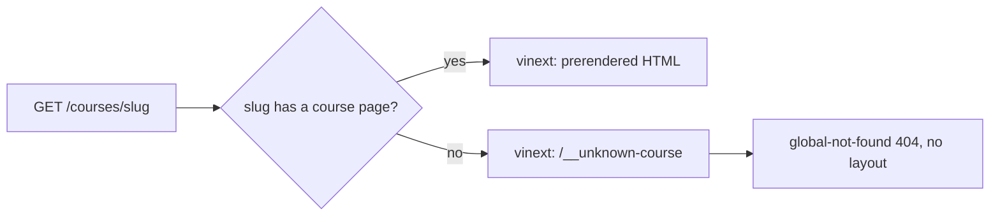

# Deployment

Production: [https://coursesplanner.johnyc.com](https://coursesplanner.johnyc.com). It is the Cloudflare Worker `coursesplanner` on the Workers Free plan ($0).

This file is operator notes. Students who use the planner do not need it.

## Project

| Item | Value |
| --- | --- |
| Production URL | https://coursesplanner.johnyc.com |
| Runtime | Cloudflare Worker `coursesplanner`, Workers Free plan, no paid add-ons |
| Build | [vinext](https://github.com/cloudflare/vinext) 1.4.4 (Vite version of the Next.js API), `@vinext/cloudflare` 1.3.3 |
| Config | [`wrangler.jsonc`](../wrangler.jsonc) (routes, assets, Worker entry [`worker.ts`](../worker.ts)), [`vite.config.ts`](../vite.config.ts) (vinext, static-assets cache) |
| Custom domain | `routes: [{ pattern: "coursesplanner.johnyc.com", custom_domain: true }]`. `workers_dev` and `preview_urls` are off (house rule for every app under `johnyc.com`) |
| DNS | Cloudflare zone `johnyc.com`. The Worker custom domain made the record (AAAA `100::`, proxied) on 2026-11-07. It replaced the DNS-only CNAME to Vercel (`e0273d0e708952dd.vercel-dns-017.com`). Shared map: [johnyuencm/johnyc-infra](https://github.com/johnyuencm/johnyc-infra) |
| Cloudflare account | `99ea46219cc098a0c9db852d9e1fd0f6` |
| Production Git branch | `master` (this repo does not use `main`) |
| Old host | Vercel Hobby project `courses-planner` (team `johnyuen97gmailcoms-projects`). Git deploys are disconnected since 2026-11-06. It still holds the 2026-10-30 build. The owner decides when to delete it |

## How it works



- `npm run build` runs `vite build`. vinext prerenders the program picker (`/`) and every page of each published program at build time: `/<universityId>/<programId>` and its `explore`, `planner`, `courses`, `pathways`, all `courses/<slug>` and all `pathways/<id>`. The Worker serves them from static assets (`X-Vinext-Cache: HIT`). See [`docs/ia.md`](ia.md).
- `/api/catalog`, `/api/roadmaps`, `/sitemap.xml`, `/robots.txt` and 404 pages run in the Worker.
- Workers has no project filesystem. The Worker reads the published snapshots from static assets. See [Published snapshots](#published-snapshots).
- `POST /api/catalog` (refresh) stays off in production: it answers 401. Refresh the catalog with `npm run catalog:refresh`, commit `data/`, then deploy.
- `app/global-not-found.tsx` renders route misses without the root layout, because a full layout render costs more CPU than the Free plan allows.
- [`worker.ts`](../worker.ts) is the Worker entry (`main` in `wrangler.jsonc`). It changes a request for an unknown program, course or path page to a route miss, then calls vinext. All other requests go to vinext unchanged.
- The program overview, Explore, Paths, Plan and Courses pages put server-rendered catalog text in the prerendered HTML ([`components/program-summary.tsx`](../components/program-summary.tsx)). Crawlers read it without JavaScript. The interactive views load after it.

## Published snapshots



- [`data/published.json`](../data/published.json) is the allowlist. Each entry is a catalog key, `<university-id>/<program-id>`, for one ready roadmap.
- `npm run build` runs [`lib/snapshot-manifest.ts`](../lib/snapshot-manifest.ts) from a plugin in [`vite.config.ts`](../vite.config.ts). It validates each listed roadmap, its `programs.json`, `data/catalog.json` and `catalog-service/universities.json`.
- The build fails when a listed roadmap is missing, invalid or not `ready`. The Worker never lists a program that answers 503.
- The build writes the files to `dist/client/_snapshots/<repo path>`. It also writes `_snapshots/manifest.json`. Each manifest entry has a catalog key, a tier (`audit` or `map`), an edition (the snapshot `lastUpdated`) and a file.
- The shipped `programs.json` keeps only the published programs. To unpublish a program, remove its key and deploy.
- To publish a new program, commit its roadmap and `programs.json` (see `.gitignore`), then add its key.
- The program pages (#71) come from `CATALOGS` in `lib/catalog-key.ts`. Add or remove the same key there. A test in `tests/course-pages.test.ts` fails when `data/published.json` and `CATALOGS` differ.
- The readers try disk first (dev, tests, CLI, prerender). When a file is missing (`ENOENT`), the Worker reads it through the `ASSETS` binding ([`lib/snapshot-assets.ts`](../lib/snapshot-assets.ts)), from `import { env } from "cloudflare:workers"`. It reads only files that the manifest lists. A corrupt disk file gives an error.
- The Worker does not validate the files again, because the build did. It parses each file once per isolate. The API routes keep the serialized body in memory, as before.
- `npm run dev:vinext` also runs in workerd without project files. There, a virtual module from `vite.config.ts` gives the same files.
- The files are public at `/_snapshots/...`. They hold the data that `/api/catalog` and `/api/roadmaps` return. `universities.json` also keeps its `crawl` settings (adapter and source URLs). These settings are not secret, because the same file is public in the repo.
- Node tools import no snapshot file. The CLI still works when you delete a `data/catalogs/<id>/` folder.

## Deploy

Deploy is manual. CI does not deploy, because a deploy job needs a Cloudflare API token as a GitHub secret.

```bash
npm ci
npm run typecheck
npm test
npm run deploy
```

`npm run deploy` runs `vinext-cloudflare deploy`: it builds, then uploads with Wrangler. It needs a Wrangler login (`npx wrangler login`) with Workers write access on the account above.

If the upload fails with `fetch failed` (network), the build in `dist/` is still good. Run the upload again:

```bash
npx wrangler deploy --config dist/server/wrangler.json
```

Run the production Worker on your PC (workerd, port 3000):

```bash
npm run build
npm run start
```

## Rollback

- Worker version: `npx wrangler rollback` (pick the earlier version), or `npx wrangler deployments list` to see versions.
- Full rollback to Vercel (only while the Vercel project exists): remove the Worker custom domain, then create the DNS-only CNAME `coursesplanner` → `e0273d0e708952dd.vercel-dns-017.com` again with the `cf` CLI. Vercel serves the frozen 2026-10-30 build.

## CPU per request (Workers Free limit: 10 ms)

Measured on 2026-11-07 with `wrangler tail --format json` (field `cpuTime`) on a temporary custom domain. Each route got 30 sequential requests from Seattle. Worker startup time: 11-22 ms (limit 1 s).

| Route | p50 | p90 | Over 10 ms |
| --- | --- | --- | --- |
| Prerendered pages (`/`, `/explore`, `/planner`, `/courses`, `/courses/cs-5010`, `/pathways/systems`) | 2-4 ms | 4-6 ms | 0 of 30 per route, after warm-up |
| `/sitemap.xml` | 3 ms | 8 ms | 0 of 30 |
| `/robots.txt` | 1 ms | 2 ms | 0 of 30 |
| `/api/catalog` | 5 ms | 10 ms | 1 of 29 |
| `/api/roadmaps` | 4 ms | 8 ms | 1 of 30 |
| `/api/roadmaps?university=…&program=…` | 4 ms | 10 ms | 5 of 60 |
| Route miss 404 (`/nothing`, `/favicon.ico`) | 6 ms | 10-28 ms | 2-3 of 30 |
| Unknown course 404 (`/courses/zz-9999`) | 10 ms | 28 ms | 13 of 28 |

- The first requests on a new isolate cost more (up to about 30 ms on `/`). The p90 values include them.
- The two API routes keep the serialized JSON body in memory for each isolate. Before that change, `/api/roadmaps?…&program=…` had p50 8 ms and p90 21 ms.
- Before `app/global-not-found.tsx`, every 404 rendered the full layout at p50 14 ms and p90 45-70 ms. Browsers ask for `/favicon.ico` on each visit, and the app has no favicon, so that cost hit every visit.
- Every request in these runs had outcome `ok`. Cloudflare did not stop any request that went over 10 ms. Do not rely on this: an over-limit request can fail with error 1102.
- An unknown `/courses/<slug>` renders the root layout when vinext handles it. `dynamicParams = false` makes it a 404, but vinext renders that 404 inside the layout. See the 2026-11-08 numbers below.
- Do not fix this with a `proxy.ts` on `/courses/:slug`. Version `11fcae7b` tried it on 2026-11-07 (60 warm requests per route). Unknown course 404 went to p50 7 ms, p90 13 ms. But every real course page paid for the proxy: p50 5 ms, p90 9 ms, 4 of 60 over 10 ms. A page without the proxy (`/explore`) had p50 4 ms, p90 6 ms. Course pages are the pages that crawlers read, so the proxy was removed.

### Unknown course 404, 2026-11-08 (issue #65)

Live Worker version `dfbdf20b` (no proxy, no `worker.ts`). Method: `wrangler tail --format json`, field `cpuTime`. GET requests from Seattle, one after the other, with a marked user agent. Course requests alternate with unknown-course requests.

| Route | Requests | p50 | p90 | Max | Over 10 ms |
| --- | --- | --- | --- | --- | --- |
| Unknown course 404 (`/courses/zz-9001` … `zz-9130`) | 57 | 15 ms | 68 ms | 119 ms | 47 of 57 |
| Real course page (`/courses/cs-5800`) | 58 | 4 ms | 7 ms | 32 ms | 4 of 58 |
| Route miss 404 (`/nothing-1` … `/nothing-30`) | 27 | 6 ms | 31 ms | 40 ms | 3 of 27 |

The unknown-course 404 is over the limit. The tail lost a few events, so some counts are under 30 per run.

Fix: [`worker.ts`](../worker.ts) wraps the vinext Worker.



- The check is one `URL` parse and one `Set` lookup. The `Set` holds every program page path (`programPagePaths()` in `lib/course-pages.ts`). Since #110 the build makes this list (`virtual:program-pages`). Before #110 the first program-path request of each isolate read and parsed `data/catalog.json` to make it.
- Since #71 the check covers every `/<universityId>/<programId>/...` path, not only `/courses/<slug>`. An unknown program (`/zz/yy`) also gets the small 404.
- vinext middleware does not run, so real course pages do not pay for the check. The old `proxy.ts` used vinext middleware.
- `tests/course-pages.test.ts` pins the rule: unknown slugs and placeholder courses go to the 404, real course pages do not.

Local check (`npm run build`, then `wrangler dev` on `127.0.0.1`). This is not a CPU measurement. Local wall time had too much noise from other processes, so the response body is the evidence:

| Build | `/courses/zz-9999` | `/courses/cs-5800` |
| --- | --- | --- |
| Before (`main`: `vinext/server/fetch-handler`) | 404, 17,678 bytes (root layout) | 200, `X-Vinext-Cache: HIT` |
| After (`main`: `./worker.ts`) | 404, 6,026 bytes (`global-not-found`, as `/nothing` with 5,981 bytes) | 200, `X-Vinext-Cache: HIT` |

Live result after the fix. Worker version `aa68c23b` (master `0cfa0ae`), deployed 2026-11-08. Same method, 30 pairs of requests:

| Route | Requests | p50 | p90 | Max | Over 10 ms |
| --- | --- | --- | --- | --- | --- |
| Unknown course 404 (`/courses/zz-9001` … `zz-9030`) | 31 | 7 ms | 32 ms | 60 ms | 5 of 31 |
| Real course page (`/courses/cs-5800`) | 31 | 4 ms | 11 ms | 22 ms | 4 of 31 |

The unknown-course 404 p50 falls from 15 ms to 7 ms. The share over 10 ms falls from 82% to 16%. Real course pages do not change.

After #61 (snapshots as static assets): Worker version `4ed89a10` (master `2584289`), 2026-11-08. Same method, 30 rounds:

| Route | Requests | p50 | p90 | Max | Over 10 ms |
| --- | --- | --- | --- | --- | --- |
| Unknown course 404 | 29 | 6 ms | 47 ms | 85 ms | 7 of 29 |
| Real course page (`/courses/cs-5800`) | 29 | 3 ms | 11 ms | 17 ms | 3 of 29 |
| `/api/catalog` | 29 | 5 ms | 26 ms | 40 ms | 4 of 29 |

The medians stay low and do not get worse. The p90 and max values change a lot between runs. The cause of the slow requests is not measured. A likely cause is the first request in a new isolate, which loads and parses the snapshot files.

After #71 (program routes): Worker version `2424a379` (master `d72891d`), 2026-11-08. Same method. Paths start with `/northeastern/computer-science-mscs-sea-8b0d00dbda`.

Round 1, right after the deploy (many cold isolates), 31 requests per route:

| Route | p50 | p90 | Max | Over 10 ms |
| --- | --- | --- | --- | --- |
| Old URL `/courses/cs-5800` (308) | 2 ms | 4 ms | 7 ms | 0 of 31 |
| New course page | 7 ms | 37 ms | 57 ms | 12 of 31 |
| New unknown course 404 | 11 ms | 59 ms | 123 ms | 16 of 31 |

Round 2, a few minutes later, 40 requests per route:

| Route | p50 | p90 | Max | Over 10 ms |
| --- | --- | --- | --- | --- |
| New course page | 5 ms | 8 ms | 9 ms | 0 of 40 |
| New explore page | 4 ms | 9 ms | 10 ms | 0 of 40 |
| New unknown course 404 | 9 ms | 16 ms | 20 ms | 14 of 40 |

The unknown-course 404 is slower again: p50 9 ms, against 6 ms after #61. Course pages are about 1 to 2 ms slower. Issue #110 tracks the fix.

### Page index at build time, 2026-11-08 (issue #110)

Cause. Before the fix, `worker.ts` made the page `Set` at request time:

```text
first program request of an isolate
  -> ASSETS fetch _snapshots/manifest.json + data/catalog.json (150 KB)
  -> JSON.parse, publicCourses() (localeCompare numeric sort), slug for each course
  -> Set of 125 paths
every program request: await that promise, then vinext
```

- In Node, the first `Set` build takes 12 ms. Later builds take 1 ms. The first build pays for lazy compile and the ICU collator.
- Workers Free starts many isolates. Each new isolate pays this cost on its first program request, a course page or a 404.
- Every program path waited for the promise, also after it resolved (PR #108 review, finding 4).

Fix. The build makes the page list. `worker.ts` reads it with no I/O and no `await`:

```text
vite build: programPageIndex() (lib/snapshot-manifest.ts)
  -> virtual:program-pages: JSON array of page paths (125 paths, about 8 KB)
worker.ts at isolate start: new Set(pagePaths)
request: isUnknownProgramPath(pathname, pages) -> /__unknown-page or vinext
```

- The list has every page of every catalog key in `CATALOGS`. More published programs only make the list longer.
- Real pages still come from the prerender cache (`X-Vinext-Cache: HIT`).
- `tests/course-pages.test.ts` pins the rule. `worker.ts` must import `virtual:program-pages`. It must not use `readCatalog`, `lib/catalog` or `await`.

Local evidence: `npm run build`, then `wrangler dev` on `127.0.0.1:3221` with `--inspector-port`. A script attached the V8 sampling profiler (50 µs) through the inspector. The profiler and other local processes make all numbers larger than live `cpuTime`. Compare them only with each other.

| First unknown-course 404 of a new isolate | Busy CPU samples | Samples in the `course-pages` chunk (page `Set` build) |
| --- | --- | --- |
| Before (`master` 8332b37) | 117 ms | 13.4 ms |
| After | 50 ms | 0 ms |

Warm requests (40 in a row) had too much local noise. `/nothing` does not use the check, and it changed from 14 to 19 ms between two runs. So the warm numbers are not evidence. Live `wrangler tail` must give them.

Status and size checks on the built Worker (after the fix):

| Request | Result |
| --- | --- |
| `<program>`, `/explore`, `/planner`, `/courses`, `/courses/cs-5800`, `/courses/cs-5010`, `/pathways`, `/pathways/systems` | 200, `X-Vinext-Cache: HIT` |
| `<program>/courses/zz-9999`, `/courses/cis-200m`, `/pathways/zz-9999`, `/zz/yy`, `/northeastern/no-such-program` | 404, 6,729 bytes (`global-not-found`) |
| `/nothing` | 404, 6,694 bytes |
| `/courses/cs-5800`, `/courses/` | 308 to the program path |
| `/` | 200, `X-Vinext-Cache: HIT` (picker) |

#### Live measurement after the deploy

Do these steps after the deploy of this fix. Do not change the Worker during the run.

1. Wait 5 minutes after the deploy, so that most isolates are warm.
2. In terminal 1, start the tail:

   ```bash
   npx wrangler tail coursesplanner --format json > tail-110.json
   ```

3. In terminal 2, send 40 rounds. Each round sends a course page, an unknown course and a route miss:

   ```bash
   SITE=https://coursesplanner.johnyc.com
   P=$SITE/northeastern/computer-science-mscs-sea-8b0d00dbda
   UA=cp-110-measure
   for i in $(seq 101 140); do
     curl -s -o /dev/null -A "$UA" "$P/courses/cs-5800"
     curl -s -o /dev/null -A "$UA" "$P/courses/zz-9$i"
     curl -s -o /dev/null -A "$UA" "$SITE/nothing-$i"
   done
   ```

4. Wait 30 seconds. Stop the tail with Ctrl+C.
5. Get p50, p90, max and the count over 10 ms for each route:

   ```bash
   node -e '
   const text = require("fs").readFileSync("tail-110.json", "utf8").trim();
   const events = JSON.parse("[" + text.replace(/}\s*{/g, "},{") + "]");
   const groups = {};
   for (const e of events) {
     const req = e.event?.request;
     if (req?.headers?.["user-agent"] !== "cp-110-measure") continue;
     const path = new URL(req.url).pathname;
     const key = path.includes("/zz-") ? "unknown course 404" : path.startsWith("/nothing") ? "route miss 404" : "course page";
     (groups[key] ??= []).push(e.cpuTime);
   }
   for (const [key, t] of Object.entries(groups)) {
     t.sort((a, b) => a - b);
     const q = (p) => t[Math.min(t.length - 1, Math.floor(p * t.length))];
     console.log(key, "n", t.length, "p50", q(0.5), "p90", q(0.9), "max", t.at(-1), "over 10 ms", t.filter((x) => x > 10).length);
   }'
   ```

6. Add the numbers to a table below this section, with the Worker version (`npx wrangler deployments list`).

Pass: unknown-course 404 p50 6 ms or lower, with at least 40 events. Course page p50 4 ms or lower.
If the unknown-course 404 and `/nothing` have the same CPU, the rest of the cost is the vinext `global-not-found` render, not `worker.ts`.

Result after #110: Worker version `1524031c` (master `e257fff`), 2026-11-08. 40 rounds each.

| Route | Round | p50 | p90 | Max | Over 10 ms |
| --- | --- | --- | --- | --- | --- |
| Course page | 1 (cold, right after deploy) | 6 ms | 31 ms | 58 ms | 12 of 40 |
| Unknown course 404 | 1 | 7 ms | 39 ms | 78 ms | 10 of 40 |
| Route miss `/nothing-N` | 1 | 9 ms | 43 ms | 66 ms | 14 of 40 |
| Course page | 2 (warm) | 4 ms | 6 ms | 9 ms | 0 of 40 |
| Unknown course 404 | 2 | 7 ms | 12 ms | 15 ms | 5 of 40 |
| Route miss `/nothing-N` | 2 | 6 ms | 11 ms | 16 ms | 4 of 40 |

- The course page passes (p50 4 ms warm).
- The unknown-course 404 does not pass yet (p50 7 ms, target 6 ms). It now costs about the same as a route miss, so the rest of the cost is the shared `global-not-found` render. A cheaper 404, for example a static 404 asset, is the next step (#110).

### Program paths, 2026-11-08 (issue #71)

Local check: `npm run build`, then `wrangler dev` on `127.0.0.1:3171`. This is not a CPU measurement. `<program>` is `/northeastern/computer-science-mscs-sea-8b0d00dbda`.

| Request | Status | Evidence |
| --- | --- | --- |
| `<program>`, `/explore`, `/planner`, `/courses`, `/courses/cs-5800`, `/pathways`, `/pathways/systems` | 200 | `X-Vinext-Cache: HIT` (prerendered) |
| `/courses?q=data` | 308 | `Location: <program>/courses?q=data` |
| `/map?focus=CS%205800` | 308 | `Location: <program>/explore?focus=CS%205800` |
| `/` | 307 | `Location: <program>` |
| `<program>/courses/zz-9999`, `/zz/yy`, `/northeastern/no-such-program` | 404 | 6,463 bytes (`global-not-found`, as `/nothing` with 6,428 bytes) |

The build prerenders 126 routes, as before. Live CPU numbers for the new paths are not measured yet. Measure them after the next deploy.

Measure again after a large change:

```bash
npx wrangler tail coursesplanner --format json > tail.jsonl
```

Send requests in a second terminal, then read `cpuTime` for each event.

## Free plan limits that matter

| Limit (Workers Free) | This app |
| --- | --- |
| 100,000 requests per day | Each page view is 1 request, plus `/api/catalog` and `/api/roadmaps` on Explore and Planner. Static `/_next/static/*` files do not count, because they skip the Worker |
| 10 ms CPU per request | See the table above |
| 3 MB Worker size (gzip) | 926 KiB gzip (2026-11-12, 5 programs, 387 prerendered routes). Master with 1 program: 611 KiB, 127 routes. Each Map-tier program adds about 77 KiB, because the prerendered HTML ships in the Worker too |
| 20,000 static asset files | 839 files (5 programs). Each Map-tier program adds about 130 files (HTML and RSC per page) |

Over the daily request limit, Cloudflare returns errors until the next day. It does not bill. Do not turn on Workers Paid, Cloudflare Images or other paid add-ons without the owner's explicit yes.
