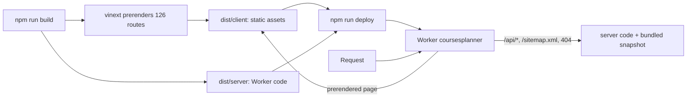

# Deployment

Production: [https://coursesplanner.johnyc.com](https://coursesplanner.johnyc.com). It is the Cloudflare Worker `coursesplanner` on the Workers Free plan ($0).

This file is operator notes. Students who use the planner do not need it.

## Project

| Item | Value |
| --- | --- |
| Production URL | https://coursesplanner.johnyc.com |
| Runtime | Cloudflare Worker `coursesplanner`, Workers Free plan, no paid add-ons |
| Build | [vinext](https://github.com/cloudflare/vinext) 1.4.4 (Vite version of the Next.js API), `@vinext/cloudflare` 1.3.3 |
| Config | [`wrangler.jsonc`](../wrangler.jsonc) (routes, assets), [`vite.config.ts`](../vite.config.ts) (vinext, static-assets cache) |
| Custom domain | `routes: [{ pattern: "coursesplanner.johnyc.com", custom_domain: true }]`. `workers_dev` and `preview_urls` are off (house rule for every app under `johnyc.com`) |
| DNS | Cloudflare zone `johnyc.com`. The Worker custom domain made the record (AAAA `100::`, proxied) on 2026-11-07. It replaced the DNS-only CNAME to Vercel (`e0273d0e708952dd.vercel-dns-017.com`). Shared map: [johnyuencm/johnyc-infra](https://github.com/johnyuencm/johnyc-infra) |
| Cloudflare account | `99ea46219cc098a0c9db852d9e1fd0f6` |
| Production Git branch | `master` (this repo does not use `main`) |
| Old host | Vercel Hobby project `courses-planner` (team `johnyuen97gmailcoms-projects`). Git deploys are disconnected since 2026-11-06. It still holds the 2026-10-30 build. The owner decides when to delete it |

## How it works



- `npm run build` runs `vite build`. vinext prerenders every static page at build time: `/`, `/explore`, `/planner`, `/courses`, all `/courses/<slug>`, all `/pathways/<id>`. The Worker serves them from static assets (`X-Vinext-Cache: HIT`).
- `/api/catalog`, `/api/roadmaps`, `/sitemap.xml`, `/robots.txt` and 404 pages run in the Worker.
- Workers has no project filesystem. [`lib/embedded-snapshot.ts`](../lib/embedded-snapshot.ts) bundles the committed JSON (`data/catalog.json`, `catalog-service/universities.json`, the Northeastern programs and roadmap). The readers try disk first (dev, tests, CLI) and use the bundle when the file is missing.
- `POST /api/catalog` (refresh) stays off in production: it answers 401. Refresh the catalog with `npm run catalog:refresh`, commit `data/`, then deploy.
- `app/global-not-found.tsx` renders route misses without the root layout, because a full layout render costs more CPU than the Free plan allows.

## Deploy

Deploy is manual. CI does not deploy, because a deploy job needs a Cloudflare API token as a GitHub secret.

```bash
npm ci
npm run typecheck
npm test
npm run deploy
```

`npm run deploy` runs `vinext-cloudflare deploy`: it builds, then uploads with Wrangler. It needs a Wrangler login (`npx wrangler login`) with Workers write access on the account above.

If the upload fails with `fetch failed` (network), the build in `dist/` is still good. Run the upload again:

```bash
npx wrangler deploy --config dist/server/wrangler.json
```

Run the production Worker on your PC (workerd, port 3000):

```bash
npm run build
npm run start
```

## Rollback

- Worker version: `npx wrangler rollback` (pick the earlier version), or `npx wrangler deployments list` to see versions.
- Full rollback to Vercel (only while the Vercel project exists): remove the Worker custom domain, then create the DNS-only CNAME `coursesplanner` → `e0273d0e708952dd.vercel-dns-017.com` again with the `cf` CLI. Vercel serves the frozen 2026-10-30 build.

## CPU per request (Workers Free limit: 10 ms)

Measured on 2026-11-07 with `wrangler tail --format json` (field `cpuTime`) on a temporary custom domain. Each route got 30 sequential requests from Seattle. Worker startup time: 11-22 ms (limit 1 s).

| Route | p50 | p90 | Over 10 ms |
| --- | --- | --- | --- |
| Prerendered pages (`/`, `/explore`, `/planner`, `/courses`, `/courses/cs-5010`, `/pathways/systems`) | 2-4 ms | 4-6 ms | 0 of 30 per route, after warm-up |
| `/sitemap.xml` | 3 ms | 8 ms | 0 of 30 |
| `/robots.txt` | 1 ms | 2 ms | 0 of 30 |
| `/api/catalog` | 5 ms | 10 ms | 1 of 29 |
| `/api/roadmaps` | 4 ms | 8 ms | 1 of 30 |
| `/api/roadmaps?university=…&program=…` | 4 ms | 10 ms | 5 of 60 |
| Route miss 404 (`/nothing`, `/favicon.ico`) | 6 ms | 10-28 ms | 2-3 of 30 |
| Unknown course 404 (`/courses/zz-9999`) | 10 ms | 28 ms | 13 of 28 |

- The first requests on a new isolate cost more (up to about 30 ms on `/`). The p90 values include them.
- The two API routes keep the serialized JSON body in memory for each isolate. Before that change, `/api/roadmaps?…&program=…` had p50 8 ms and p90 21 ms.
- Before `app/global-not-found.tsx`, every 404 rendered the full layout at p50 14 ms and p90 45-70 ms. Browsers ask for `/favicon.ico` on each visit, and the app has no favicon, so that cost hit every visit.
- Every request in these runs had outcome `ok`. Cloudflare did not stop any request that went over 10 ms. Do not rely on this: an over-limit request can fail with error 1102.
- Known ceiling: an unknown `/courses/<slug>` still renders the root layout (it is a `notFound()` inside the route, not a route miss). Only typos and bots ask for these URLs.

Measure again after a large change:

```bash
npx wrangler tail coursesplanner --format json > tail.jsonl
```

Send requests in a second terminal, then read `cpuTime` for each event.

## Free plan limits that matter

| Limit (Workers Free) | This app |
| --- | --- |
| 100,000 requests per day | Each page view is 1 request, plus `/api/catalog` and `/api/roadmaps` on Explore and Planner. Static `/_next/static/*` files do not count, because they skip the Worker |
| 10 ms CPU per request | See the table above |
| 3 MB Worker size (gzip) | 614 KiB gzip |

Over the daily request limit, Cloudflare returns errors until the next day. It does not bill. Do not turn on Workers Paid, Cloudflare Images or other paid add-ons without the owner's explicit yes.
