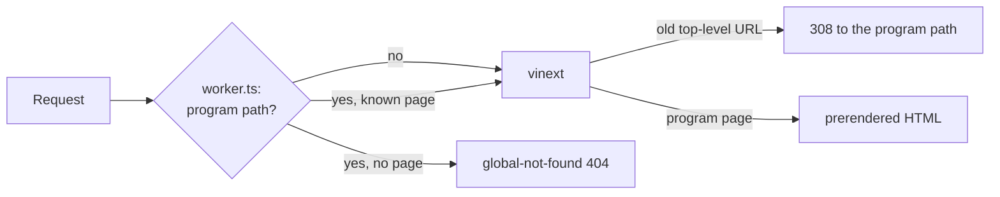

# Information architecture

CoursesPlanner is graph-first. The product promise is **understand what every course unlocks**, not “we also have a graph.”

## Program paths (#71)

Every page is under the catalog key of its program: `/<universityId>/<programId>/...`. The URL selects the catalog. In the tables below, `<program>` is that path. For MSCS Seattle it is `/northeastern/computer-science-mscs-sea-8b0d00dbda`.

- `app/[universityId]/[programId]/layout.tsx` lists the published programs (`generateStaticParams`, `dynamicParams = false`). It gives the catalog key to `AppProvider`.
- `AppProvider` loads `/api/catalog?key=<catalog key>` and stores the key as the remembered program (`coursesplanner:catalog-key`).
- Each program has its own provider. A move to another program starts with fresh state, so a plan never goes to the wrong program.
- The page tier comes from the catalog (#70). A Map-tier program gets Explore, Courses and Plan checks, but no degree audit.

## Primary navigation

| Label | Route | Page |
| --- | --- | --- |
| Explore | `<program>/explore` | Prerequisite map (default workspace) |
| Plan | `<program>/planner` | Semester plan builder |
| Courses | `<program>/courses` | Catalog search and filters |
| Paths | `<program>/pathways` | Persona targets (“What are you trying to become?”) |

The brand mark also goes to **Explore**. Overview is not a primary nav item.

## Overview

`<program>` is a slim status doorway: credits, target, critical prereq, next unlock, and a CTA **Explore my course map**. It is not a degree-audit dashboard. A **Status overview** link in the sidebar footer still reaches it.

## Redirects and old bookmarks

The old top-level URLs go to the default program. The query string stays (for example `/courses?q=data`).

| Old path | New path | Status |
| --- | --- | --- |
| `/` | `<program>` | `307`. Temporary, because the program picker (#72) will replace `/`. |
| `/explore` | `<program>/explore` | `308` |
| `/map` | `<program>/explore` | `308` |
| `/planner` | `<program>/planner` | `308` |
| `/courses` | `<program>/courses` | `308` |
| `/courses/<slug>` | `<program>/courses/<slug>` | `308` |
| `/pathways` | `<program>/pathways` | `308` |
| `<program>/pathways/<id>` | `<program>/pathways/<id>` | `308` |

- `legacyRedirects` in `lib/routes.ts` is the list. `next.config.ts` serves it as `redirects()`.
- The old paths have no page, so they never answer `200`. The sitemap and the canonical URLs list only the program paths.
- Page paths come from `programRoutes(catalogKey)` in `lib/routes.ts`. Client components get them from `useRoutes()` in `components/app-provider.tsx`.

Local setup: open [http://localhost:3000/northeastern/computer-science-mscs-sea-8b0d00dbda/explore](http://localhost:3000/northeastern/computer-science-mscs-sea-8b0d00dbda/explore) for the default workspace. [http://localhost:3000](http://localhost:3000) redirects to the slim Overview.

## Server-rendered pages (2026-11-06)

The app pages load the catalog in the browser, so a crawler sees little text on them. These pages are plain HTML, prerendered at build time from `data/catalog.json` and `config/pathways.json`:

| Route | Content |
| --- | --- |
| `<program>/courses` (bottom) | Course index: every course with catalog text, linked to its page |
| `<program>/courses/<slug>` (for example `<program>/courses/cs-5010`) | What the course unlocks (direct and through a chain), prerequisites, the fewest courses in a row to reach it, paths that use it, catalog description |
| `<program>/pathways/<id>` | The path's courses with credits, degree role and prerequisites (and/or kept), prerequisites the path does not cover, other paths |
| `/sitemap.xml`, `/robots.txt` | The overview, Explore, Courses, Paths, course and path pages of each published program, on `https://coursesplanner.johnyc.com`. Plan is not listed. |

- Placeholder courses (the scraper's "unavailable in the cached department sources" text) get no page. An unknown program, course or path is a small 404: `worker.ts` sends it to `app/global-not-found.tsx`.
- Helpers and tests: `lib/course-pages.ts`, `tests/course-pages.test.ts`.
- `metadataBase` in `app/layout.tsx` sets canonical URLs to `coursesplanner.johnyc.com`, so the old `courses-planner.vercel.app` copy does not count as a duplicate.
- Reason: AdSense rejected `johnyc.com` for "Low value content" (plan: `johnyuencm/johnyc-infra` `docs/adsense-value-plan.md`). This site counts in that review, even with no ads on it.
