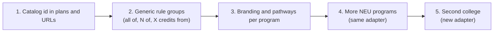

# Multi-program readiness review

- Question: is CoursesPlanner ready for other courses (programs) and other colleges?
- Base: `origin/master` `6c8277a`. Reviewer: Claude Opus 5.5, 2026-11-06. Read-only. No tests were run for this review.
- Verdict: **not ready**. Other Northeastern programs work only as read-only prerequisite maps. Other colleges need new code.

| Scope | Map (read-only) | Full planner (Plan, rules, audit) |
|---|---|---|
| NEU MSCS Seattle | Yes | Yes |
| Other NEU programs | Partly. Sitemap discovery works; only 1 roadmap is committed | No |
| Other colleges | No. 39 of 40 entries in `catalog-service/universities.json` are `unverified`; 1 adapter | No |

## Blockers, most serious first

| # | Area | Finding |
|---|---|---|
| 1 | Degree rules | `DegreeRequirement` in `lib/types.ts` has a fixed MSCS shape: core, breadth areas, elective credits. `scraper/parser.ts:340-398` needs the exact "Breadth Areas" table and wording. `lib/validation.ts` uses the same shape. |
| 2 | Adapters | `catalog-service/adapters.ts:170` registers only `northeastern-acalog`. Each new catalog platform needs a new parser. |
| 3 | Plan identity | `StudentPlan` stores bare course codes without a catalog id. Plans for two catalogs collide on shared codes. This is why foreign roadmaps are read-only (`overrideActive`). |
| 4 | One catalog per deploy | `CATALOG_ID ?? "neu-mscs-seattle"` in `lib/catalog.ts:559` and `app/api/catalog/route.ts:13`. `/courses/[code]`, the sitemap and pathways have no program segment. |
| 5 | Branding | About 15 hardcoded "NEU MSCS" / "Northeastern" strings (titles, metadata, `brand-mark`), `neu-mscs-*` LocalStorage keys, and `config/pathways.json` with NEU codes only. |
| 6 | Production crawl | Production serves only committed or bundled files. Each new program must be crawled offline and committed. |

## Suggested order

Do steps 1 and 2 first. Without them, each new program adds MSCS-only patches. On Workers, also see finding 5 in [2026-11-06-workers-port-evaluation.md](2026-11-06-workers-port-evaluation.md): the hand-written snapshot list in `lib/embedded-snapshot.ts` does not scale.
