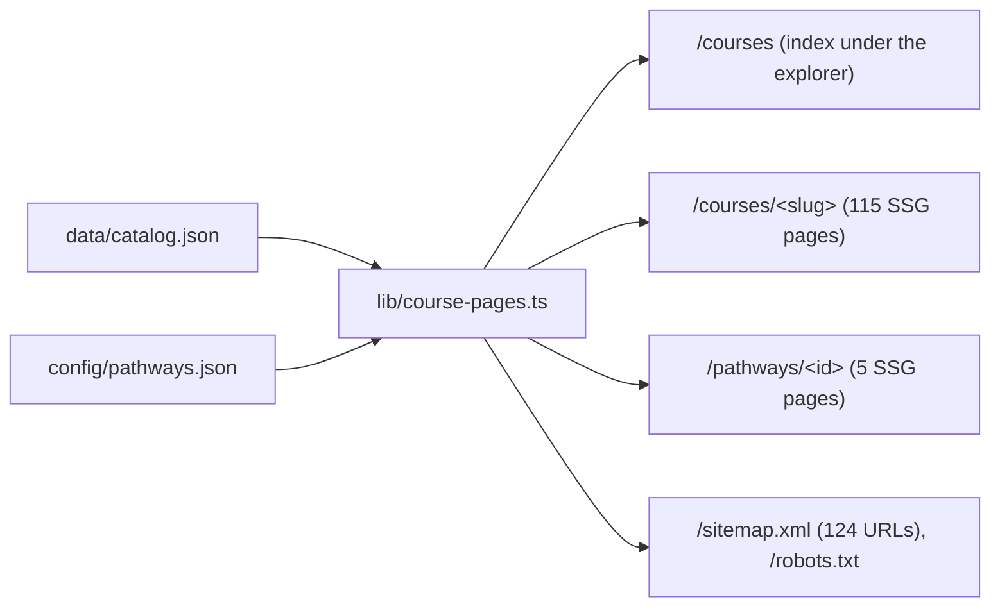

# PR #53 review: server-rendered course and path pages

- PR: https://github.com/johnyuencm/CoursesPlanner/pull/53 (`feat/crawlable-course-pages` → `master`)
- Reviewed head before fixes: `a6b517c`. Fix commits: `b5f952e`, `8c4ac8e`.
- Reviewer: independent agent (Claude Opus 5.5), 2026-11-06.
- Verdict: **merge**. Two medium defects and two low defects are fixed on the branch. The open items are low and need no change before merge.

## Findings

| # | Severity | Location | Finding | Status |
|---|---|---|---|---|
| 1 | Medium | `app/courses/[code]/page.tsx:80` | Corequisite-only courses said "You can take it late in the program without blocking anything." CS 5011 (core) is a corequisite of CS 5010. CS 2001, CS 2101, CS 3101, CS 5003 and CS 5005 have the same problem. The sentence is false for these 6 pages. | Fixed in `8c4ac8e`. The page now says "It is a corequisite of CS 5010, so plan them in the same term." |
| 2 | Medium | `app/courses/[code]/page.tsx:35` | The summary said "a direct prerequisite for 6 courses, and 10 courses depend on it through a chain" (CS 5800). The 10 included the 6 direct courses. The "Further down the chain" list on the same page shows 4. | Fixed in `8c4ac8e`. The text now says "and 4 more depend on it through a chain". |
| 3 | Low | `lib/course-pages.ts:87` (`requirementText`) | The path pages printed "needs (CS 5010 or CS 5004) or CS 5010" for CS 5500. The catalog lists CS 5010 twice with different grade floors. | Fixed in `b5f952e`. The function reuses `simplifyRequirement` from `lib/requirement-logic.ts` and removes repeated codes. Output: "CS 5010 or CS 5004". |
| 4 | Low | `lib/course-pages.ts:102` (`unmetRequirements`) | For "(A and B) or C", the function returned "One of: A, B, C". A alone does not satisfy the requirement. No current path hits this case. | Fixed in `b5f952e`. Only single-course alternatives go in the "One of" list. When every alternative is an "and", the function returns the smallest one. Tests added. |
| 5 | Low | `lib/course-pages.ts:83` (`requirementLabel`) | External courses got "(a prerequisite for program courses)". The 5 corequisite-only externals (for example CS 5003) are not a prerequisite for any course. | Fixed in `b5f952e`. The parenthesis shows only when the course unlocks a course. |
| 6 | Low | `app/courses/[code]/page.tsx:89` | "Before you take it" prints the catalog sentence (it keeps and/or), then a flat bullet list of codes. A quick reader can see CS 5004, CS 5010 and CS 5500 as "all required" for CS 6510. | Open. The sentence above the list is correct. Consider `requirementText` as the list heading later. |
| 7 | Low | `lib/course-pages.ts:102` | `unmetRequirements` treats an `unknown` item inside an "and" as met. CS 5400 and DADS 7275 have this shape. Neither is in a path, so no page prints it now. | Open. Revisit if a path adds these courses. |
| 8 | Info | `lib/course-pages.ts:42` | `shortestPrerequisiteChain` memoizes results that depend on the cycle-guard path. The catalog has no prerequisite cycles, so results are correct now. | Open, no action. |
| 9 | Info | `lib/course-pages.ts:114` | `creditsLabel` repeats `creditLabel` in `components/ui.tsx`. That file is `"use client"`, so a server component cannot call it. The copy is acceptable. | No action. |

## What I verified, and how

1. **Prerequisite sentences on real data.** I ran the helpers with `tsx` over all 142 catalog courses and all 5 paths. I listed every prerequisite shape (16 shapes, including `any(course,unknown)` and `any(any(...),all(course,unknown))`).
   - All 5 path pages: the "Plan these first" lists are correct. Robotics needs one of CS 5010/CS 5004 and one of CS 5800/CS 7800. The other 4 paths show no gaps. This is correct because each "or" group has one option in the path.
   - Chains longer than 2: CS 6510 (CS 5010 → CS 5500 → CS 6510) and DADS 7650 (DADS 5200 → DADS 7275 → DADS 7650). Both are correct.
   - `unlocks` equals the reverse of `prerequisiteCodes` for every course. Corequisites are not in `unlocks`; this caused finding 1.
   - Spot checks: CS 5800, CS 5010, CS 6140, CS 7800, CS 5335, CS 5011, CS 6510.
2. **Next.js 16** (checked against `node_modules/next/dist/docs/`).
   - `params` is a `Promise` and is awaited in the page and in `generateMetadata`.
   - `dynamicParams = false` is valid because `cacheComponents` is off in `next.config.ts`.
   - `metadataBase` is in the root layout. Canonical links render as `https://coursesplanner.johnyc.com/courses/cs-5011`.
   - `sitemap.ts` and `robots.ts` build as static routes.
   - Server pages pass only strings and JSX to the client `PageHeading`. This is serializable.
3. **Regressions.** `components/courses-explorer.tsx` is the old `app/courses/page.tsx` with one changed line (the export name). The `Suspense` boundary is kept. Local `next start`: `/`, `/explore`, `/planner`, `/pathways`, `/courses`, `/api/catalog` return 200. `/map` returns 308.
4. **404s and escaping.** `/courses/nope`, `/courses/cis-200m` (placeholder), `/courses/..%2Fetc`, `/courses/CS-5800` and `/pathways/nope` return 404. React escapes all catalog text. No page uses `dangerouslySetInnerHTML`. Every `officialUrl` starts with `https://`.
5. **Branch freshness.** `origin/master` has 11 newer commits (Next 16.4.1, lucide-react 1.55.0, setup-node v7.1.0, `docs/deploy.md`). A throwaway merge had no conflicts. The merge diff against `origin/master` touches only the 11 PR files, so nothing from master is lost.
6. **Build output.** 130 static pages. The course index links 115 course pages. The sitemap has 124 URLs. `robots.txt` disallows `/api/` and points to the sitemap. The 6 Turbopack "dynamic filesystem access" warnings also occur on plain `origin/master`, so the PR does not add them.

## Check results

| Tree | `npm run typecheck` | `npm test` | `npm run build` |
|---|---|---|---|
| Branch with fixes (Next 16.3.8) | pass | 260/260 pass | pass, 130 pages |
| Branch merged with `origin/master` (Next 16.4.1, `npm ci`) | pass | 260/260 pass | pass, 130 pages |

GitHub Actions "Typecheck, test, and build" passed on the PR.

## Deploy note

The `Deploy production` job in `.github/workflows/ci.yml` runs on a push to `master` only when the `VERCEL_*` repository secrets exist. The last `master` push (2026-10-31) logged "Skipping GitHub Actions production deploy.", so the secrets are not set. With Vercel Git deploys disconnected, a merge does not deploy.
