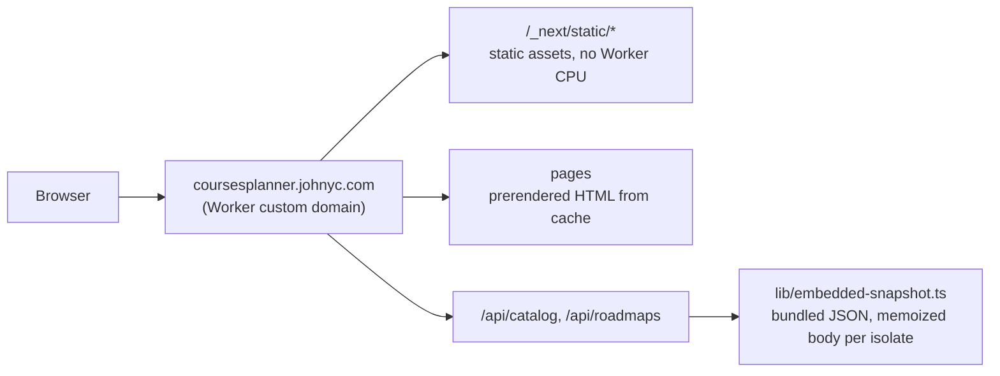
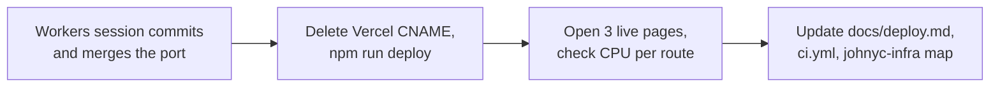

# Cloudflare Workers port evaluation (vinext)

- Subject: the move from Vercel to Cloudflare Workers with vinext. Branch `feat/cloudflare-workers`, worktree `.worktrees/cf-workers`.
- Base: `origin/master` `6c8277a`. The port was **not committed** at review time. The review used a copy of the working tree from 2026-11-06 23:24 PST.
- Changed files: `.gitignore`, `app/api/catalog/route.ts`, `app/api/roadmaps/route.ts`, `lib/catalog.ts`, `lib/roadmap-reader.ts`, `lib/university-directory.ts`, `next.config.ts`, `package.json`, `package-lock.json`, `tests/packaged-snapshot.test.ts`. New files: `lib/embedded-snapshot.ts`, `tests/embedded-snapshot.test.ts`, `vite.config.ts`, `wrangler.jsonc`.
- Reviewer: independent agent (Claude Opus 5.5), 2026-11-06. Read-only on the port. Nothing was deployed.
- Verdict: **ship after the cutover tasks below**. The build, tests and local `workerd` run pass. No blocking code defect was found.

## Evidence

| Check | Result |
|---|---|
| `npm run typecheck` | Pass |
| `npm test` | Pass, 261 of 261 |
| `npm run build` (`vite build`) | Pass. 126 routes prerendered, 3 skipped (API routes and `/map`) |
| `wrangler deploy --dry-run` | Total upload 4809.71 KiB, gzip 614.54 KiB. The Workers Free limit is 3 MiB gzip |
| `wrangler dev`, every sitemap URL | 124 of 124 return 200 |
| `wrangler dev`, other routes | `/map` 308, unknown course or page 404, `/robots.txt` 200, `/api/catalog` 200 (149 KB, `no-store`), `/api/roadmaps` directory, program list and roadmap all 200 |
| `POST /api/catalog` in production | 401 "Catalog refresh is not authorized." (correct) |
| Crawler code in the Worker | Not present. `cheerio` appears only in a source map |
| Crawler-visible text | `/courses/cs-5800` has a server-rendered `<h1>`, description paragraphs, `<title>`, meta description and canonical `https://coursesplanner.johnyc.com/courses/cs-5800`. Response header `X-Vinext-Cache: HIT` |
| Cost | $0. Workers Free. `wrangler.jsonc` has no `observability` block, so the 2026-12-01 Observability pricing does not apply |

CPU timing in Node 24 (`NODE_ENV=production`), as a stand-in for Workers V8. Local `workerd` trace queries failed with an internal error, so real Workers CPU is **not measured**.

| Work | Time |
|---|---|
| `validateCatalog`, first call / second call | 2.08 ms / 1.12 ms |
| `JSON.stringify` of the catalog | 0.62 ms |
| `/api/roadmaps` directory, first call | 12.67 ms wall (includes disk read in Node) |
| `/api/roadmaps` one roadmap, first call / memoized | 6.13 ms / 0.68 ms wall |

## Findings

| # | Severity | Area | Finding | Action |
|---|---|---|---|---|
| 1 | High (cutover) | DNS | The `coursesplanner` CNAME still points to Vercel (`johnyc-infra` README). A Worker custom domain cannot attach while that record exists. Merged work is not live until the switch. | Delete the CNAME, then run `npm run deploy`. Expect a few minutes of downtime. Update the `johnyc-infra` subdomain map. |
| 2 | Medium | CPU | The first API call in a new isolate costs about 6 to 13 ms. The memoized calls cost under 1 ms. Workers Free allows 10 ms. It does not stop each request at that point, but it gives no guarantee. Pages come from the prerender cache and use little CPU. | After the first deploy, read CPU time per route in the dashboard. If it is high, move validation to module scope (startup limit) or serve the JSON as static assets. |
| 3 | Medium | Runtime drift | `npm run dev` still runs Next/Turbopack. Production runs vinext 1.4.4, which is new. A change can pass in dev and fail in production. | Use `npm run dev:vinext`, or `npm run build` and `npm start`, before you accept a UI or route change. Say this in `AGENTS.md`. |
| 4 | Medium | Docs and CI | "Vercel" is on 31 lines of `docs/deploy.md` and 4 lines of the README. `.github/workflows/ci.yml` keeps the Vercel deploy job and has no Workers deploy. GitHub Actions on the org is blocked by billing. | Rewrite `docs/deploy.md` for Workers. Delete the Vercel job. Deploy by hand with `npm run deploy` until Actions works. |
| 5 | Low | Scale | `lib/embedded-snapshot.ts` lists each snapshot file by hand. Each new program needs a code change and makes the bundle larger. | Accept for 1 program. For more programs, put roadmaps in static assets and read them through the `ASSETS` binding. |
| 6 | Low | Cache | HTML responses send `Cache-Control: s-maxage=31536000, stale-while-revalidate`. | After the first redeploy, confirm that the live pages show the new build. |
| 7 | Info | Fallback | `readCatalog` falls back to the bundled JSON on any `statSync` error, also in Node. The bundled JSON is the same file at build time, so the effect is nil now. | No action. |

## Cutover order

## Changed after review

An independent check on 2026-11-06 compared this review with the port. The findings above stay as written. They describe the 23:24 PST working tree.

| Item | State at the check |
|---|---|
| Commit | The port is commit `d7b5010` on `feat/cloudflare-workers` (23:31 PST), pushed. It is not merged to `master`. |
| New files in the commit | `app/global-not-found.tsx`, plus changes to `.github/workflows/ci.yml`, `README.md`, `docs/deploy.md` and `docs/ia.md`. `next.config.ts` turns on `experimental.globalNotFound`. |
| Finding 1 (DNS) | Done. `coursesplanner.johnyc.com` has no CNAME. The response has `Server: cloudflare` and `X-Vinext-Cache: HIT`. Production now runs a branch that `master` does not contain. |
| Finding 2 (CPU) | Real Workers CPU is now measured in `docs/deploy.md` (`wrangler tail`, `cpuTime`). Pages: p50 2-4 ms. API routes: p50 4-5 ms, p90 8-10 ms. |
| New risk | The same table shows an unknown course 404 (`/courses/zz-9999`) at p50 10 ms. 13 of 28 requests are over 10 ms. Route misses got a lighter page (`app/global-not-found.tsx`), but `/courses/[code]` misses did not. |
| Finding 4 (docs and CI) | Done. `ci.yml` has no Vercel job. `docs/deploy.md` is rewritten for Workers. "Vercel" stays only in the old-host and rollback notes. The README has no "Vercel". |
| Finding 3 (runtime drift) | `AGENTS.md` does not mention `dev:vinext` yet. |
| Verdict | No change. Merge `feat/cloudflare-workers` to `master` so that `master` matches production. |
