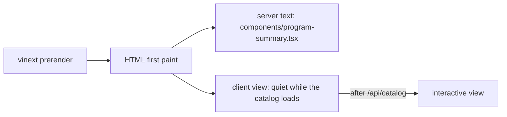

# Crawler-visible content (AdSense re-review of johnyc.com)

- Date: 2026-11-07. Branch: `feat/adsense-ready`. Base: `381c9b8`.
- Goal: plan step C4 in `johnyc-infra/docs/adsense-value-plan.md` section 4.2. A crawler must read real text on every main page.
- This site has no AdSense tag. This change does not add one.

## Changes

| Item | Change |
|---|---|
| `/`, `/explore`, `/pathways`, `/planner` | Server pages now render catalog text below the client view: degree rules, breadth areas, top unlock courses, paths. All facts come from `data/catalog.json` and `config/pathways.json`. |
| First paint | `CatalogState quiet` renders nothing while the catalog loads. The shell hides the "Loading…" refresh button and the "Catalog not loaded" text until the server answers. |
| Review #1 (PR 54) | New test: every ready roadmap in a committed `data/catalogs/*/programs.json` must be in `lib/embedded-snapshot.ts` `FILES`. README crawl section tells operators to add the file. |
| Review #2 | Readers use the bundle only on `ENOENT`. `wrangler dev` (workerd) served `/api/roadmaps` and `/api/catalog` with 200, so workerd gives `ENOENT` for a missing file. |
| Review #5 | README POST text now names the Worker and `npm start` (`wrangler dev`). |
| `AGENTS.md` | Tells agents to verify with `npm run dev:vinext`, or `npm run build` then `npm start`. |
| Unknown course 404 | Tried `proxy.ts` (matcher `/courses/:slug`) in PR #58. Removed in a follow-up PR: it made every real course page slower. See the CPU section. |

Open: review #3 (static JSON imports in CLI) and #4 (`fflate` audit item). Neither has a trivial fix.

## Crawler word count (local `npm start`, Googlebot UA, scripts and tags removed)

| URL | Before | After | "Loading" in text, after |
|---|---|---|---|
| `/` | 93 | 798 | no |
| `/explore` | 95 | 375 | no |
| `/pathways` | 93 | 394 | no |
| `/planner` | 119 | 404 | no |
| `/courses` | 1,724 | 1,709 | no (before: yes) |
| `/courses/cs-5800` | 294 | 290 | no (before: yes) |
| `/pathways/machine-learning` | 324 | 320 | no (before: yes) |
| `/courses/zz-9999` | 404, 96 | 404, 26 | no |

The small drops on `/courses` and course pages are the removed loading and shell text.

Live on https://coursesplanner.johnyc.com (version `11fcae7b`, Googlebot UA): the same counts. `/sitemap.xml` 200 with 124 URLs.

## Checks

| Check | Result |
|---|---|
| `npm run typecheck` | Pass |
| `npm test` | 262/262 pass |
| `npm run build` | Pass. 126 prerendered routes |
| `npm start` | Prerendered pages answer `X-Vinext-Cache: HIT`. `/sitemap.xml` 200. Unknown course 404 |
| Browser (`npm start`) | `/`, `/explore`, `/pathways`, `/planner`, `/courses` hydrate. No console errors |

## CPU check of `proxy.ts` (live, version `11fcae7b`)

`wrangler tail --format json`, field `cpuTime`, 60 warm sequential requests per route from one PC.

| Route | p50 | p90 | Over 10 ms |
|---|---|---|---|
| `/explore` (no proxy) | 4 ms | 6 ms | 1 of 84 |
| `/courses/cs-5800` (proxy, known slug) | 5 ms | 9 ms | 4 of 60 |
| `/courses/zz-*` (proxy, unknown slug) | 7 ms | 13 ms | 11 of 60 |
| `/nothing-*` (route miss) | 6 ms | 12 ms | 10 of 60 |

The proxy cut the unknown-course 404 from p50 10 ms to 7 ms. It added about 1 ms (p50) and 3 ms (p90) to every real course page. Real course pages get most crawler traffic. Unknown slugs come only from typos and bots. Decision: remove `proxy.ts` and keep the known ceiling.
