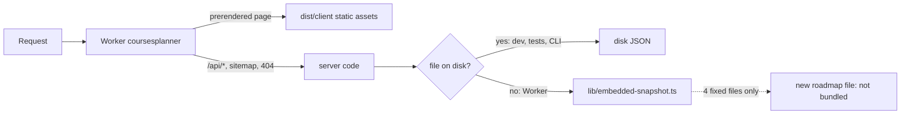

# PR #54 review: move to Cloudflare Workers Free (vinext)

- PR: https://github.com/johnyuencm/CoursesPlanner/pull/54 (`feat/cloudflare-workers` → `master`)
- Reviewed head: `2ff3c3c` (commits `d7b5010` feat, `2ff3c3c` docs). Base: `2a68253`.
- Merge commit: `8e5426c` (`gh pr merge --merge --match-head-commit 2ff3c3c…`).
- Reviewer: independent agent (Claude Opus 5.5), 2026-11-07.
- Verdict: **merge**. I found no blocking defect. One medium item and four low items stay open. Production already ran this branch, so the merge makes `master` match production.

## Findings

| # | Severity | Location | Finding | Status |
|---|---|---|---|---|
| 1 | Medium | `lib/embedded-snapshot.ts:10` | The bundle is a fixed list of 4 files. `programs.json` is bundled, but a new roadmap file is not. If a crawl commits a second ready program, the Worker lists it and `GET /api/roadmaps?…&program=<new>` answers 503. No test fails when a committed `data/catalogs/**.json` file is missing from the list. The README crawl text (`README.md:77`) does not tell the operator to add the file. | Open. Add a test that lists every committed `data/catalogs/**/*.json` file and checks that `FILES` has it. Add one line to the README crawl section. Production is correct now: it has 1 ready program. |
| 2 | Low | `lib/roadmap-reader.ts:29`, `lib/university-directory.ts:170` | The fallback runs on every read error, not only on a missing file. In dev and in the CLI, a corrupt or oversize disk file silently gives the bundled copy. `readCatalog` (`lib/catalog.ts:572`) catches only the `statSync` error, which is correct. | Open. Limit the fallback to a missing file. First confirm the error code that workerd gives for a missing file. |
| 3 | Low | `lib/embedded-snapshot.ts:2` | The 4 JSON files are static imports. Every Node process that loads the readers (CLI, `catalog:serve`, tests) needs them. If an operator deletes `data/catalogs/northeastern/` to crawl again, the CLI stops at import. Before, it treated the files as missing. | Open. Document it, or load the bundle only in the Worker build. |
| 4 | Low | `package-lock.json` (vinext → `@vercel/og` → satori → fflate 0.7.3) | `npm audit --omit=dev` shows 5 moderate items (GHSA-px8p-9vwx-vf98, ZIP64 loop). The app does not unzip user input. `npm audit fix --force` would downgrade vinext to 0.2.1, so do not run it. | Open. Update when vinext ships a fixed satori. |
| 5 | Low | `README.md:158` | The text still says "Production/`next start` refreshes". `npm start` now runs `wrangler dev`. | Open. Wording only. |
| 6 | Info | `app/api/roadmaps/route.ts:68` | The memo keeps `status.updatedAt` of the 39 non-crawlable universities from the first request in each isolate. Live value: `2026-11-07T23:10:32.633Z`. Before, it was the request time. No UI uses it as "fresh". | No action. |

### Memo checks (both API routes)

- `app/api/roadmaps/route.ts`: the key is `<university>/<program>`. IDs match `SAFE_ID`, so an ID cannot contain `/`, and two keys cannot collide.
- The route stores a body only after a successful read. Errors (400, 404, 503) go to `errorResponse` and are not stored. A bad query cannot fill the map.
- A successful read needs a known university and a ready program. The map has at most 42 entries now (1 list, 40 universities, 1 roadmap). User input cannot grow it.
- The memo is on only when `NODE_ENV` is `production` and `rootDir` is `process.cwd()`. Tests and `next dev` do not use it.
- `app/api/catalog/route.ts`: the key is the catalog object and `refreshAvailable`. `readCatalog()` returns a new object when the file changes, so the body is rebuilt. A throw goes to the 503 path and is not stored.

### Known items from the 2026-11-06 evaluation

| Item | Change at `2ff3c3c` |
|---|---|
| Unknown course 404 (`/courses/zz-9999`) uses about 10 ms CPU p50 | No change. `2ff3c3c` changes only docs. Live: 404, 18,212 bytes, full layout. |
| `AGENTS.md` does not tell agents to test with `npm run dev:vinext` | No change. The PR does not touch `AGENTS.md`. |

## Evidence

| Check | Result |
|---|---|
| `npm ci` (Node 24.20.0) in a detached worktree at `2ff3c3c` | Pass. 259 packages. |
| `npm run typecheck` | Pass. |
| `npm test` | 261/261 pass. Includes `tests/embedded-snapshot.test.ts`. |
| `npm run build` (`vite build`) | Pass. 126 CDN warmup paths. Warnings are sourcemap and dynamic-import notes from plugins only. |
| `npx wrangler deploy --dry-run --config dist/server/wrangler.json` | Pass. 4,799 KiB, 614.58 KiB gzip (Free limit 3 MB). Binding: `ASSETS` only. |
| Generated `dist/server/wrangler.json` | Custom domain route, `workers_dev: false`, `preview_urls: false`, no `observability`, no `triggers`. Cost: $0. |
| `"type": "module"` | No `.js` file uses CommonJS. The only config file is `postcss.config.mjs`. `npm run catalog:refresh -- --list-universities` prints 40 universities, exit 0. |
| `.github/workflows/ci.yml` | One job: typecheck, test, build. No deploy job. The master run on `8e5426c` runs CI only. The PR showed no Vercel check. |
| Live GETs on https://coursesplanner.johnyc.com | `/`, `/explore`, `/courses/cs-5800`: 200, `X-Vinext-Cache: HIT`. `/sitemap.xml`: 200, 124 URLs. `/robots.txt`: 200. `/api/catalog`: 200, 142 courses, `refreshAvailable: false`. `/api/roadmaps`: 200, 40 universities, northeastern `ready`. Roadmap with program: 200. Unknown university or program: 404. `university=../x`: 400. `/courses/zz-9999` and `/nothing`: 404. |
| GitHub CI on the PR | "Typecheck, test, and build": pass. |

I did not run `npm run deploy` or a real `wrangler deploy`. I did not change DNS or Cloudflare settings. I did not compare the live Worker build with `2ff3c3c` byte for byte.

## Deploy note

The merge does not deploy. CI has no deploy job, and Vercel Git deploys are disconnected. Production stays on the Worker version that the author deployed by hand. Deploy is manual with `npm run deploy` (see `docs/deploy.md`).
