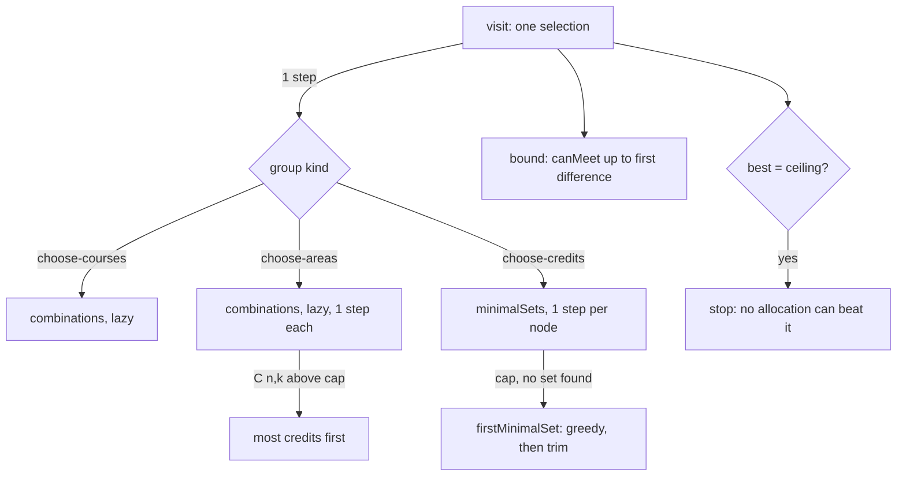

# Issue #105 verification: audit search budget

- Issue: #105 (B4, parent #60). Source: `docs/reviews/2026-11-08-pr102-review.md` finding 1, `docs/reviews/2026-11-08-pr98-pr99-review.md` finding 4.
- Base: master `44bd51e`. Branch: `fix/105-audit-budget`.
- Date: 2026-11-08. Node 24.20, Windows 11, shared machine (other agents ran at the same time).

## Change

1. `choose-areas` makes combinations one at a time. Each counts as one step. At the cap it keeps the combinations found so far. Memory stays below 20,000 entries.
2. When `C(n, count)` is above the cap, `choose-areas` tries courses with more credits first. Then the combinations that it reaches can meet the credits.
3. `minimalSets` counts each search node as one step and stops at the cap. If it found no set, `firstMinimalSet` gives one minimal set without search. The candidates reach the target, so this set is truthful.
4. `choose-credits` tries courses with more credits first, inside the old split ("no later group lists it" first). The first sets are small and leave more courses free.
5. Speed only, same results: group course lists and area maps are computed once per group. The prune bound calls `canMeet` lazily. The area matching in `canMeet` stops at `minAreas`. The search stops when the best result equals the `canMeet` ceiling on all free courses, because no allocation can beat it.

## Timings (one cold run per process, `validatePlanV2` only)

| Probe | Before (`44bd51e`) | After |
|---|---|---|
| MSCS breadth, 2 areas over 96 courses, `count` 3, all completed | 249 ms | 46 ms |
| Same, `count` 4 | 6,390 ms | 40 ms |
| Same, `count` 5 | heap out of memory (4 GB) | 43 ms |
| Electives: n one-credit courses + one 40-credit course, n = 16 | 26 ms | 8 ms |
| Same, n = 20 | 166 ms | 8 ms |
| Same, n = 24 | 3,632 ms | 8 ms |
| Same, n = 26 | 19,099 ms | 9 ms |
| Same, n = 32 | above 120 s (timeout) | 8 ms |
| Probe E: 9 groups on 8 courses, then `choose-areas` 3 of 40 | 70 ms | 71 ms, same result |
| MSCS, all 142 courses completed | 14 ms | 18 ms (cold-run noise) |

In the test suite (warm), the worst single audit is about 80 ms on the 60 worst-case random trees and about 35 ms on "5 of 96".

## Tests (`tests/requirements-v2.test.ts`)

Each new audit check is deterministic. It reads `lastAuditSearch.steps`, a test hook in `lib/requirements-v2.ts` that is not part of the audit result. The steps must stay at or below `SEARCH_LIMIT + 1 + 2 × groups`: past the cap, each group still takes one selection (at most 2 steps). A wall-clock check of 2,000 ms per audit stays only as a hang guard. The first CI run used a 200 ms clock limit and failed on a slow runner ("random tree 16 took 201.3 ms").

- "choose-areas 5 of 96 courses ...": met case, reversed plan gives the same result, 21 credits (impossible) is not met. Each audit within the step budget.
- "choose-credits over 30+ candidates ...": 24, 32 and 40 one-credit courses plus a 40-credit course. A later group that needs one of the one-credit courses is met. Each audit within the step budget.
- "the PR #98 review probes keep their results": probe D, probe F at N = 18, 20, 24, 32, probe G at 2 to 13 groups.
- "worst-case random trees ...": 60 seeded trees, 2 to 10 groups over 15 to 40 courses, wide overlapping lists, all courses completed. Each audit within the step budget, no course used twice, each satisfied group checked independently, same result for the reversed plan.
- Before the fix: the 30+ test took 3,255 ms at n = 24 and failed. The random test failed at 357 ms on tree 10. "5 of 96" ran out of memory.
- Unchanged and passing: probes A, B, C, the 400-tree brute-force test, and the 500-plan fixture `tests/fixtures/mscs-v1-audits.json` (file not changed).

## Checks

- `npm ci`, `npm run typecheck`, `npm test` (322 pass, two runs after the step-budget change), `npm run build`: pass.

## Limits

- The cap can still report "not met" for a plan that can be met, when a group has more combinations or minimal sets than the cap allows. It never reports a false "satisfied". This is PR #98 review finding 4, still open.
