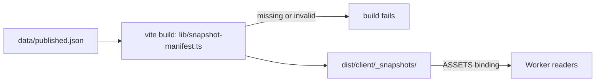

# Issue #61 verification: published snapshots as static assets

- Branch: `feat/61-snapshot-assets`. Base: `master` `414536b`. Code commit: `232d13e`.
- Date: 2026-11-08. Verifier: implementing agent (Claude Opus 5.5). This is not an independent review.

## Checks

| Check | Result |
| --- | --- |
| `npm run typecheck` | Pass |
| `npm test` | 265/265 pass. New: `tests/snapshot-manifest.test.ts` (5 tests) |
| `npm run build` | Pass. 5 files in `dist/client/_snapshots/`. No snapshot JSON in `dist/server` |
| `npx wrangler deploy --dry-run --config dist/server/wrangler.json` | Pass. 4,524.74 KiB, 582.70 KiB gzip (before: 614 KiB gzip). Binding: `ASSETS` only |
| `npm run dev:vinext` (port 3062) | `/api/catalog`, roadmap, `/courses/cs-5800`, `/sitemap.xml`: 200. Roadmap body is byte-equal to the built Worker |

## Built Worker against production

`wrangler dev` on the built output (port 3061), compared with https://coursesplanner.johnyc.com (the live `master` build). The comparison removes build ids (UUIDs) and the per-isolate `updatedAt` of non-crawlable universities (PR #54 review, finding 6).

| Route | Status | Bytes | Same as live |
| --- | --- | --- | --- |
| `/api/catalog` | 200 | 149,644 | Yes (byte-equal) |
| `/api/roadmaps` | 200 | 15,208 | Yes |
| `/api/roadmaps?university=northeastern` | 200 | 603 | Yes (byte-equal) |
| `/api/roadmaps?university=northeastern&program=computer-science-mscs-sea-8b0d00dbda` | 200 | 147,557 | Yes (byte-equal) |
| `/courses/cs-5800` | 200 | 26,155 | Yes |
| `/sitemap.xml` | 200 | 14,773 | Yes (byte-equal) |
| `/api/roadmaps?university=northeastern&program=nope` | 404 | 36 | Yes |
| `/courses/zz-9999` | 404 | 17,678 | Yes |

## Not done

- No live CPU measurement. The Worker no longer validates snapshots per isolate, but it now parses each JSON file on the first request of an isolate. Measure with `wrangler tail` after the next deploy.
- No deploy. No DNS or Cloudflare change.
