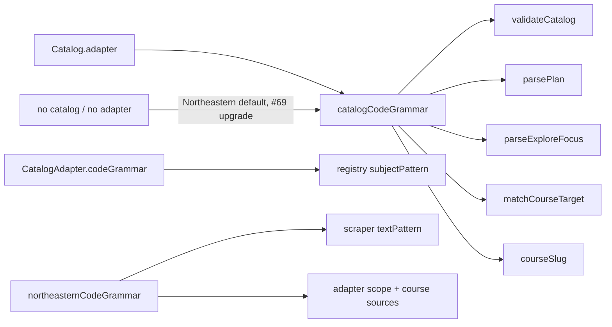

# Issue #68 verification: course-code grammar at every call site

- Branch: `feat/68-grammar-migrate`. Base: `master` `1c7d5f4`.
- Date: 2026-11-08. Verifier: implementing agent (Claude Opus 5.5). This is not an independent review.

## Checks

| Check | Result |
| --- | --- |
| `npm run typecheck` | Pass |
| `npm test` | 290/290 pass. Only `tests/course-code.test.ts` changed (6 new tests, 2 fields added to its test grammars) |
| `npm run build` | Pass |
| Guard test | No `[A-Z]{2,` pattern in `app`, `components`, `lib`, `catalog-service`, `scraper`, `worker.ts` outside `lib/course-code.ts` |

## Built Worker (`wrangler dev`, port 3081)

| Route | Status | Bytes |
| --- | --- | --- |
| `/courses/cs-5800` | 200 | 25,986 |
| `/courses/zz-9999` | 404 | 6,026 |
| `/explore?focus=CS%205800` | 200 | 27,544 |
| `/explore?focus=cs5800` | 200 | 27,544 |
| `/api/catalog` | 200 | 149,438 |
| `/courses` | 200 | 76,688 (115 course links) |
| `/sitemap.xml` | 200 | 14,773 (115 course URLs) |

Browser check: `/explore?focus=cs5800` opens the course chain for `CS 5800`. The console has no errors.

## Decisions

- **Target strictness.** `matchCourseTarget` keeps the current input rules. A catalog course matches with case and spaces ignored. A code outside the catalog must match `grammar.pattern` after upper-casing and space collapsing. `grammar.normalize` is not used, because it also accepts `CS9999` and `cs-9999`. A test pins this.
- **Grammar with no catalog.** Plan and pathway storage keys are Northeastern-only, and the plan can load before the catalog. `catalogCodeGrammar()` gives the Northeastern grammar in that case. A `ponytail:` comment names #69 as the upgrade path.
- **Scraper.** The parser reads Northeastern HTML only. It uses `northeasternCodeGrammar.textPattern` directly. The generic CourseLeaf adapter will pass its own grammar.
- **One adapter-id list.** `KNOWN_ADAPTER_IDS` now comes from the grammar map in `lib/course-code.ts`. `lib/source-types.ts` re-exports it.
- **Small UX change.** The Courses search "is not in this catalog" message now uses `grammar.normalize`. It now also shows for `CS 58` or `cs-5800`, and no longer for 7+ letter subjects.
