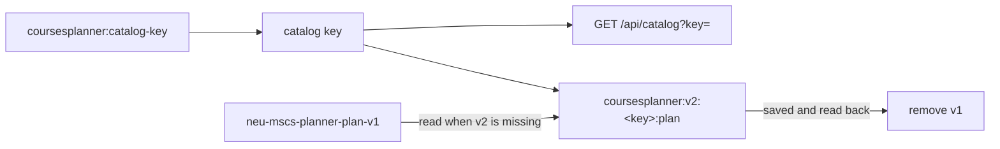

# Issue #69 verification: catalog key and plan storage v2

- Branch: `feat/69-catalog-key`. Base: `master` `7c9555e`.
- Date: 2026-11-08. Verifier: implementing agent (Claude Opus 5.5). This is not an independent review.

## Checks

| Check | Result |
| --- | --- |
| `npm run typecheck` | Pass |
| `npm test` | 311/311 pass. New: migration, save failure, corrupt v1, v2 precedence, preferences, remembered key (`tests/plan.test.ts`); other keys and v1 events (`tests/cross-tab-plan.test.ts`); key, alias, 404, default key (`tests/catalog-route.test.ts`); grammar from key (`tests/course-code.test.ts`) |
| `npm run build` | Pass. The manifest lists `data/catalog.json` as `northeastern/computer-science-mscs-sea-8b0d00dbda`, tier `audit` |

## Built Worker (`wrangler dev --config dist/server/wrangler.json --port 3121`)

| Request | Status | Bytes | `key` in body |
| --- | --- | --- | --- |
| `/api/catalog` | 200 | 149,496 | `northeastern/computer-science-mscs-sea-8b0d00dbda` |
| `/api/catalog?key=northeastern/computer-science-mscs-sea-8b0d00dbda` | 200 | 149,496 | same |
| `/api/catalog?key=northeastern%2Fcomputer-science-mscs-sea-8b0d00dbda` | 200 | 149,496 | same |
| `/api/catalog?key=neu-mscs-seattle` (alias) | 200 | 149,496 | same |
| `/api/catalog?key=nope` | 404 | 44 | - |
| `/api/catalog?key=northeastern/nope` | 404 | 57 | - |

## Browser (built Worker, new tab, LocalStorage reset first)

| Step | Result |
| --- | --- |
| Put a v1 plan and a v1 career target in LocalStorage. Fill the rest of the quota. Load `/planner`. | Save fails with a quota error. v1 plan is still present. No v2 plan. |
| Free the quota. Click **Retry save**. | v2 plan text is equal to the v1 text. v1 plan is removed. |
| Same v1 plan with free quota. Load `/planner`. | v2 text equal to v1. `coursesplanner:catalog-key` is set. `/api/catalog?key=...` answers 200. |
| Audit, local (v2) and live site (v1, `master`) | Equal: 24 / 32 credits; 1 / 3 groups; core 2 of 3; breadth 3 of 3, 2 of 2 areas, 12 of 12 credits; electives 4 of 12; critical path "Systems" (from the v1 career target) |
| Corrupt v1 plan (`{not-json`). Load `/planner`. | Blocked banner. v1 text stays. No v2 plan. |
| Two tabs on `/planner`. Tab 2 writes the v2 plan. | Tab 1 shows the new plan (8 / 32 credits). |

Note: another agent shared the browser pane during one early run and changed LocalStorage on the same origin. I ran each check again in a new tab after a LocalStorage reset. The table gives those results.
