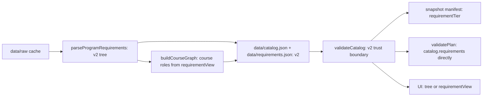

# Issue #70 verification: requirement model v2 in the snapshot, v1 type deleted

- Branch: `feat/70-v2-snapshot`, from `origin/master` `7c9555e`.
- Date: 2026-11-08. Author: implementer agent (Claude Opus 5.5).
- Scope: the parser emits v2, the snapshot stores v2, `lib/catalog.ts` validates v2, readers use v2. `DegreeRequirement` (v1) and `requirementsV2FromV1` are deleted.

## Data flow

## Offline rebuild

Method (PR #90, PR #97 review): copy `data/raw` to a temp root, add a cached robots entry, run `refreshCatalog` with a `fetchImpl` that throws and `now()` fixed at the committed `lastUpdated` (`2026-09-12T06:14:27.155Z`). The network is never used.

| Run | Code | fetch calls | `catalog.json` | `courses.json` | `requirements.json` |
|---|---|---|---|---|---|
| Control | `7c9555e` (unchanged) | 0 | byte-identical | byte-identical | byte-identical |
| New | this branch | 0 | `requirements` changed, all other fields equal | byte-identical | v2 |
| Recheck | this branch, after write | 0 | byte-identical | byte-identical | byte-identical |

- New `requirements` is deep-equal (and JSON-equal) to `requirementsV2FromV1(old committed requirements)`, computed with the old converter before deletion.
- `lastUpdated`, `sources` and `warnings` are unchanged.
- The roadmap file does not use the program requirements (`buildRoadmapCourseGraph`) and is unchanged.
- Dropped v1 field `rawRules`: no reader. Its rule sentences stay as `rawText` on the groups. The one non-rule sentence ("Students should refer to the course numbering table ...") is not kept.

## Checks

- `npm run typecheck`: pass. `npm test`: 302 pass (301 before; +1 trust-boundary test). The 500-plan fixture `tests/fixtures/mscs-v1-audits.json` is unchanged and passes.
- New guards: `tests/scraper.test.ts` checks that the parser output deep-equals `data/requirements.json`. `tests/requirements-v2.test.ts` checks that `validateCatalog` rejects a v1 shape, an unknown kind, a course not in the catalog, a bad count, bad areas, a duplicate id and zero credits.
- `npm run build`: pass.
- Built Worker (`wrangler dev --config dist/server/wrangler.json --port 3131`):
  - `/`, `/planner`, `/courses/cs-5800`, `/api/catalog`, `/_snapshots/manifest.json`: 200.
  - Manifest: `neu-mscs-seattle` tier `audit`, roadmap tier `map`.
  - `/api/catalog`: `requirements.version` 2, groups `core`, `breadth`, `electives`, `total`, 142 courses.
  - Text of the degree rules section on `/`, and of `/courses/cs-5800`, `/courses/cs-5100`, `/courses/cs-6140`: identical to live https://coursesplanner.johnyc.com.
  - `/planner`, same plan on local and live (completed CS 5010, CS 5800; waived CS 5011; Fall CS 5100, CS 6140; Spring CS 5500, CS 6650, CS 6510): both show 24 / 32, Audit tier, 2 / 3 groups met, 1 issue (CS 6510 prerequisite), core 3 of 3, breadth 3 of 3 courses / 2 of 2 areas / 12 of 12 credits, electives 4 of 12.
