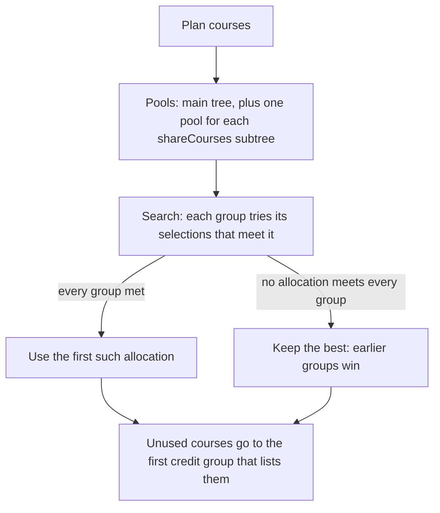

# Issue #70 verification: v2 audit, allocation search, tier

Branch `feat/70-audit-v2`, PR 1 of 2. PR 2 deletes v1.

## Allocation rule

- The search tries the plain tree-order allocation first. Ties keep the first found. Thus the result is deterministic.
- Candidates are in code order (or group list order), not plan order. Thus plan order does not change the result.
- Each group gets `satisfied` from its own final courses. Thus the audit cannot claim a false "satisfied".
- `shareCourses` is two-sided. The shared subtree can use every course, and it takes no course from other groups.
- A step cap (20,000) stops a pathological tree. Past the cap, the audit keeps the best allocation found so far.

## Tier

- Audit: every group is modeled, a top-level `total-credits` group exists, and the top-level credits add up to it.
- MSCS Seattle: core 8 (4 + 0 + 4) + breadth 12 + electives 12 = 32. Tier is Audit.
- A roadmap has no requirement model. Tier is Map.

## Evidence

| Check | Result |
|---|---|
| Probes A, B, C from `docs/reviews/2026-11-08-pr92-review.md` as tests | Red before the fix, green after |
| Brute-force test: 400 random trees, every assignment of courses to groups | Search meets every group exactly when brute force can; no course used twice; plan order has no effect |
| Mutation: search turned off (`SEARCH_LIMIT = 0`) | 3 tests fail |
| Ad hoc sweep: 24,000 seeded plans over real MSCS and two mutated catalogs, v1 against v2 | All equal; 13,309 with breadth satisfied |
| `npm run typecheck` | Pass |
| `npm test` | 294 pass, 0 fail |
| `npm run build` | Build complete |
| Built Worker (`wrangler dev --port 3091`): `/planner`, `/`, `/api/catalog`, `/_snapshots/manifest.json` | All 200 |
| Manifest | `neu-mscs-seattle` tier `audit`; the published roadmap tier `map` |
| Sample plan on the built Worker, v1 against v2 | Same: 24 / 32 credits, core met, breadth CS 5200, CS 5500, CS 6140 in 2 areas, electives 4 credits, 0 issues |
| `/planner` in a browser with that plan | "Requirements status · Audit tier 2 / 3", each group shows its raw catalog rule |

## PR 2: v1 audit deleted

- Deleted: v1 `validatePlan`, `chooseBreadth`, the `DegreeProgress` type and `tests/v2-equivalence.ts`. `categoryMatching` moved into `lib/requirements-v2.ts`, its only user.
- Equivalence evidence stays. `tests/fixtures/mscs-v1-audits.json` holds the v1 audit of 500 seeded MSCS plans (300 random, 200 near-complete; 28 fully satisfied, 181 with breadth satisfied). The recording ran while v1 and v2 both ran and agreed. The test now checks that v2 gives the recorded results.
- The scenario tests (`tests/validation.test.ts`, `tests/plan.test.ts`) now assert v2 group results (`core`, `breadth`, `electives`).
- `npm run typecheck`: pass. `npm test`: 294 pass, 0 fail. `npm run build`: Build complete.

Still open: the snapshot keeps the v1 `DegreeRequirement` shape, and `requirementsV2FromV1` converts it. To store v2 in the snapshot, change `lib/catalog.ts`, `scraper/parser.ts` and `catalog-service/`. PR #97 (#68) changes the same files, so do this after #97 merges.
