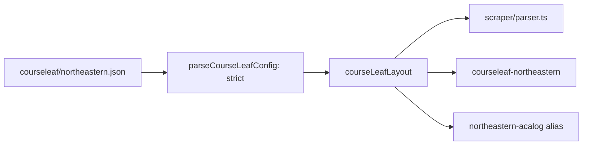

# Issue #78 verification: generic CourseLeaf adapter

- Base: `origin/master` at `9b64a4f`.
- Change commit: `95c0c18` on `feat/78-courseleaf-adapter`.
- Scope: `catalog-service/`, `scraper/parser.ts`, `lib/course-code.ts`, tests and docs. No new college. No crawl.

## What changed



- The Northeastern adapter is now the generic CourseLeaf adapter with one config file.
- The alias `northeastern-acalog` keeps its own `id`. Source files, snapshots and roadmaps that name it do not change.
- The config loader rejects unknown keys, non-HTTPS URLs and selectors that do not parse.

## Proof of no behaviour change

Method (PR #90, #97, #102): copy `data/raw` to a temp root and add a cached robots entry. Run `refreshCatalog` with a `fetchImpl` that throws and `now()` fixed at `2026-09-12T06:14:27.155Z`. Then run the adapter roadmap path (`parseProgramScope`, `courseSources`, `parseCourses`, `buildRoadmapGraph`) on the same cached pages. Script: [`2026-11-08-issue78-offline-proof.mts`](2026-11-08-issue78-offline-proof.mts).

```bash
npx tsx docs/reviews/2026-11-08-issue78-offline-proof.mts <repo root> <out dir>
```

| Output | SHA-256 on master `9b64a4f` | SHA-256 on `95c0c18` | Equals committed file |
|---|---|---|---|
| `data/catalog.json` | `42c1d3c1…6fb049` | `42c1d3c1…6fb049` | yes, both |
| `data/courses.json` | `bd335c5e…aa2b36` | `bd335c5e…aa2b36` | yes, both |
| `data/requirements.json` | `17d08fd0…c5900` | `17d08fd0…c5900` | yes, both |
| `data/catalogs/northeastern/roadmaps/computer-science-mscs-sea-8b0d00dbda.json` | `0f292832…a03b59` | `0f292832…a03b59` | yes, both |

Fetch calls: 0 on both runs.

## Checks on `95c0c18`

| Check | Result |
|---|---|
| `npm ci` | pass |
| `npm run typecheck` | pass |
| `npm test` | 329 of 329 pass |
| `npm run build` | pass |
| New tests | alias equivalence, config validation (12 bad configs), a non-Northeastern layout, no `g` or `y` flag on any registered grammar pattern |

No deploy, no network crawl, no paid service.

## Not done here

- `registry.ts` still reads `CATALOG_ID` in `defaultCatalogId()`. A change there can move the default catalog, so it stays for a separate ticket.
- The audit parser (`parseProgramRequirements`) still reads the Northeastern MSCS table layout only. A new college starts at Map tier (#79).
