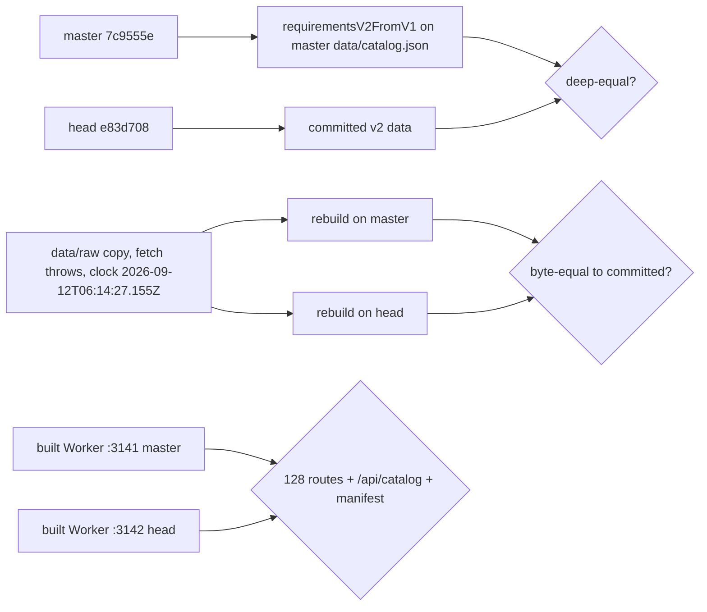

# PR #102 review: requirement model v2 in the snapshot, v1 type deleted (#70)

- PR: #102 (`feat/70-v2-snapshot`). It closes #70.
- Reviewed head: `e83d7089ba5093c696f4b68f57d11ab5aa80abee` (pinned). Base: master `7c9555e`.
- Date: 2026-11-08. Reviewer: independent agent (Claude Opus 5.5).
- Verdict: **merge**. Merge commit: `3a3eedf54baf6036c65b5aec642e94250038b63a` (CI green on `e83d708`). No blocking finding. Finding 1 is a pre-existing defect. It is the same on master, and this PR does not make it worse.

## Method

## Findings

| # | Severity | File:line (at `e83d708`) | Finding | Status |
|---|---|---|---|---|
| 1 | Medium (pre-existing) | `lib/requirements-v2.ts:239`, `lib/requirements-v2.ts:179-192` | The audit search can exhaust memory or run for a very long time on a crafted tree that `validateCatalog` accepts. (a) `choose-areas` puts all `C(candidates, count)` combinations in one array before the step cap applies. Probe: MSCS breadth with 2 areas over the 96 program courses, `count` 5, plan with every course completed: heap out of memory (4 GB) in about 15 s. `count` 4: 6.0 s on master, 6.4 s on head. (b) `minimalSets` explores subsets that never reach the target and yields nothing, so the step cap never applies. Probe: electives over n one-credit courses plus one 40-credit course: n=16 17 ms, n=20 55 ms, n=24 411 ms (doubles per course). The same crafted v1 snapshot gives the same crash on master `7c9555e`. The audit code comes from PR #98, and this PR does not change it. An attack needs write access to the committed snapshot. The Worker does not run the audit. The browser tab of `/planner` is the victim. | Open, non-blocking for #102. Follow-up: stream the `choose-areas` combinations under the step cap, and count `minimalSets` nodes against a budget. Check the 500-plan fixture after the change. |
| 2 | Info | `lib/catalog.ts:238-305` | Trust boundary probes, all rejected with a clear message: root `null` or array, `children` not an array or empty, depth 12, `count` NaN, string or 1.5, `credits` Infinity or -1, a number in `courses`, unknown course code, area not an object, area with no courses, duplicate area id, `minAreas` above the area count, `shareCourses` string, missing id, kind `__proto__`, `label` number, v1 shape. Accepted odd shapes (root is a leaf, root `unmodeled`, `count` above the listed courses, junk fields on `unmodeled`) give tier Map and do not crash `requirementView`, `requirementTier` or `validatePlan`. | OK |
| 3 | Low | `lib/catalog.ts:238` | Master rejected a program with no core courses ("Core course mapping is incomplete"). v2 accepts any modeled tree. This is correct for the multi-college model. The tier and the UI handle a tree with no core group. | OK, by design |
| 4 | Low | `components/program-summary.tsx:27`, `:40` | `DegreeRules` still says "Northeastern catalog" and shows only the first `choose-areas` and the first `choose-credits` group. This is correct for MSCS. A non-MSCS tree needs a generic view (spec "Routes and branding"). | Open, non-blocking. Not in #70 scope. |
| 5 | Info | `data/catalog.json`, `data/requirements.json` | One v1 `rawRules` sentence is not kept as group `rawText`: "Students should refer to the course numbering table for graduate course leveling." On master only the validator and `requirementsV2FromV1` read `rawRules`. No UI, route or test reads it. | OK |
| 6 | Info | `/` and `/planner` RSC payload | The optional GPA fragment adds one React fragment in the RSC payload. The visible text is the same. | OK |

## Data

| Check | Result |
|---|---|
| Head `data/catalog.json` `requirements` vs `requirementsV2FromV1(master requirements)` (converter run on master) | deep-equal and JSON-equal |
| Head `data/requirements.json` vs `requirementsV2FromV1(master data/requirements.json)` | JSON-equal |
| `id`, `university`, `program`, `adapter`, `courses`, `lastUpdated`, `sources`, `warnings`, key order | same as master |
| `requirementType`, `breadthCategories`, `electiveEligible` for all 142 courses | same as master (`courses` is equal) |
| Offline rebuild on head (fetch calls: 0) | `catalog.json`, `courses.json`, `requirements.json` byte-identical to the PR's committed files |
| Offline rebuild on master (fetch calls: 0) | byte-identical to master's committed files |
| Parser `eligibleElectives` vs old converter electives (`eligibleElectives` + breadth courses) | same list: the parser already puts the breadth courses first |

## Pages (built Workers, master :3141, head :3142)

| Check | Result |
|---|---|
| 128 routes: the 124 sitemap routes (`/`, `/explore`, `/courses`, 115 `/courses/<slug>`, `/pathways`, 5 `/pathways/*`) + `/planner`, `/_snapshots/manifest.json`, `/robots.txt`, `/sitemap.xml` | status equal. Visible text equal on 128 of 128. Markup equal on 126 after removing build ids and UUIDs. The 2 others are finding 6. |
| `/api/catalog` | only `requirements` differs |
| `/_snapshots/manifest.json` | byte-identical. `neu-mscs-seattle` tier `audit`, roadmap tier `map` |
| Hydrated text in the browser (`/`, `/courses` with the Area options, `/explore`, `/pathways/machine-learning`) | SHA-256 equal on both Workers |
| `/planner` with the PR's sample plan (own origins only) | equal text on both: 24 / 32, Audit tier, 2 / 3, 1 issue (CS 6510 prerequisite), core 3 of 3, breadth 3 of 3 / 2 of 2 / 12 of 12, electives 4 of 12 |

## Audit

- `validatePlan` output for 3 plans (the sample plan, every course completed, empty plan): JSON byte-identical between master and head.
- 500-plan fixture `tests/fixtures/mscs-v1-audits.json`: unchanged, passes (353 ms).

## Checks

- `npm ci`, `npm run typecheck`, `npm test`, `npm run build` in both worktrees: pass. Tests: 301 on master, 302 on head.
- CI on `e83d708`: "Typecheck, test, and build" SUCCESS.
- No deploy, no network crawl, no Cloudflare or DNS change. Ports 3141 and 3142 only, stopped by PID after use.
