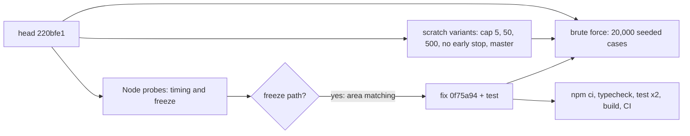

# PR #107 review: bound the degree-audit search (#105)

- PR: #107 (`fix/105-audit-budget`), closes #105 (B4, parent #60).
- Pinned head: `220bfe10c3553d9c5fa39687c786c8f0fb9dcbce`. Review fix: `0f75a9436c8229363b9470d7d8bf43e91e33865c`.
- Date: 2026-11-08. Reviewer: independent agent (Claude Opus 5.5). Node 24.20, Windows 11.
- Verdict: **merge after the review fix**. Merge commit: `2f1d2343b850e1c67a81c3b07f460d5204c5164a` (CI green on `0f75a94`).
- Inputs: `docs/reviews/2026-11-08-pr102-review.md` (finding 1), `docs/reviews/2026-11-08-pr98-pr99-review.md` (findings 1-4, probes), `docs/reviews/2026-11-08-issue105-verification.md`.

## Method

## Findings

| # | Severity | File:line (at `0f75a94`) | Finding | Status |
|---|---|---|---|---|
| 1 | High (blocking) | `lib/requirements-v2.ts:175-179`, `:322` (at `220bfe1`: `:170-187`, `:316`) | A remaining freeze path. One `choose-areas` combination counts as one step, but its area matching can cost about `count`^3 checks. Probe: MSCS breadth "70 of 96" with 70 areas that each list all 96 courses. `validateCatalog` accepts it. Time: **14.3 s** (50 of 96 in 50 areas: 5.3 s). Profile: 442 million category checks in 20,001 matchings; `canMeet` used 22,100. | Fixed in `0f75a94`. Area matching in `selections` and `canMeet` counts each category check. Past `MATCHING_LIMIT` (2,000,000 checks, about 60 ms) the search stops as at the step cap. "5 of 96" uses about 164,000 checks, MSCS all completed about 9,000. Same probes after: 26 ms and 41 ms. New test "choose-areas with many overlapping areas stays within the matching budget": 13,744 ms (fail) without the fix, 33 ms with it. |
| 2 | Medium | `lib/requirements-v2.ts:317`, `:322` | The step cap is shared by all groups. When earlier groups use most of it, a later `choose-areas` group sees few combinations. Above the cap, `mostCreditsFirst(order)` also drops the "no later group lists it" split. Probe: 600 seeded trees, 30 to 55 courses, `C(n, count)` above the cap. 598 same as master, 2 false "not met" where master meets the group, 0 better. Against cap 2,000,000: 7 of 300 false "not met". Never a false "satisfied". | Open, non-blocking. Same class as PR #98 review finding 4. Possible follow-up: keep the split in the credit order, or give each group a minimum share of the cap. |
| 3 | Low | `lib/requirements-v2.ts:242-256` | `firstMinimalSet` is minimal. Proof: a kept course fails the trim test, and later drops only lower the total. It always reaches the target, because only courses with positive credits go in and their sum reaches the target. It is not the set with the fewest credits. Example: target 4, credits 3, 3, 1 gives {3, 3} (6 credits), not {3, 1}. It runs only after the cap. It tries "no later group lists it" first, so it takes later-listed courses only when needed. | Open, non-blocking. |
| 4 | Low | `lib/requirements-v2.ts:396-416` | The work for one step grows with the number of groups (lazy prune bound, `unbeatable`). 200 `choose-credits` groups over 96 courses: 550 ms. 1,000 groups: 2,956 ms. Master: 18,062 ms and 91,382 ms. It is better than master, and real programs have fewer than 20 groups. | Open, non-blocking. |
| 5 | Info | `lib/requirements-v2.ts:136`, `:520` | `lastAuditSearch` is module state. `validatePlanV2` is synchronous and writes it once, after the search. No app code reads it (grep). JavaScript runs one audit at a time in a tab, so no race can occur. It is not in the audit result. | OK as a test hook. |
| 6 | Info | `lib/requirements-v2.ts:357-367`, `:396-397` | Early stop. Each `canMeet` condition is necessary for its group, so `canMeet` on all free courses is a true upper bound. When the best result equals it, no allocation can beat it. A later equal result never replaces the first one, so the result is the same as a full search. Brute force: the variant with the old stop (`every(Boolean)`) gave byte-equal results on 20,000 cases. | OK |
| 7 | Info | `lib/requirements-v2.ts:264-274`, `:317` | Determinism. Candidate order is code order (list order for `choose-courses`). The credit sort is stable. The matching budget depends only on the tree and the plan set. Reversed plan, shuffled plan, shuffled `completedCredits` keys, shuffled catalog order and a repeat call gave equal results on 20,000 cases. | OK |
| 8 | Info | `tests/fixtures/mscs-v1-audits.json` | The fixture is not changed (`git diff origin/master` is empty). The 500-plan test passes in 67 ms. | OK |

## Brute-force comparison

Generator: 1 to 10 courses, 1 to 4 leaf groups. Credits 0 to 5, variable credits with `completedCredits`, waived courses. Multi-area courses, duplicate list entries, nested `all`, `shareCourses` on leaves and subtrees, `unmodeled`, `total-credits`. Oracle: bitmask search over every allocation per pool, with an independent area matching. Seeds 107, 2026, 31337, 9, 5,000 cases each.

| Check (20,000 cases, 27,246 pools) | PR (cap 20,000) | master | no early stop | cap 5 | cap 50 | cap 500, matching budget 20 |
|---|---|---|---|---|---|---|
| False "satisfied" group | 0 | 0 | 0 | 0 | 0 | 0 |
| Wrong area matching | 0 | 0 | 0 | 0 | 0 | 0 |
| Course used twice in a pool | 0 | 0 | 0 | 0 | 0 | 0 |
| "All met" where no allocation exists | 0 | 0 | 0 | 0 | 0 | 0 |
| Satisfiable pools met (of 8,622) | 8,622 | 8,622 | 8,622 | 8,520 | 8,619 | 8,559 |
| Different from plan order or repeat | 0 | - | - | 0 | 0 | 0 |

- Capped paths ran (5,000 cases, caps 5 and 50): `firstMinimalSet` 406 times, `choose-areas` cap break 1,048 times, credit order 622 times.
- The vector differs from the lexicographic best in 1,544 pools, the same 1,544 for master. This is PR #98 review finding 3: an unmet group keeps its progress.
- Mutation check: drop the credit filter of `choose-areas` feasible options. The checker found 257 false "satisfied" groups.

## Timings (Node 24, one cold run per process, `validatePlanV2` only)

| Probe | `220bfe1` | `0f75a94` |
|---|---|---|
| MSCS, all completed | 17 ms | 16 ms |
| Breadth 3 / 4 / 5 of 96, 2 areas | 32 / 31 / 31 ms | 42 / 36 / 43 ms |
| Breadth 5 of 96, 21 credits (not met) | 30 ms | 45 ms |
| Electives 24 / 32 / 40 one-credit + 40-credit, then 1 named | 9 / 0 / 0 ms, met | 10 / 0 / 0 ms, met |
| Electives 40 one-credit only | 7 ms | 6 ms |
| Breadth 50 of 96 in 50 areas, each lists all | 5,267 ms | 41 ms |
| Breadth 70 of 96 in 70 areas, each lists all | 14,344 ms | 26 ms |
| Same group + 13 pigeonhole groups | 12,519 ms | 53 ms |
| 500-plan fixture (test) | - | 67 ms |

## Checks at `0f75a94`

- `npm ci`, `npm run typecheck`, `npm test` (323 pass, two runs), `npm run build`: pass.
- CI "Typecheck, test, and build": pass.
- Master moved to `91b7b34` (PR #108, #109, #111). No overlap with this PR. The merge has no conflict.
