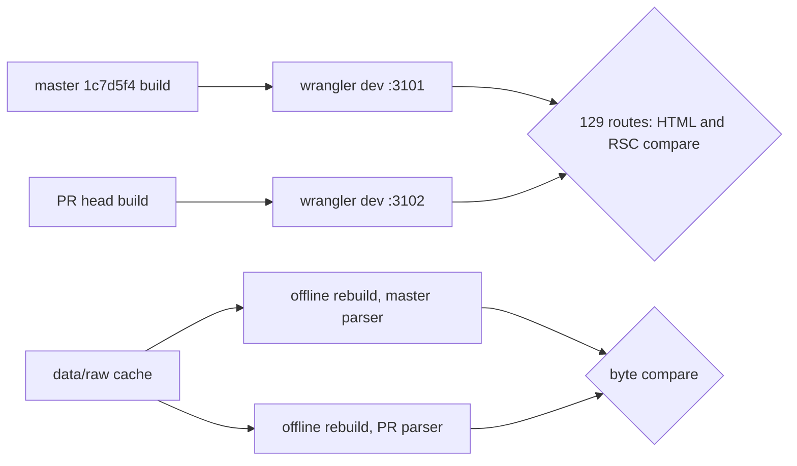

# PR #97 review: course-code grammar at every call site (#68)

- PR: #97 (`feat/68-grammar-migrate`). Closes #68 (T3 of #60).
- Reviewed heads: `b5e7431` (pinned), then `bc58124` (with the review fix).
- Base: `master` `1c7d5f4`.
- Date: 2026-11-08. Reviewer: independent agent (Claude Opus 5.5).
- Verdict: **merge**. No blocking defect remains. One small defect is fixed in `bc58124`.
- Merge commit: `23ae4324e76fd05baffad62f0974507e73f3f60a` (CI green on `bc58124`).

## Method

## Checks

| Check | Result |
| --- | --- |
| `npm run typecheck` | Pass (master and PR) |
| `npm test` | Master 284/284. PR 290/290 at `b5e7431` and at `bc58124` |
| `npm run build` | Pass (master and PR) |
| Page diff, built Workers | 129 routes: `/`, `/explore`, `/courses`, 115 `/courses/<slug>`, `/pathways`, 5 `/pathways/<id>`, `/planner`, `/sitemap.xml`, `/api/catalog`, `/api/roadmaps`, `/courses/zz-9999`. Status codes are the same (128x 200, 1x 404). Server HTML is identical after removal of `<script>`/`<link>` tags. RSC payloads are identical after normalization of chunk names, row ids and build ids. Done at `b5e7431` and again at `bc58124` |
| Saved v1 plan load | 173 codes: every `data/catalog.json` code, `CIS 200M`, lowercase, hyphen, no-space, tab, NBSP, `+`, Arabic digits, 1/5 digits, 3-letter suffix, 7-letter subject, `__proto__`. `parsePlan`, `parseExploreFocus`, `matchCourseTarget` and `courseSlug` give identical results on master and PR. 147 plans load in both. 26 are rejected in both |
| Scraper, offline | `refreshCatalog` on a copy of `data/raw` with a fetch that throws, plus the adapter roadmap path (`parseProgramScope`, `courseSources`, `parseCourses` on all 10 pages, `parseRequirement` on 572 texts). Master and PR output is byte-identical. `courses.json` and `requirements.json` equal the committed files. `catalog.json` differs from the committed file only by the robots.txt warning from the blocked fetch, on master and PR alike |
| Guard test | Mutation check: one `[A-Z]{2,6}` pattern added to `components/ui.tsx` makes the test fail and name the file |
| Browser, built Worker | `/courses` search `cs-5800`: generic empty state (after fix). `cs-9999`: "CS-9999 is not in this catalog." No console errors |

## Findings

| # | Severity | File:line | Finding | Status |
| --- | --- | --- | --- | --- |
| 1 | Medium | `components/courses-explorer.tsx:115-117` (at `b5e7431`) | `looksLikeCode` used `grammar.normalize`, but `knownCode` compared the raw search text. A search for `cs-5800` showed "CS-5800 is not in this catalog." CS 5800 is in the catalog. The verification record listed `cs-5800` as intended. | Fixed in `bc58124`: compare the normalized code to `course.code`. Verification record line 49 updated |
| 2 | Low | `lib/course-code.ts:13-29` | The `CourseCodeGrammar` interface does not forbid the `g` or `y` flag. `parsePlan`, `validateCatalog` and the scraper reuse `pattern`/`textPattern` across calls. A future grammar with `g` would give `lastIndex` bugs. The Northeastern and test grammars have no `g` flag today, so no bug exists now. | Open, follow-up: add a test that each registered grammar has no `g`/`y` flag |
| 3 | Low | `tests/course-code.test.ts:217-226` | The guard test finds only the `[A-Z]{2,` family. Other shapes (for example `[A-Z]{1,4}`, `\d{4}`) pass. It catches every pattern that this PR removed. | Accepted |
| 4 | Info | `lib/catalog.ts:212` | `validateCatalog` now rejects a catalog with an unknown `adapter`. Before, it accepted it. This is a stricter trust boundary and is correct. All committed catalogs use `northeastern-acalog`. | Accepted |
| 5 | Info | `scraper/parser.ts:20-24` | `CODE_AT_START` and `TITLE_LINE` add `\b` around the code. On a sliced string and before `.`, `\b` always holds, so matches do not change. Backtracking is the same as the old patterns. No new ReDoS risk. | Accepted |
| 6 | Info | `lib/course-code.ts:60-65` | `courseCodeGrammar` uses `Object.hasOwn`. `toString`, `__proto__`, `constructor` throw. A test covers this. | Accepted |
| 7 | Info | `lib/course-code.ts:67-76` | With no catalog or no `adapter`, `catalogCodeGrammar` gives the Northeastern grammar. Plan and pathway storage keys are Northeastern-only until #69, so this is correct. A `ponytail:` comment names #69. | Accepted |

## Spec and issue

- Spec "Identity and storage": trust boundary, plan validation, route parsing and target-path parsing use the active catalog grammar. Done.
- #68 criteria: no hardcoded pattern outside the grammar module (guard test). `6.1210` and `15-122` pass with a matching grammar (test). Northeastern tests pass unchanged (only `tests/course-code.test.ts` changed).
- #62 review items: `Object.hasOwn`, target strictness decision, `textPattern`/`subjectPattern`, one adapter id list. Done.
