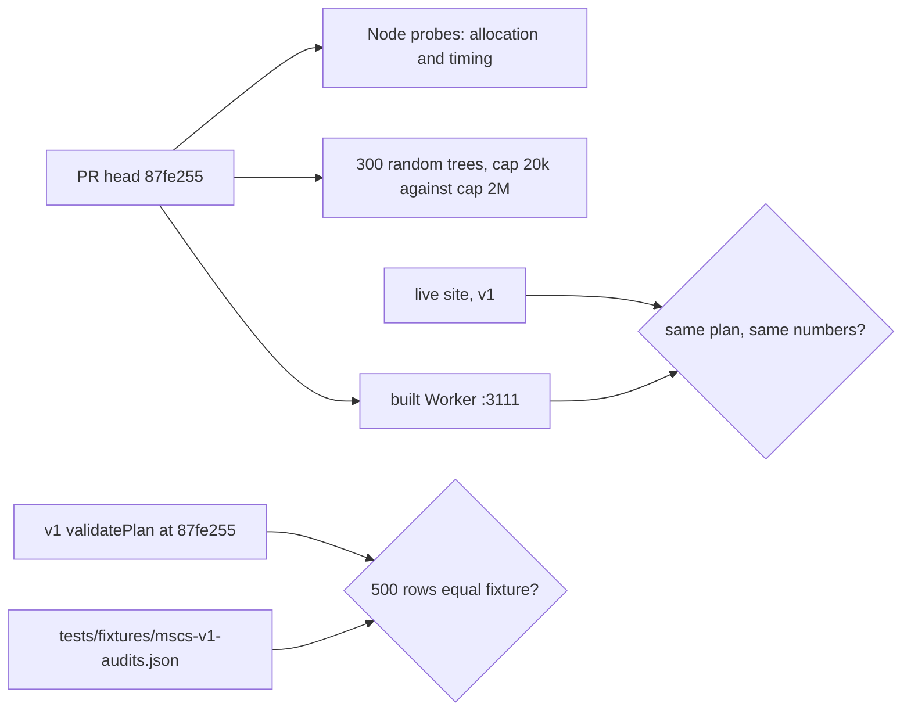
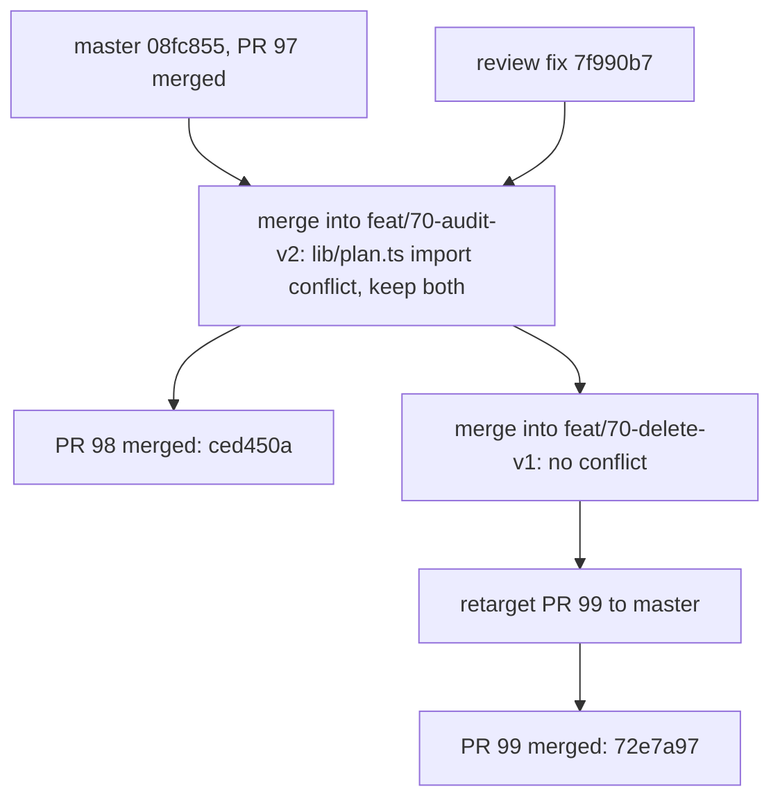

# PR #98 and PR #99 review: degree audit on requirement model v2 (#70)

- PRs: #98 (`feat/70-audit-v2`, allocation search, Plan on v2, tier) and #99 (`feat/70-delete-v1`, stacked, deletes the v1 audit). Issue #70 (T6 of #60) stays open.
- Reviewed heads: #98 `87fe255` (pinned), then `7f990b7` (review fix) and `86e6179` (master merge). #99 `58f539a` (pinned), then `bb63a4b` (merge of the #98 branch).
- Date: 2026-11-08. Reviewer: independent agent (Claude Opus 5.5).
- Verdicts: #98 **merge after the review fix**. #99 **merge**.
- Merge commits: #98 `ced450aeef2a935ceee27bb5802b2bf260b395f4` (CI green on `86e6179`). #99 `72e7a97bff4e10963cc7fbc15fd66cc77f00841c` (CI green on `bb63a4b`).
- Note: GitHub closed #70 when #99 merged, because the PR body says "does not close #70". The reviewer reopened #70.

## Method

## Merge order

## PR #98

### Findings

| # | Severity | File:line (at `87fe255`) | Finding | Status |
|---|---|---|---|---|
| 1 | High (blocking) | `lib/requirements-v2.ts:271-275`, `:247` | The step cap did not bound the time. `canMeet` enumerated every `choose-areas` combination at each prune check. These combinations did not count as steps. Probe: 9 groups "choose 1 of the same 8 courses", then `choose-areas` 3 of 40. Time: **80.6 s**. On 300 random trees (2 to 10 groups, 15 to 40 courses), the worst time was **2.5 s**. The planner runs this on every plan change. | Fixed in `7f990b7`. `canMeet` for `choose-areas` is now a cheap optimistic bound. Each enumerated combination counts as one step. Same probe: **48 ms**. Random worst: **160 ms**. |
| 2 | High (blocking) | `lib/requirements-v2.ts:166-176`, `:220-231` | The search tried candidates in code order. A large credit group before a named course took that course first, and the cap hid the valid allocation. Probe: `choose-credits` 30 credits of 18 three-credit courses, then `choose-courses` 1 of the first course. Result: second group "not met", but a full allocation exists. Also: 10 groups that compete for 10 courses gave "not met". This is a wrong audit result for a realistic tree shape (probe A at a larger size). | Fixed in `7f990b7`. Each group now tries first the courses that no later group in its pool lists. Picks keep candidate order. New test in `tests/requirements-v2.test.ts` fails on `87fe255` and passes now. |
| 3 | Low | `lib/requirements-v2.ts:283-288` | The comment said the search "keeps the allocation that meets the most groups in tree order". That is not true. An unmet group keeps its partial progress and holds those courses. Probe: `[choose-courses 2 of {A,B}, choose-courses 1 of {A}]`, plan `A`: both groups unmet, although the second group alone can be met. It is never a false "satisfied". MSCS behaves like v1 here (unmet breadth keeps its progress). | Fixed in `7f990b7`: comment and `docs/reviews/2026-11-08-issue70-verification.md` now state this rule. |
| 4 | Medium | `lib/requirements-v2.ts:157` | The cap can still report "not met" for a satisfiable plan when every candidate of every group is contested (for example identical lists with a late key choice). No such case in 300 random trees, in the 500 MSCS fixture plans, or in the probes after the fix. | Open, non-blocking. Look again when a non-MSCS tree uses v2 (for example a matching-based bound). |
| 5 | Low | `components/planner-board.tsx:328` | A group with empty `rawText` shows the program rule (`progress.root.rawText`). For MSCS core this is the correct catalog sentence. For other trees it can show the wrong rule. | Open, non-blocking. |
| 6 | Info | `lib/requirements-v2.ts:136-148`, `:426`; `components/planner-board.tsx:309-311`, `:324` | Tier matches the spec: Audit only when no group is unmodeled, a top-level `total-credits` exists and the top-level credits add up. MSCS is Audit (8 + 12 + 12 = 32). A Map tree is never `satisfied`. The UI shows "Map tier · No degree audit" and hides the group cards. Map tier is not reachable in Plan yet (Plan converts only the MSCS v1 data); the unit test covers it. | OK |
| 7 | Info | `lib/types.ts:61-67`, `tests/requirements-v2.test.ts` probe C | `shareCourses` is two-sided, documented and tested in both orders. A shared group adds 0 credits to the tier sum. | OK |

### Step cap timing (Node 22, this machine)

| Probe | `87fe255` | `7f990b7` |
|---|---|---|
| 9 groups on 8 courses, then `choose-areas` 3 of 40 | 80,627 ms | 48 ms |
| 300 random trees, worst case | 2,537 ms | 160 ms |
| 30 credits of 18 x 3-credit courses, then 1 named course | 22 ms, wrong ("not met") | 0.1 ms, met |
| 10 groups, 10 courses, satisfiable | 30 ms, wrong ("not met") | 0.2 ms, met |
| MSCS, all 142 courses completed | 2 ms | 3 ms |
| 500 MSCS fixture plans, worst case | - | 6.7 ms |

### Checks

- `npm ci`, `npm run typecheck`, `npm test` (295 pass; 301 after the master merge), `npm run build`: pass.
- Built Worker (`wrangler dev --port 3111`): `/planner` 200. Manifest: `neu-mscs-seattle` tier `audit`, roadmap tier `map`.
- Same plans on the built Worker and on live https://coursesplanner.johnyc.com (v1). Plan 1: 20 / 32, 2 / 3, 0 issues, electives 0 of 12 on both. Plan 2: 24 / 32, 0 / 3, 2 issues, same suggested fix, core needs CS 5011, breadth 1 of 2 areas, electives 4 of 12 on both. After more edits: 32 / 32, 2 / 3, 0 issues on both.
- Flows on the built Worker: Apply fix, Move menu, Mark waived, Mark completed: all work and the cards update. Drag: the synthetic drag in the review browser did not start a dnd-kit drag on local or on live, so this is a tool limit. The diff does not touch the drag code.

## PR #99

### Findings

| # | Severity | File:line | Finding | Status |
|---|---|---|---|---|
| 1 | Info | `tests/fixtures/mscs-v1-audits.json`, `tests/requirements-v2.test.ts:83-147` | Provenance check: I ran the v1 `validatePlan` from `lib/validation.ts` at `87fe255` with the same seeded generator and projected each audit to the same row. The 500 rows are equal to the fixture (28 satisfied, 181 with breadth satisfied). Thus the fixture comes from v1, not from v2. v2 after the PR #98 review fix also gives the same 500 rows. | OK |
| 2 | Low | `tests/validation.test.ts`, `tests/plan.test.ts` | Some coverage is lost. Before, `tests/v2-equivalence.ts` compared the full v1 and v2 projections (core, breadth, electives, notes, issues, required credits) in every scenario test. Now the scenario tests check chosen v2 fields, and a fixture row keeps only the issue count. Issues and notes come from the shared `auditPlanCourses` and `auditNotes`, so the risk is small. | Open, non-blocking. |
| 3 | Info | repository | No remaining import of `chooseBreadth`, `DegreeProgress`, v1 `validatePlan` or `tests/v2-equivalence.ts`. `categoryMatching` moved into `lib/requirements-v2.ts`, and the PR #98 fix uses it there. | OK |
| 4 | Info | issue #70 | The v1 requirement type (`DegreeRequirement`, `requirementsV2FromV1`) stays. A third PR removes it. Do not close #70. | Open, as planned. |

### Checks

- `npm ci`, `npm run typecheck`, `npm test` (294 pass at `58f539a`; 301 pass after the merge), `npm run build`: pass.
- `git diff origin/master origin/feat/70-delete-v1`: only the 9 files of this PR.

## Probes

Each probe is a v2 tree with `validatePlanV2` in Node. "met" lists each group in tree order.

- Probe D (fallback): `[choose-courses 2 of {A,B}, choose-courses 1 of {A}]`, plan `A`. Result: both unmet. This is the documented rule now (finding #98-3).
- Probe E (time): 9 groups "choose 1 of the same 8 courses", then `choose-areas` 3 of 40 in 2 areas. 80.6 s before, 48 ms after.
- Probe F (cap): `choose-credits` 30 of N three-credit courses, then `choose-courses` 1 of the first course. Before: wrong at N = 18, 20, 24. After: met for every N.
- Probe G (cap): one group "1 of {A, B}", then n groups "1 of {A, C1..Cn-1}". Before: wrong from 10 groups. After: met up to 13 groups.
- Random sweep: 300 trees, 2 to 10 groups, 15 to 40 courses, credits 1 to 4. Cap 20,000 and cap 2,000,000 agree on every tree, before and after the fix. Worst time 2,537 ms before, 160 ms after.
