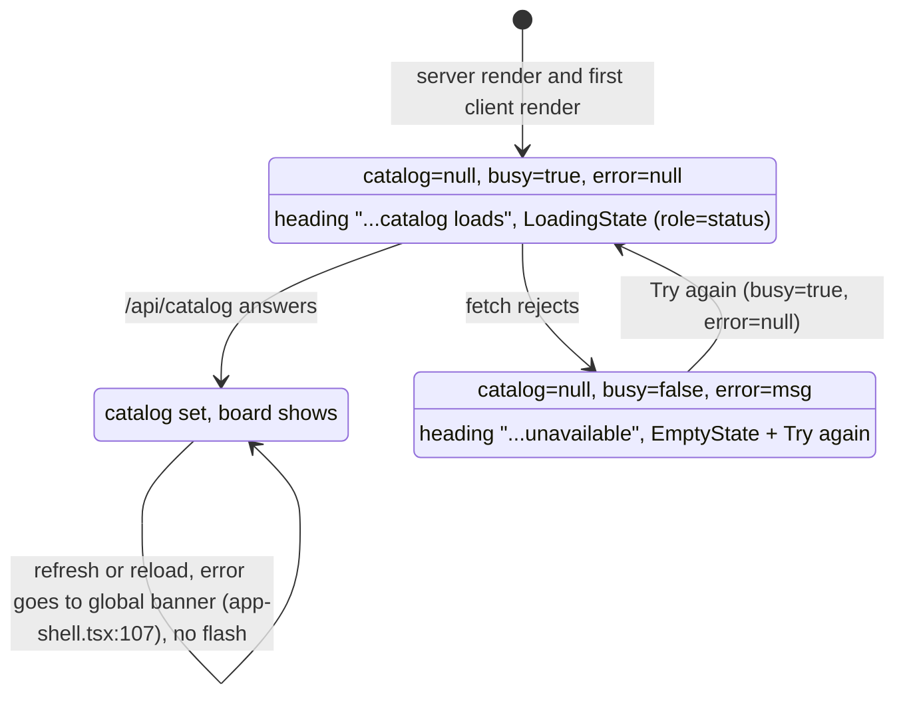

# Review: #140 planner loading state (tech_lead, round 1)

## Scope

- Diff `git diff c87953a...HEAD`: `components/planner-board.tsx` (+4/-2), `tests/planner-page.test.ts` (+27), verification record.
- Read the connected code: `components/app-provider.tsx:121-213` (`fetchCatalog`, `requestCatalog`), `components/catalog-state.tsx`, `components/ui.tsx:55` (`LoadingState`), `components/plan-backup.tsx`, `lib/plan.ts:747-765`, `app/globals.css:343`.

## State machine

| Question | Result | Evidence |
|---|---|---|
| Initial state is loading | Yes | `app-provider.tsx:169` `useState(true)` |
| "Unavailable" only after a failed request | Yes | `busy=false` with `catalog=null` comes only from the `catch` path, `app-provider.tsx:211-213` |
| Retry goes back to loading | Yes | `fetchCatalog` sets `busy=true`, `error=null` first, `app-provider.tsx:198-199` |
| Flash of "unavailable" on a later refresh | No | `setCatalog` is never set to `null`. The `!catalog` branch at `planner-board.tsx:250` cannot come back after one success. |
| StrictMode double effect | Safe | Both calls share `catalogGetInflight`, `app-provider.tsx:145-151` |
| Other "unavailable" text while loading | None | `plan-backup.tsx:114` is behind `isCatalogOutage`, which is false while busy (`lib/plan.ts:752`) |

## SSR and hydration

- The server render and the first client render both read `catalogBusy=true` from `useState(true)`. Effects do not run on the server. The heading text and `<CatalogState />` give the same markup on both sides. No hydration mismatch.
- `hydrated` changes only the save-status label, as before this change.
- The loader fades in after 300 ms (`globals.css:343`), so a fast load does not flash a spinner.

## Tests (mutation check)

I ran the new tests on a scratch copy of HEAD (now deleted). Each mutation below makes a test fail:

| Mutation | Result |
|---|---|
| `<CatalogState quiet />` again (`planner-board.tsx:254`) | killed |
| Heading always "unavailable" | killed |
| Heading always "loads" | killed |
| Provider initial `catalogBusy=false` (`app-provider.tsx:169`) | killed |
| `CatalogState` always loading (`catalog-state.tsx:11`) | killed |

## Worker CPU method

I repeated the A/B (production React, `renderToStaticMarkup` of the board, median of 9 x 3,000):

| Build | Run 1 | Run 2 | HTML |
|---|---|---|---|
| base `c87953a` | 23.6 µs | 22.0 µs | 1,509 B |
| head `a0b581b` | 27.2 µs | 28.4 µs | 1,969 B |

The increase is real (about +4 to +6 µs) and comes from the extra `LoadingState` markup. The method is a fair relative A/B. It measures only the board, not the full Worker request in workerd.

## Findings

### Medium

- **M1. The CPU acceptance item is not met as written.** The issue says "Worker CPU per request does not go up". It goes up by about 5 µs (`planner-board.tsx:254` now renders `LoadingState` on the server). The record says this openly, and the cost is small (about 0.05% of the 10 ms limit). This is a scope decision for `project_manager` and the owner: accept the increase explicitly or reword the item. It is not a correctness defect. The increase is the direct cost of the AC "show a loading state" in server HTML.

### Low

- **L1. The provider transition is not tested.** The new tests at `tests/planner-page.test.ts:112-117` spread fake state over the provider value. No test makes `fetchCatalog` reject and checks `busy=false` and `error` set (`app-provider.tsx:211-213`). A mutation that drops `setCatalogBusy(false)` from `finally` (stuck loader forever) would pass all tests. The code is unchanged by this diff, so this is an older gap.
- **L2. One assert message says the opposite.** `tests/planner-page.test.ts:134`: the message "the loading state stays after the request fails" shows when the loading text is present. It should describe a failure. The assert itself is correct.
- **L3. Two `role="status"` regions while loading.** `LoadingState` (`ui.tsx:56`) and the empty backup message `
` (`plan-backup.tsx:140`). This is harmless now because the second one is empty.

### High

None.

## Verdict

PASS. The state machine is correct, no hydration mismatch, no "unavailable" flash on a later refresh, and the tests kill the main mutations. M1 needs an explicit acceptance decision. It is not a code blocker.
