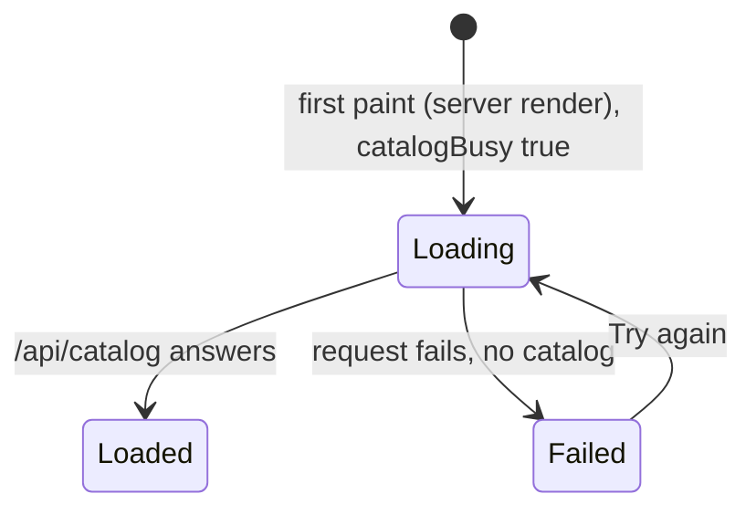

# Issue #140 verification: planner loading state

- Issue: #140. Source: `docs/reviews/2026-11-20-126-user_advocate.md` finding F1 (stress walk D1).
- Base: master `c87953a`. Branch: `fix/140-catalog-loading`.
- Date: 2026-11-19. Node 22.23, Linux cloud container.

## Change

| State | Heading description | Below the backup buttons |
|---|---|---|
| Loading | "Your local plan remains available for backup while the catalog loads." | `LoadingState` (`role="status"`): "Loading the course map". It fades in after 300 ms (CSS rule in `app/globals.css`). |
| Failed | "Your local plan remains available for backup while the catalog is unavailable." | Outage banner, "The course catalog did not load", Try again |
| Loaded | Tier text (unchanged) | The board (unchanged) |

1. `components/planner-board.tsx` reads `catalogBusy` from the app provider. The provider already had this state, so there is no new state.
2. The planner uses `<CatalogState />`, not `<CatalogState quiet />`. The board is the main content of the page, so the page shows the shared loading state.
3. No other component shows failure text while the catalog loads. `PlanBackup` already shows its banner only through `isCatalogOutage`, which knows about the busy state. Overview, Courses and Paths keep `quiet` with static text.

## Checks

| Check | Result |
|---|---|
| `npm run typecheck` | exit 0 |
| `npm test` | exit 0, 364 pass, 0 fail |
| `npm run build` | exit 0 |
| New tests in `tests/planner-page.test.ts` | Loading state (server render and after hydration). Failure state. A mutation that always shows the loading text makes the failure test fail. |

## Live walk (production runtime)

`npm run build`, then `npm start` (local wrangler dev, no deploy). Global Playwright, Chromium. The walk delays `/api/catalog` by 2.5 s, as the stress walk does.

| Check | Boston (Map tier) | Seattle (Audit tier) |
|---|---|---|
| Server HTML: failure strings | 0 | 0 |
| Server HTML: loading text in `role="status"` | yes | yes |
| D1: "unavailable" visible while loading, 1280 and 390 wide | never | never |
| Loader opacity | 0 at 130 ms, 0.91 at 590 ms, 1 at 1 s | 0 at 160 ms, 0.83 at 580 ms, 1 at 1 s |
| `/api/catalog` aborted | Failure description, banner and Try again show. No loader. | not walked |
| Try again after the API comes back | The board loads. | not walked |

## Layout shift (M1)

The #126 walk read CLS 0.000. It read that value before the data landed. The stress walk stops its D1 loop when the false text shows. It then reads CLS 1.8 s later, before the 2.5 s answer.

This table uses the same observer and reads CLS 1.8 s after the board shows:

| Build | Boston 1280 | Boston 390 | Seattle 1280 | Seattle 390 |
|---|---|---|---|---|
| base `c87953a` | 0.252 | 0.467 | 0.464 | 0.506 |
| this branch | 0.204 | 0.261 | 0.339 | 0.261 |

Before the data lands, CLS is 0.000 on both builds. The shift source is `div.static-page`, the server content below the board. The board pushes it down when it lands. This change makes the shift smaller, but CLS stays above 0.1. A fix needs a placeholder with the height of the board. That is a separate ticket.

## Worker CPU

The planner route is dynamic (`ƒ` in the build output). The server render always takes the loading branch.

A/B of the board server render: React production build, `renderToStaticMarkup`, median of 9 rounds of 3,000 renders.

| Build | Time per render | HTML |
|---|---|---|
| base `c87953a` | 24.2 µs | 1,509 bytes |
| this branch | 29.4 µs | 1,969 bytes |

The change adds about 5 µs per request. That is 0.05% of the 10 ms Workers Free limit.
