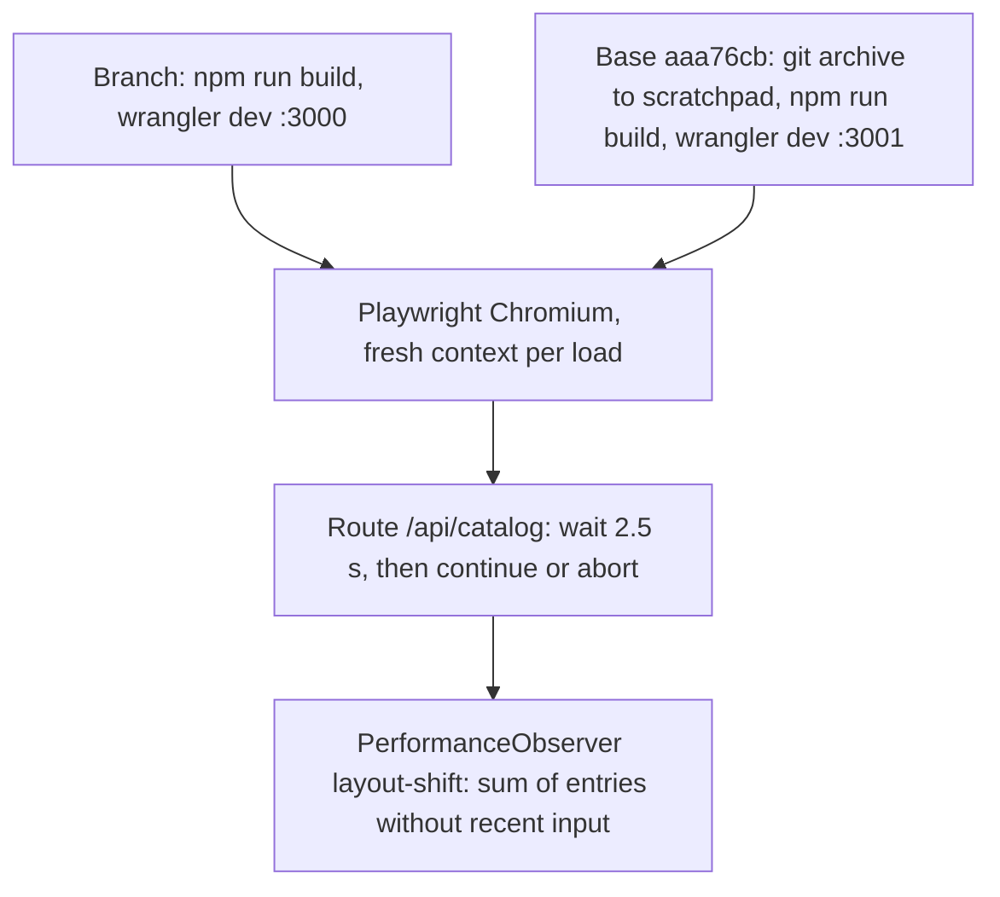

# Issue #144 user advocate review, round 1

- Branch: `fix/144-planner-cls`, product head `00ccbc4`. Stacked on PR #146 (`aaa76cb`).
- Diff: `git diff aaa76cb...00ccbc4 -- app components tests`. The placeholder `div.board-placeholder { min-height: 100vh }` wraps the loading state while `catalogBusy` is true.
- User: a student who opens the MSCS Boston or Seattle planner on a slow network, on a phone (390x844) and a laptop (1280x900).

## Verdict

PASS. The change solves the stated problem live. CLS after the board lands is 0.004 to 0.027 on all four cells, 3 loads each. The loading screen is calm. The backup buttons stay in the first screen. The failure path and retry work.

No finding is caused by this change. Two medium findings are on the base too (`aaa76cb`). They affect a student who scrolls or tabs while the catalog loads. They are outside the #144 acceptance, which measures a load with no input. Track them as follow-up tickets.

## How I walked it

- Viewports: 1280x900, and 390x844 with touch and `isMobile`.
- Scenarios: no input; scroll to the page text while loading; Tab 12 and 25 times while loading; API aborted after 2.5 s, then "Try again".
- I ran the skill `stress-walk.mjs` on both planner pages.
- Scripts and screenshots stayed in the session scratchpad. I stopped both servers. I left no files in the repo except this review. I did not deploy.

## Result: CLS with no input (measured by me)

| Program | Width | Branch, 3 loads | Base, 1 load | Limit |
|---|---|---|---|---|
| Boston (Map tier) | 1280 | 0.027, 0.027, 0.027 | 0.204 | 0.1 |
| Boston (Map tier) | 390 | 0.004, 0.004, 0.004 | 0.261 | 0.1 |
| Seattle (Audit tier) | 1280 | 0.024, 0.024, 0.024 | 0.339 | 0.1 |
| Seattle (Audit tier) | 390 | 0.004, 0.004, 0.004 | 0.261 | 0.1 |

The board landed about 2.9 s after navigation. On the branch, only the heading actions shift (1280) and the save status (390). These numbers agree with `docs/reviews/2026-11-20-issue144-verification.md`.

### What the student sees

| Moment | 390x844 | 1280x900 |
|---|---|---|
| 0-300 ms | Heading and backup buttons, then a blank area (the loader fades in after 300 ms, from #140) | Same |
| Loading | Heading, "Saved on this device", Download / Restore backup at y 318, loader at y 370-590, about 250 px of plain background below it | Heading, backup buttons at y 160, loader at y 206-426, about 470 px of plain background below it |
| Board lands | Board replaces the loader. Nothing in view jumps. | Board replaces the loader. Heading actions grow (small shift). |

The blank area below the loader is not confusing in my view. The loader card sits at the top, with a spinner and "Loading the course map". The rest is the page background, not an empty box. So it reads as "something is loading here". It lasts 2.5 s.

### Scroll and keyboard while loading (branch and base)

| Scenario | Branch | Base | Effect on the student |
|---|---|---|---|
| Small scroll (50 or 300 px), any width | CLS 0-0.027 | not run | No jump. Scroll anchoring keeps the view. |
| Scroll to "How the planner works", 1280 | CLS 0.0001 | 0.204 / 0.349 | Better on the branch. |
| Scroll to "How the planner works", 390 | Boston 0.516, Seattle 0.939 | Boston 0.516, Seattle 0.939 | Same as base. See U1. |
| Tab 25 times (focus in the top bar or nav), 390 | Boston 0.516, Seattle 0.832; scrollY jumps to the page bottom | Same | Same as base. See U1. |
| Focus on "Download backup", then the board lands, 390 | Focus goes to `body` | Same | Same as base. See U2. |

### Failure path (API aborted after 2.5 s, branch)

| Program | Width | CLS at the failure state | "Try again" loads the board |
|---|---|---|---|
| Boston | 1280 | 0.072 | yes |
| Boston | 390 | 0.031 | yes |
| Seattle | 1280 | 0.072 | yes |
| Seattle | 390 | 0.031 | yes |

The placeholder is gone in the failure state. The outage banner, the current-plan summary, the acknowledgement checkbox, "Download backup" and "Try again" all show. The loading text never shows after the failure.

## Findings

| ID | Rank | Caused by #144? | Finding | Evidence |
|---|---|---|---|---|
| U1 | medium | No, same on `aaa76cb` | At 390 px, a student who scrolls into the page text, or tabs into the top bar or nav, while the catalog loads, loses their place when the board lands. The page jumps to the bottom (scrollY 755 to 2964 Boston, 890 to 3766 Seattle). CLS is 0.52 to 0.94. At 1280 px the branch does not show this. | `scroll` and `focus` walks, 390x844, both builds. Shift sources: `static-page course-index`, `workspace-footer`. |
| U2 | medium | No, same on `aaa76cb` | At 390 px, keyboard focus on "Download backup" during load is lost when the board lands. `document.activeElement` becomes `body`. A keyboard or screen reader user must start again from the top. | `focus` walk, 12 Tab presses, both programs, both builds. |
| U3 | low | Yes | While loading, nothing tells the student that page text ("How the planner works", degree rules) is below the blank area. The text is still reachable by scrolling and by Tab. | Loading screenshots: static-page top at 1138 px (1280) and 1246 px (390). |
| U4 | low | No, from #140 or earlier | The failure text joins the raw browser error to the help text without a full stop: "Failed to fetch Check your connection, then try again." | `components/catalog-state.tsx:14`, failure screenshot. |
| U5 | low | No, from #140 or earlier | During load, "Restore backup" is disabled. The reason is only in the `title` tooltip. A phone user cannot see it. | `components/plan-backup.tsx` (Restore button `title`). |

The review does not propose fixes.

## Automated stress walk (`designing-ux-mechanics/stress-walk.mjs`, branch, 390 px)

Config: home and lists are the Boston and Seattle planner pages. `api` is `/api/catalog`, `empty` is the failure text, `content` is `.semester-board`, `throttleMs` 2500. The planner has no sends and no deeper screens in scope.

| # | Check | Target | Result | Detail |
|---|---|---|---|---|
| D1 | No empty state before the first answer | Planner Boston | PASS | skeleton, cache or loading shown |
| M1 | No layout shift when data lands (CLS ≤ 0.1) | Planner Boston | PASS | CLS 0.014 |
| D1 | No empty state before the first answer | Planner Seattle | PASS | skeleton, cache or loading shown |
| M1 | No layout shift when data lands (CLS ≤ 0.1) | Planner Seattle | PASS | CLS 0.004 |
| L1 | At most one layer over a screen | all walked steps | PASS | never more than one |

5 PASS, 0 FAIL.

## Manual checklist (`designing-ux-mechanics/checklist.md`)

| # | Result | Note |
|---|---|---|
| N1 | NOT TESTED | The change adds no navigation. |
| N2 | NOT TESTED | The change adds no screen. The stress walk had no deeper screens to walk. |
| N3 | NOT TESTED | No send flow in the change. |
| N4 | PASS | A direct link to each planner page opens it (all walks start from the deep link). |
| N5 | NOT TESTED | No list-to-detail flow in the change. |
| N6 | PASS | Reload shows the same planner page with the same loading then board sequence. |
| L1 | PASS | Stress walk: never more than one layer. |
| L2 | NOT TESTED | The change opens no layer. |
| L3 | FAIL (pre-existing) | Not a layer, but the same rule: focus on "Download backup" is lost when the board lands at 390 px (U2). Same on base. |
| L4 | PASS | No confirm dialog. Restore uses an Undo toast (`plan-backup.tsx` comment, from #140). |
| D1 | PASS | Failure text never shows while loading (stress walk and my walk). |
| D2 | NOT TESTED | The catalog has no client cache to show on a return visit; out of scope for #144. |
| D3 | PASS | Loader fades in after 300 ms (no flash). No jump when the board lands with no input. Scroll-while-loading at 390 px jumps (U1, pre-existing). |
| D4 | PASS | Failure is in place, says what to do, and offers "Try again", which works. Copy nit U4. |
| D5 | NOT TESTED | Offline was not simulated beyond the aborted request. |
| A1 | PASS | Download backup, Tab focus and "Try again" respond at once. |
| A2 | NOT TESTED | No send action in the change. |
| A3-A6 | NOT TESTED | No send action in the change. |
| M1 | FAIL (pre-existing) | At 390 px, content under the reader moves when the board lands, if they scrolled first (U1). Same on base. |
| M2-M5 | NOT TESTED | No counters, transitions or slides in the change. |

## Interaction design (Shneiderman)

- Consistency: the planner uses the shared `LoadingState` and `EmptyState`, like the other catalog views.
- Shortcuts: the skip link and Tab order reach "Download backup" in 12 presses at 390 px. The change adds no shortcut and needs none.
- Informative feedback: the loader says what is loading ("the official catalog and the plan saved in this browser"). The heading says the local plan stays available for backup.
- Closure: the loader goes away and the board takes its place. The placeholder is gone after success and after failure.
- Simple error handling: the failure state says what failed and offers "Try again". Copy nit U4.
- Easy reversal: no new action. Restore still has Undo.
- Internal locus of control: the student can use "Download backup" and scroll to the page text during the load. At 390 px, scroll or focus can be taken away when the board lands (U1, U2, pre-existing).
- Short-term memory load: the loader sits where the board will appear, so the student does not need to look for it.
- Clarity and hierarchy: heading, backup actions, then the loader card at the top of the reserved area. The blank area below is plain background (U3, low).
- Accessibility: the loader has `role="status"`. The state is not told by colour alone. Focus loss on landing is U2.

## Problem solved

Yes. Issue #144 asks for CLS 0.1 or below after the catalog loads, on Boston and Seattle, at 1280 and 390 px. I measured 0.004 to 0.027. The base reads 0.204 to 0.339. Worker CPU: I did not measure it. The tech lead and the implementer record cover it.

## Not checked

- Real phones and real network throttling. I used Chromium emulation and a fixed 2.5 s route delay.
- Other programs, other viewports and the "no terms" plan. The implementer record covers them.
- Worker CPU per request.
