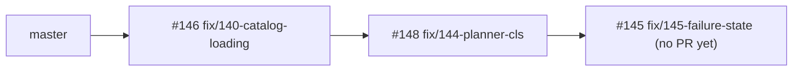

# Issue #145 review, project_manager, round 1

- Branch: `fix/145-failure-state`. Head: `85e07b3` (docs only). Product head: `5083cd6`.
- Base: `da76ed0` (PR #148). Diff: `git diff da76ed0...HEAD`.
- Record: `docs/reviews/2026-11-20-issue145-verification.md`.

## Verdict

PASS. All six criteria are met on the planner. No high finding. Two medium findings must go in the PR body, or get a fix.

## My own checks

| Check | Result |
|---|---|
| `git rev-parse HEAD` | `85e07b3daa500ce748dbb8a63b4dd329e29a0340`. The remote branch has the same SHA. |
| `npm run typecheck` | exit 0 |
| `npm test` | 370 pass, 0 fail |
| `npm run build` | exit 0. Working tree clean after the build. |
| Live walk (Playwright, wrangler dev) | Not run by me. I read the record tables. |

## Per-criterion map

| # | Criterion | Status | Evidence |
|---|---|---|---|
| 1 | One plain sentence; raw error to the console | met | `components/catalog-state.tsx:25` shows title plus "Check your connection, then try again." `components/app-provider.tsx:213` logs `console.error(..., error)`. Tests: `tests/planner-page.test.ts:144-149` (raw 503 text not in page), `tests/app-provider.test.ts:54`. See M1 for the copy. |
| 2 | Try again visible without scrolling at 390 px | met | `components/planner-board.tsx:257` puts `CatalogState` before `PlanBackup`. Record: 476-520 at 390x844, bottom bar at 780. Also visible at 360x640 and 375x667. Test: DOM order only (`tests/planner-page.test.ts:151-156`). Pixel position is proven only by the live walk. |
| 3 | The page says "unavailable" once | met (intent) | Failure is stated once, in the card ("did not load"). "unavailable" occurs 0 times. Heading text changed (`planner-board.tsx:251`), banner removed (`plan-backup.tsx:121`). Test: `tests/planner-page.test.ts:136`. See L1. |
| 4 | Focus moves to a sensible place after Try again | met on planner; partial on Courses and Explore | `catalog-state.tsx:16-21` focuses `main h1` with `tabIndex = -1`. Test: `tests/planner-retry-focus.test.ts` (Try again, retry fails). Courses and Explore have no h1 while the catalog is missing, so focus goes to body (record, "Other pages"). See M2. |
| 5 | The disabled reason is visible text | met | `plan-backup.tsx:61-66,140` adds a visible `
` linked with `aria-describedby`. `title` removed. Test: `tests/planner-page.test.ts:158-168`. See L2. |
| 6 | Tests cover copy and focus; test, typecheck, build pass | met | 4 new tests plus 1 extended. My runs: typecheck 0, 370 pass, build 0. |

## Findings

### M1 (medium): the sentence says "check your connection" for a server 503

- `components/catalog-state.tsx:25`. The issue's own example is a 503 with an HTML body. That is a server fault, not the user's connection.
- The criterion asks for "what failed, what to do". The title says what failed. The sentence gives one cause, and for a 503 it is the wrong cause.
- Cheap fix: "Check your connection or try again in a minute." Or name the copy choice in the PR body.

### M2 (medium): the shared card still drops focus to body on Courses and Explore

- `CatalogState` is shared. The fix depends on `main h1`, which Courses and Explore do not render while the catalog is missing.
- Not a regression: the base also drops focus to body. The issue scope is the planner.
- The PR body must name this limit. Open a follow-up issue for Courses and Explore. I found no open issue for it.

### L1 (low): "once" is now zero

- The issue counted three places, including the card. The card now says "did not load", not "unavailable". So the failure is stated once, and the literal word is used zero times.
- This honours the intent (one statement of the failure). The PR body must say this reading.

### L2 (low): no visible reason in some disabled states

- `plan-backup.tsx:61-66`. When `hydrated` is false and the catalog is available, Restore is disabled with no reason. The window is short (storage read). Accept, or name it.

### L3 (low): raw error still shows in the global banner on refresh failure

- `components/app-shell.tsx:107` shows `app.catalogError` text when a refresh fails with a catalog loaded. This is outside the #145 failure card, and it is older than #145. Open a follow-up issue.

## Design alignment

- The architecture report candidate 1 ("one catalog status", `artifacts/architecture-140-catalog-loading.html`) is not used. The record (judgment call 1) gives the reason. #145 adds no new reader of raw fields. I accept this. It is not a silent fork, because the record names it.

## Scope honesty

- No TODO, no mock in product code. No test deleted. The old `CATALOG_FAILED` list became one regex. The new test is stricter.
- `tests/fake-dom.ts` (135 lines) is test-only infrastructure. The `jsdom` install was refused. It is in scope for AC6. Its limit (it cannot render the loaded board) is named in the record.
- The "The map shows only official catalog data ..." sentence is removed from the shared card on all pages. This is in scope for AC1 (one sentence).
- Two `shortcut:` comments name the layout limits (`app/globals.css:569`, `planner-board.tsx:256`).

## Trade-offs the PR body must name

1. "Unavailable" is now zero; the failure is stated once (L1).
2. Focus goes to body on Courses and Explore (M2), with the follow-up issue number.
3. While loading, on 360x640 and 375x667 the backup buttons now need a scroll. At 390 px and wider they stay in the first screen. Reason: the panel does not jump at the failure.
4. CLS at the failure, 1280 px: 0.072 to 0.084 (still below 0.1). At 390 px: 0.031 to 0.022.
5. "One catalog status" was not done, with the reason.
6. The 503 copy choice (M1), if not fixed.
7. Not checked: real screen reader, real phones, real throttling.

## Risk surface

- Copy growth breaks the 15rem card height and the matched line counts. Mitigated by the `shortcut:` comments only. No test checks CLS.
- `heading.tabIndex = -1` stays on the h1 for good. Low risk.
- Removing the outage banner removes the "semester board is hidden" text. The card and the heading now carry the state. Low risk.

## Merge order

- No PR exists for this branch yet. Open it with base `fix/144-planner-cls`.
- Merge #146, then #148, then this PR. After each merge, retarget the next PR base and re-check the diff.
- If #146 or #148 is squash-merged, rebase this branch. Then re-run typecheck, test and build on the new head. A new head needs a new review SHA.
