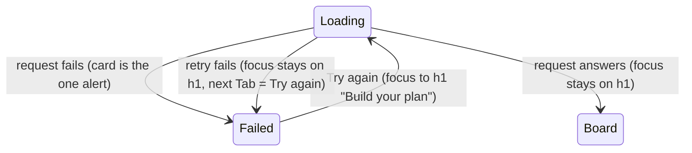

# User advocate review, #145 (planner catalog failure state), round 1

## Verdict

PASS. No high and no medium findings. Four low findings. None blocks the merge.

## User and task

The user is a student on the planner page. The catalog request fails because the student is offline, or because the server sends HTTP 503. The student must understand what happened, try again, and keep access to the local plan backup. Devices: phone (360, 375, 390 px) and laptop (1280 px). Keyboard and screen-reader users are included.

## Live walk (done, not simulated)

Method: `npm run build` at `fae0878`, then `wrangler dev --config dist/server/wrangler.json --port 3000 --ip 127.0.0.1`. Local only, no deploy. Playwright 1.63 Chromium, a fresh context per run. Route `**/api/catalog**`: 2.5 s delay, then abort (`internetdisconnected`) or a 503 with the body `<html>Service Unavailable</html>`. Programs: MSCS Boston (`computer-science-mscs-976b977119`) and MSCS Seattle (`computer-science-mscs-sea-8b0d00dbda`). 2 causes x 2 programs x 4 viewports = 16 runs. Both programs and both causes gave the same values. I stopped the server after the walk. The scripts stayed in the session scratchpad.

| Check | 360x640 | 375x667 | 390x844 | 1280x900 |
|---|---|---|---|---|
| Card text | "The course catalog did not load" / "Check your connection, or try later." | same | same | same |
| Sentence lines | 1 | 1 | 1 | 1 |
| Raw error on the page | no | no | no | no |
| "unavailable" / "did not load" | 0 / 1 | 0 / 1 | 0 / 1 | 0 / 1 |
| Live regions with text | 1 (`alert`, the card) | 1 | 1 | 1 |
| Alert nodes per failed load | 1 | 1 | 1 | 1 |
| Try again, y top-bottom | 492-536 | 492-536 | 476-520 | 321-359 |
| Bottom bar top | 576 | 603 | 780 | none |
| Try again in the first screen | yes | yes | yes | yes |
| Restore reason | visible text, linked by `aria-describedby`, no `title` | same | same | same |
| Focus after Try again (Enter) | h1, ring | h1, ring | h1, ring | h1, ring |
| Focus after retry fails / next Tab | h1 / Try again | same | same | same |
| Focus when the board lands | h1 | h1 | h1 | h1 |
| CLS at the failure | 0.025 | 0.018 | 0.022 | 0.084 |
| Download backup while loading | 586-630, under the bar | 586-630, under the bar | 570-614, visible | visible |
| Horizontal scroll / page errors | none / 0 | none / 0 | none / 0 | none / 0 |

Other observations:

- While loading, the one live region is the loading status. The page says "unavailable" and "did not load" 0 times. The visible Restore reason is "Wait for the catalog to finish loading before restoring."
- After the failure, the Restore reason is "Review the current plan and confirm before restoring." At 360x640 it is at y 910, under the Restore button that it describes.
- A mouse press on Try again moves focus to the h1 with no focus ring (`:focus-visible` false).
- Console: the browser resource error and the app log "The catalog did not load." once per failed load.
- Restore reason color `rgb(100,109,123)` on `rgb(244,245,247)`: about 4.8:1, AA for body text.

## Stress walk (designing-ux-mechanics)

The change has no navigation, layer or send action, so the `stress-walk.mjs` N2, A1, A2 and N3 checks have no target. The script's D1 and M1 checks throttle and then continue the request, so they do not cover a failure. I ran the same CLS observer and the same false-empty check by hand for the failure path (table above). Results in the script's format:

| # | Check | Target | Result | Detail |
|---|---|---|---|---|
| D1 | No empty or failure state before the first answer | planner, 4 viewports, 2 programs | PASS | loading status at 800 ms, failure text 0 times |
| M1 | No layout shift at the failure (CLS <= 0.1) | planner, blocked and 503 | PASS | 0.018 to 0.025 (phone), 0.084 (1280) |
| L1 | At most one layer over a screen | all walked steps | PASS | no layer opens |
| N2, N3, A1, A2 | Back, send, double tap | none | NOT TESTED | no navigation or send action in this change |

### Manual checklist

| # | Result | Note |
|---|---|---|
| N1, N2, N4, N6 | NOT TESTED | the change adds no screen or route |
| N3 | NOT TESTED | no form flow |
| N5 | PASS | focus has a defined place (h1) after Try again and after the board lands |
| L1-L4 | NOT TESTED | no layer or dialog in the change |
| D1 | PASS | see the table |
| D2 | NOT TESTED | out of scope; the catalog has no cached copy in this flow |
| D3 | PASS | CLS at the failure <= 0.084; CLS when the board lands is the #144 record |
| D4 | PASS | the failure is in place, says what to do, and offers Try again |
| D5 | PASS | offline shows a clear state; the local plan and Download backup stay available |
| A1 | PASS | Try again replaces the card with the loading status at once |
| A2 | NOT TESTED | Try again is a GET retry, and the card goes away on the first press |
| A3 | PASS | the local plan stays after a failed retry |
| A4, A5 | NOT TESTED | no optimistic write |
| A6 | PASS | Restore over the current plan still needs the checkbox during an outage |
| M1-M5 | NOT TESTED | no live data or transitions in the change |

## Findings

| ID | Rank | Finding | Evidence |
|---|---|---|---|
| U1 | low | For a 503, the sentence starts with "Check your connection", which points to the student's own network. "or try later" makes it true for both causes, so the student is not misled. | `components/catalog-state.tsx:27`; 503 runs show the same text |
| U2 | low | Known trade-off: at 360x640 and 375x667, Download backup is under the bottom bar while the catalog loads (y 586-630, bar at 576 and 603). After the failure, Try again is in the first screen. | live walk, loading phase |
| U3 | low | On Courses and Explore, focus still drops to the body after Try again. The code comment names #149. | `components/catalog-state.tsx:17` |
| U4 | low | Screen-reader output is not heard. The DOM gives h1 focus, then the loading status, then one alert per failure. Real NVDA or VoiceOver order is not checked. | live-region DOM only |

## Shneiderman rules and other quality notes

| Rule | Note |
|---|---|
| Consistency | The shared card has the same title and button on every page. The planner uses the same `EmptyState`. |
| Shortcuts | Enter on Try again works. Focus on the h1 puts Try again one Tab away. |
| Informative feedback | Try again shows the loading status at once. A failed retry shows a new alert. |
| Closure | The board replaces the card when the request answers. Focus stays on the h1. |
| Simple error handling | One plain sentence and one action. No raw error on the page. |
| Easy reversal | Try again has no cost. Restore during an outage still needs a confirm checkbox. |
| Internal locus of control | The student decides when to retry. Download backup works during the failure. |
| Short-term memory load | The Restore reason is visible text next to the button, not a tooltip. |
| Clarity and hierarchy | Heading, then the card, then the backup panel. "did not load" shows once. |
| Accessibility | Focus ring on keyboard focus, none on mouse focus. Reason text about 4.8:1. The failure is said in text, not by color only. |

## Not checked

- Real screen readers and real phones. I used Chromium emulation.
- Dark mode and 200 % zoom.
