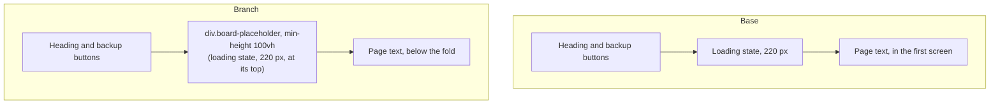

# Issue #144 verification: planner layout shift when the board lands

- Issue: #144. Source: `docs/reviews/2026-11-19-issue140-verification.md`, section "Layout shift (M1)".
- Base: `fix/140-catalog-loading` `aaa76cb` (PR #146). Branch: `fix/144-planner-cls`, stacked on #146.
- Date: 2026-11-20. Node 22.23, Linux cloud container, Chromium 153 (global Playwright).

## Cause

While the catalog loads, the board area holds only the heading, the backup buttons and the 220 px loading state. So the page text (`div.static-page`: "How the planner works" and the degree rules) starts in the first screen. When the catalog lands, the board replaces the loading state. The board is much taller, so it pushes the page text out of the first screen.

| Program, viewport | Page text top while loading | Page text top after the board lands |
|---|---|---|
| Boston 1280x900 | 458 px | 1391 px |
| Seattle 1280x900 | 458 px | 1566 px |
| Boston 390x844 | 622 px | 3248 px |
| Seattle 390x844 | 622 px | 3560 px |

Shift sources on the base, from the `layout-shift` entries:

- `div.static-page` at both widths. This is most of the score.
- `footer.workspace-footer` at Boston 1280x900. It was in view at y 854.
- The heading: at 1280 px, the heading actions grow and the description wraps one more line. At 390 px, the save status moves right.

## Fix

1. `components/planner-board.tsx`: while `catalogBusy` is true, the loading state is in `div.board-placeholder`. After a failed request, the failure state shows without the placeholder, as before.
2. `app/globals.css`: `.board-placeholder { min-height: 100vh; }`.
3. Why one screen: the loaded board is taller than one screen at both widths (table above). So the page text starts below the fold while the catalog loads. The board then pushes it only further down, out of view. Nothing in view moves.
4. The loading copy, `role="status"` and the 300 ms fade-in from #140 do not change.
5. Page text top while loading, on the branch: 1138 px at 1280x900 and 1246 px at 390x844. Both are below the fold and above the loaded position.

## Method

The same method as the #140 record. The base numbers below are the same as the #140 record (0.204, 0.261, 0.339, 0.261), so the two records compare.

1. `npm run build`. Then `wrangler dev --config dist/server/wrangler.json --port 3000 --ip 127.0.0.1` (local, no deploy).
2. Open a fresh browser context for each load. Viewports: 1280x900 (as in #126) and 390x844 with touch (as in the stress walk).
3. Delay `/api/catalog` by 2.5 s with a Playwright route.
4. Use the observer of `designing-ux-mechanics/stress-walk.mjs`: the sum of `layout-shift` values without recent input.
5. Wait until `.semester-board` is visible. Read CLS 1.8 s later.
6. Do 3 loads per cell. The scripts stayed in the session scratchpad.

## Result: CLS after the catalog loads

| Program | Width | Base `aaa76cb`, 3 loads | Branch, 3 loads | Limit |
|---|---|---|---|---|
| Boston (Map tier) | 1280 | 0.204, 0.204, 0.204 | 0.027, 0.027, 0.027 | 0.1 |
| Boston (Map tier) | 390 | 0.261, 0.261, 0.261 | 0.004, 0.004, 0.004 | 0.1 |
| Seattle (Audit tier) | 1280 | 0.339, 0.339, 0.339 | 0.024, 0.024, 0.024 | 0.1 |
| Seattle (Audit tier) | 390 | 0.261, 0.261, 0.261 | 0.004, 0.004, 0.004 | 0.1 |

Before the data lands, CLS is 0.000 on both builds.

On the branch, only the heading still shifts. At 1280 px, the heading actions grow from the save status alone to the save status, the backup buttons and three more controls (0.024-0.027). At 390 px, the save status moves right (0.004). The change keeps this shift, because it is far below the limit.

### Other viewports and plans (branch, 1 load each)

| Viewport | Boston, default plan | Seattle, default plan | Boston, no terms | Seattle, no terms |
|---|---|---|---|---|
| 1280x900 | 0.027 | 0.024 | 0.027 | 0.024 |
| 390x844 | 0.004 | 0.004 | 0.004 | 0.004 |
| 1280x720 | 0.034 | 0.030 | | |
| 1024x768 | 0.041 | 0.037 | | |
| 1440x900 | 0.030 | 0.027 | | |
| 1920x1080 | 0.007 | 0.007 | 0.007 | 0.007 |
| 2560x1440 | 0.003 | 0.003 | 0.018 | 0.011 |
| 768x1024 | 0.001 | 0.000 | | |
| 414x896 | 0.004 | 0.004 | | |
| 360x640 | 0.007 | 0.007 | | |

A plan with no terms gives the shortest board. On a 2560x1440 screen, that board is shorter than the placeholder. So the page text moves up into view, but CLS stays at 0.018.

### Failure path (API aborted after 2.5 s, 1 load each)

CLS 1.8 s after "The course catalog did not load" shows:

| Program | Width | Base | Branch |
|---|---|---|---|
| Boston | 1280 | 0.156 | 0.072 |
| Boston | 390 | 0.143 | 0.031 |
| Seattle | 1280 | 0.175 | 0.072 |
| Seattle | 390 | 0.143 | 0.031 |

The failure state was above the limit on the base. The branch makes it smaller. At 1280 px, the page text moves up into view when the placeholder goes. At 390 px, only the backup buttons move.

### Loading behaviour from #140 (branch)

| Check | Boston 1280 | Boston 390 | Seattle 1280 | Seattle 390 |
|---|---|---|---|---|
| Loader opacity at 150 / 600 / 1000 ms | 0 / 0.98 / 1 | 0 / 0.76 / 1 | 0 / 0.91 / 1 | 0 / 0.91 / 1 |
| Failure text while loading | never | never | never | never |
| Placeholder after the board lands | gone | gone | gone | gone |

Served HTML of both planner pages: `role="status"` is the first child of `div.board-placeholder`, and the placeholder comes before the page text.

## Worker CPU

- The Worker serves both planner pages from the prerender cache (`X-Vinext-Cache: HIT`). A normal request does not render the board.
- On a cache miss, the server render takes the loading branch. A/B of that render: React production build, `renderToStaticMarkup`, median of 9 rounds of 3,000 renders. Base and branch ran in turns, 3 processes each.

| Build | Median per render, 3 processes | HTML |
|---|---|---|
| base `aaa76cb` | 47.3, 46.5, 45.8 µs | 1,969 bytes |
| branch | 43.6, 48.2, 48.4 µs | 2,006 bytes |

The difference is inside the noise between processes (about 2 µs). The change adds one `div` (37 bytes). Both builds use less than 0.5% of the 10 ms Workers Free limit. Times on this machine are higher than in the #140 record, so compare times only inside this table.

## Checks

| Check | Result |
|---|---|
| `npm run typecheck` | exit 0 |
| `npm test` | exit 0, 366 pass, 0 fail |
| `npm run build` | exit 0, 387 routes prerendered |
| New test in `tests/planner-page.test.ts` | While the catalog loads, the loading status is in `div.board-placeholder`, and `globals.css` makes it one screen tall. After a failed request, there is no placeholder. |
| Red runs | Before the fix, the new test failed ("the loading state is in the board placeholder"). With `min-height: 220px`, it failed ("the placeholder is one screen tall"). |
