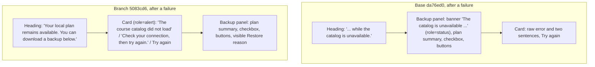
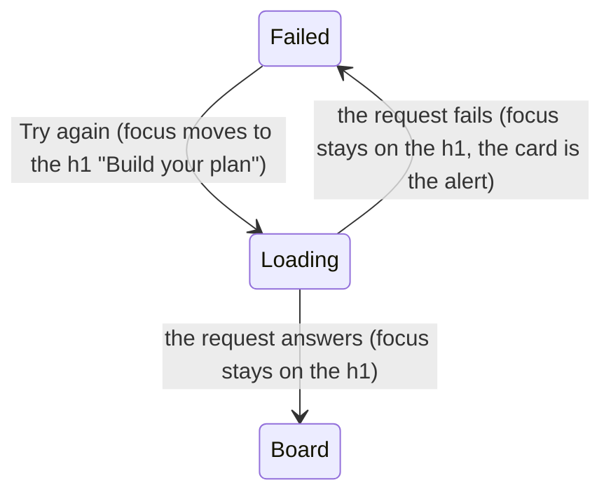

# Issue #145 verification: planner catalog failure state

- Issue: #145. Sources: `docs/reviews/2026-11-19-140-user_advocate.md` (M1, M2, L1, L2, L4) and `docs/reviews/2026-11-20-144-user_advocate.md` (U4, U5).
- Base: `fix/144-planner-cls` `da76ed0` (PR #148, stacked on PR #146). Branch: `fix/145-failure-state`, stacked on #148.
- Product head: `5083cd6`. Date: 2026-11-20. Node 22.23, Linux cloud container, global Playwright 1.63, Chromium 153.

## Change

| Acceptance item | Change | File |
|---|---|---|
| One plain sentence, raw error to the console | The card text is "Check your connection, then try again." The provider logs `console.error("The catalog did not load.", error)`. | `components/catalog-state.tsx`, `components/app-provider.tsx` |
| Try again visible without scrolling at 390 px | The card comes before the backup panel. In both states, the board area (loading state or card) and then the panel are in one wrapper. | `components/planner-board.tsx` |
| "Unavailable" once | The failure heading and the outage banner do not state the failure. Only the card states it. | `components/planner-board.tsx`, `components/plan-backup.tsx` |
| Announced once | The card has `role="alert"`. The outage banner (`role="status"`) is removed. | `components/ui.tsx` (`EmptyState` `role`), `components/catalog-state.tsx` |
| Focus after Try again | Try again moves focus to the page heading (`main h1`, `tabindex="-1"`). The heading stays while the catalog loads, fails or lands. | `components/catalog-state.tsx` |
| The disabled reason is visible text | A line under the buttons, linked with `aria-describedby`. The `title` is removed. | `components/plan-backup.tsx` |

### Copy

| Place | Base | Branch |
|---|---|---|
| Card title | "The course catalog did not load" | no change |
| Card text, blocked request | "Failed to fetch Check your connection, then try again. The map shows only official catalog data, so nothing appears until it loads." | "Check your connection, then try again." |
| Card text, 503 with an HTML body | "Unexpected token '<', "<html>Serv"... is not valid JSON Check your connection, then try again. ..." | "Check your connection, then try again." |
| Heading, loading | "Your local plan remains available for backup while the catalog loads." | no change (#140) |
| Heading, failure | "Your local plan remains available for backup while the catalog is unavailable." | "Your local plan remains available. You can download a backup below." |
| Backup panel banner, failure | "The catalog is unavailable, so the semester board is hidden. Review the current plan below before restoring a backup over it." | removed |
| Restore reason, loading | `title` only: "Wait for the catalog to finish loading before restoring." | visible line, same words |
| Restore reason, failure | `title` only: "Review the current plan and confirm before restoring." | visible line, same words |
| Browser console | no app log | "The catalog did not load. TypeError: Failed to fetch" or "The catalog did not load. SyntaxError: Unexpected token '<', ..." |

The banner had two sentences. The first one stated the failure again. The second one is now the visible Restore reason.

## Layout shift at the failure

The first layout (`fb4cfba` to `cc9e550`) put the card above the backup panel. CLS at the failure went up to 0.219 (1280) and 0.235 (390). The panel moved about 430 px down at 390 px.

Cause, from the `layout-shift` entries: the start of the backup panel moved, so the whole panel counted as an unstable node. Three things moved it. The card was above it. The card is 4 to 10 px taller than the loading state. At 360 and 390 px, the failure heading was one line shorter.

Fix (`7845917`, `5083cd6`):

1. One wrapper holds the board area and the backup panel. It is `div.board-placeholder` while loading (#144) and `div.board-failed` after a failure. `PlanBackup` keeps its place in the tree, so its state and focus stay.
2. The loading state and the card have the same `min-height` (15rem) and the same gap below.
3. The failure description has the same line count as the loading description.
4. The Restore reason line has a `key`, so a new reason is a new line, not a moved line.

| Build | CLS at the failure, 1280 | CLS at the failure, 390 |
|---|---|---|
| Base `da76ed0` | 0.072 (blocked), 0.065 (503) | 0.031 |
| Card above the panel (`cc9e550`) | 0.219 | 0.235 |
| One wrapper, heights not matched (not committed) | 0.191 | 0.157 |
| Branch `5083cd6` | 0.084 | 0.022 |

Shift sources on `5083cd6`. At 1280 px, the page text (`div.static-page`) comes into view when the placeholder goes, and the backup buttons move from the right to the left of the panel. At 390 px, the backup buttons move down under the plan summary. The base has the same sources.

Known limits, marked `shortcut:` in the code. The two heading descriptions wrap to the same line count only at 360 to 1280 px. 15rem holds the card only while its title and sentence each fit on one line (360 px and wider).

## Tests

| Test | What it checks | Red run |
|---|---|---|
| `tests/planner-page.test.ts`: "the failure card says what failed and what to do in one plain sentence, not the raw error (#145)" | The card is the title and "Check your connection, then try again." A raw 503 error is not in the page. | Failed before `58eb056`: "the card has its title and one sentence" |
| `tests/app-provider.test.ts`: "... then it stops with the error and logs it (#140, #145)" | The raw error object goes to `console.error`. | Failed before `58eb056`: "the raw error goes to the console" |
| `tests/planner-page.test.ts`: "after a failure, Try again comes before the backup panel ..." | DOM order after a failure. | Failed before `fb4cfba` |
| `tests/planner-page.test.ts`: "the reason Restore backup is off is visible text that describes the button ..." | Both reasons are `
` text, and `aria-describedby` on Restore backup points to them. | Failed before `8847f38` |
| `tests/planner-page.test.ts`: "after the request fails, the planner says so once, and only the failure card speaks, as an alert (#140, #145)" | "did not load" or "unavailable" shows once. One live region has text, and it is the alert. | Failed before `c7c3dba` |
| `tests/planner-retry-focus.test.ts`: "after Try again, focus moves to the planner heading and stays there while the catalog loads and fails again (#145)" | The real provider and the planner board run in React's client renderer, with a stub `fetch`. Focus is on the h1 after Try again and after the retry fails. | Failed before `cc9e550`: "not to BODY". Without `tabIndex = -1`, it fails the same way. |

`tests/fake-dom.ts` is a small DOM for the focus test. The session's permission check refused the `jsdom` install, so I added no dependency. The fake DOM keeps two browser rules. A heading takes focus only with a tabindex. When the focused node leaves the document, focus goes to the body. It cannot render the loaded board (select options, layout). So the live walk checks that focus stays on the h1 when the board lands.

## Live walk (production runtime)

Method (the #140 and #144 method):

1. `npm run build`. Then `wrangler dev --config dist/server/wrangler.json --port 3000 --ip 127.0.0.1`. Local only, no deploy.
2. Base: `git archive da76ed0` into the session scratchpad, `npm run build`, `wrangler dev` on port 3001.
3. Use a fresh browser context for each run. Viewports: 1280x900, and 390x844 with touch and `isMobile`.
4. Route `**/api/catalog**`: wait 2.5 s, then abort (`internetdisconnected`), send a 503 with an HTML body, or continue.
5. Use the CLS observer of `designing-ux-mechanics/stress-walk.mjs`. Read it 1.8 s after the failure card shows.
6. Keyboard: focus Try again and press Enter, once while the network is broken and once after it recovers.
7. The scripts and screenshots stayed in the session scratchpad. I stopped the servers.

### After a failure (MSCS Boston and MSCS Seattle show the same values)

| Check | Base 1280 | Branch 1280 | Base 390 | Branch 390 |
|---|---|---|---|---|
| Card text | raw error and two sentences | "Check your connection, then try again." | raw error and two sentences | "Check your connection, then try again." |
| Raw error on the page | yes | no | yes | no |
| App log of the raw error in the console | none | 1 per failed load | none | 1 per failed load |
| "unavailable" / "did not load" in the page text | 2 / 1 | 0 / 1 | 2 / 1 | 0 / 1 |
| Live regions with text | the outage banner (`status`) | the card (`alert`) | the outage banner (`status`) | the card (`alert`) |
| Try again, top to bottom (viewport height) | 649-687 blocked, 670-708 503 (900) | 321-359 (900) | 930-974 blocked, 951-995 503 (844): below the fold | 476-520 (844), bottom bar at 780 |
| Restore reason | `title` only | visible text | `title` only | visible text |
| Focus after Try again (keyboard) | body | h1 "Build your plan", focus ring | body | h1, focus ring |
| Focus after the retry fails | body | h1 | body | h1 |
| Next Tab from the h1 | not applicable | Try again | not applicable | Try again |
| Focus when the board lands | body | h1 | body | h1 |
| CLS at the failure | 0.072 blocked, 0.065 503 | 0.084 | 0.031 | 0.022 |
| Page errors | 0 | 0 | 0 | 0 |

A mouse press on Try again (Boston, 1280) also moves focus to the h1, without a focus ring (`:focus-visible` is false).

### Phone sizes, after a failure (branch, blocked request, both programs)

| Viewport | Try again, top to bottom | Bottom bar top | Visible without scrolling | CLS at the failure |
|---|---|---|---|---|
| 360x640 | 492-536 | 576 | yes | 0.025 |
| 375x667 | 492-536 | 603 | yes | 0.018 |
| 390x844 | 476-520 | 780 | yes | 0.022 |
| 414x896 | 476-520 | 832 | yes | 0.019 |

### The loading path from #140 and #144 (branch)

| Check | Boston 1280 | Boston 390 | Seattle 1280 | Seattle 390 |
|---|---|---|---|---|
| Loading status at 800 ms | yes | yes | yes | yes |
| Placeholder while loading | yes | yes | yes | yes |
| Failure text while loading | none | none | none | none |
| Live regions with text while loading | 1 (loading status) | 1 | 1 | 1 |
| Restore reason while loading | visible | visible | visible | visible |
| CLS when the board lands (#144 record: 0.027, 0.004, 0.024, 0.004) | 0.027 | 0.004 | 0.024 | 0.004 |
| Placeholder after the board lands | gone | gone | gone | gone |

Server HTML of both planner pages: "unavailable" 0 times, "did not load" 0 times, "Loading the course map" 1 time, and the Restore reason 1 time, as text with no `title`. The loading status is the first child of `div.board-placeholder`.

### Backup buttons while loading (judgment call 5)

| Viewport | Base: Download backup | Branch: Download backup | Bottom bar top |
|---|---|---|---|
| 360x640 | 334-378, visible | 586-630, under the bottom bar | 576 |
| 375x667 | 334-378, visible | 586-630, under the bottom bar | 603 |
| 390x844 | 318-362, visible | 570-614, visible | 780 |
| 414x896 | 318-362, visible | 570-614, visible | 832 |

### Other pages with the shared failure card (Boston, 1280, blocked request)

| Page | Card text | "unavailable" | Raw error | Live regions with text | Focus after Try again |
|---|---|---|---|---|---|
| Overview | plain sentence | 0 | no | alert | h1 "Overview" |
| Paths | plain sentence | 0 | no | alert | h1 "What are you trying to become?" |
| Courses | plain sentence | 0 | no | alert | body: no page heading while the catalog is missing |
| Explore | plain sentence | 0 | no | alert, and the roadmap status (not from this change) | body: no page heading while the catalog is missing |

## Checks

| Check | Result |
|---|---|
| `npm run typecheck` | exit 0 |
| `npm test` | exit 0, 370 pass, 0 fail (baseline 366, plus 4 new tests) |
| `npm run build` | exit 0, 387 routes prerendered, working tree clean |

## Judgment calls

1. One catalog status, owned by the provider (`artifacts/architecture-140-catalog-loading.html`, candidate 1): not done. #145 reads `catalogBusy` where the code already read it, and adds no new reader of the raw fields. A status field would change the provider interface, `isCatalogOutage`, `canRestorePlanBackup` and their tests, and it would not make any #145 edit smaller.
2. "Unavailable" once: the issue counts the card as one of the three "unavailable" places. Now the page states the failure once, in the card. The word "unavailable" is not in the failure state.
3. Focus target: the page heading, not the loading status. The loading status goes away when the request ends. The heading stays while the catalog loads, fails and lands. So one focus move covers all three outcomes. On Courses and Explore, no page heading shows while the catalog is missing, so focus there still goes to the body. #145 is about the planner.
4. The outage banner is removed, not reworded. Its first sentence stated the failure again, and its second sentence is now the visible Restore reason.
5. While the catalog loads, the backup buttons are now under the loading state. This keeps the panel still at the failure (CLS 0.022, against 0.235 with the panel above). On 360x640 and 375x667, the buttons need a scroll during the load. At 390x844 and 414x896 they stay in the first screen. The other choice is the `fb4cfba` layout: the buttons stay in the first screen, but the panel jumps about 430 px when the load fails.
6. The commit message of `7845917` says that Try again is at y 470-514 at 390 px. The measured value on `7845917` and `5083cd6` is y 476-520.

## Not checked

- Real screen reader output. I read the live-region DOM, not NVDA or VoiceOver audio.
- Real phones and real network throttling. I used Chromium emulation and a fixed 2.5 s route delay.
- Worker CPU. The Worker serves the planner pages from the prerender cache (#144 record). The server render of the loading branch adds one line of text and moves the backup panel into the placeholder.
