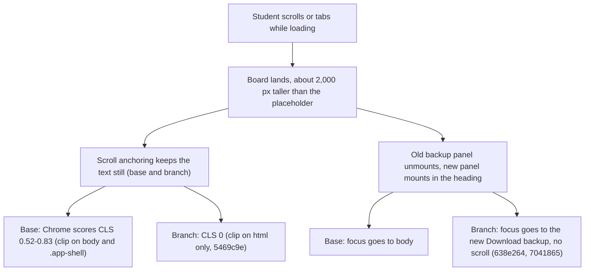

# Issue #147 review: project manager (round 1)

- Issue: johnyuencm/CoursesPlanner#147. Branch: `fix/147-load-scroll-focus`.
- Diff: `git diff origin/master...0623f7c` (4 commits, 7 files).
- Evidence read: the diff, `docs/reviews/2026-11-21-issue147-verification.md`, `docs/reviews/2026-11-20-144-user_advocate.md` (branch `fix/144-planner-cls`), the issue text.
- Own check: `npx tsx --test tests/planner-load-focus.test.ts tests/planner-page.test.ts` at `0623f7c`: 11 pass, 0 fail.
- Round 1 is independent. The tech_lead file `docs/reviews/2026-11-21-147-tech_lead.md` was not on the branch when I wrote this.

## Verdict

PASS. All three acceptance criteria are met at 390 px with recorded evidence. No high finding. One medium finding is about the report text at close, not about the code.

## Per-criterion map

| # | Criterion | State | Evidence |
|---|---|---|---|
| 1a | At 390 px, a student who scrolls while the catalog loads keeps their scroll position | met | Verification record, 390x844 table: "wheel", "bottom", "tabscroll" rows. Text on screen moves 0 px, Boston and Seattle, 3 runs each. Also 0 px on the base (see S1). |
| 1b | At 390 px, a student who tabs while the catalog loads keeps their focus | met | `components/planner-board.tsx:250-253` reads focus in the loading wrapper during render. `components/plan-backup.tsx:79-82` moves focus to the new "Download backup" with `preventScroll`. Record: "tab" and "tabscroll" rows, focus body to "Download backup". "Download backup" is the only enabled control in the panel while loading: "Restore backup" is off (`lib/plan.ts:761-763`, `catalogBusy` gives false). So "the same control" is exact for the load case. |
| 2 | CLS stays at 0.1 or below in that case | met | `app/globals.css:831-834`. Record, 390x844: wheel, bottom, tabscroll, tab25 go from 0.11-0.83 to 0. "tab" stays 0.004. Also 0 at 360 px. 1280 px unchanged within 0.0006. |
| 3 | A test or a recorded live check covers it | met | `tests/planner-load-focus.test.ts:13-42` (focus, real provider and board, stub `fetch`). `tests/planner-page.test.ts:180-187` (CSS guard). Live record with method, 140 runs, 0 page errors. Both tests pass at `0623f7c` (own run). Red runs are claimed in the record. I did not repeat the red runs. |

## Is "keeps their scroll position" true for the student?

Yes. The student sees content, not `scrollY`.

- On the branch, the "How the planner works" heading stays at the same viewport y in every frame (315 to 315, 765 to 765). `scrollY` grows by the board height (900 to 2955) because the board lands above the text. That is the correct result: the content under the reader does not move.
- The other reading, "keep `scrollY` the same", is the `overflow-anchor: none` test in the record. Then the text jumps 2,055 px. That is the real jump that the issue is afraid of.
- So criterion 1a is met in the sense that matters to the student.

But the issue premise was wrong. The #144 walk read `scrollY` (755 to 2964) as "the page jumps to the bottom". The record shows the text did not move on the base either. The only defect in U1 was the CLS score. See S1.

## Design alignment

- No `design.md` or `implementation-plan.md` for #147. The design to keep is the #144 and #145 layout: placeholder one screen tall, loading state before the backup panel, Try again first.
- The fix keeps both layouts. It does not fork them. The #145 checks are kept: "retry" rows give focus h1 and the same CLS on base and branch.
- The focus hand-off copies an existing method (the toast in `app-shell.tsx`, as the record says). It is not a new pattern.

## Goal alignment and cheaper options

- The change is small: 6 lines of CSS, about 15 lines of product code, 2 tests. It is on goal.
- Cheaper option for focus: one panel instance in both states. That changes the #145 layout or the board heading, so it is larger and a product decision. The implementer is right not to do it here.
- Cheaper option for CLS: none smaller than removing two clip rules that clip nothing today (record: 0 px sideways overflow on 9 pages at 6 widths).
- No gold-plating. The `tests/fake-dom.ts` additions (`options`, `setTimeout`) are the minimum to render the loaded board.

## Scope honesty

- No TODO in the diff. No deleted test. No mocked product behavior: the test stubs only `fetch`, the system boundary.
- The CSS test (`tests/planner-page.test.ts:180-187`) checks the CSS text, not layout. That is honest: the comment and the record say the fake DOM has no layout, and the live record covers CLS.
- Not checked, and named in the record: real phones, iOS Safari, a screen reader, programs other than Boston and Seattle.

## Open decisions: block or follow-up?

| # | Decision | Blocks #147? | Follow-up issue? |
|---|---|---|---|
| 1 | The CSS works around a Chromium CLS scoring defect | No. CLS is the score that field data uses, so the fix has real value. A test guards it. | No. Name it in the close comment. A revert of `5469c9e` alone is documented. |
| 2 | Focus moves with no scroll, so after Tab then scroll the focused button can be off screen | No. This is what a browser does when a focused element moves. The next Tab shows "Restore backup" (record: `scrollY` 2504 to 0, button at y 306). The criterion asks to keep focus and scroll. Both are kept. To scroll to the button would break 1a. | No. Name it in the close comment. |
| 3 | One panel instance for both states is not done | No. The hand-off meets the criterion. | No new issue now. Open one only if the product owner wants one panel place. Reason it can wait: the hand-off is correct while "Download backup" is the only enabled control in the loading panel. |

None of the three needs a human before close. All three need one line each in the close comment.

## Trade-offs and risk surface

| Risk | Mitigation | State |
|---|---|---|
| A later change makes content wider than the screen at 860 px or less. `html` still stops a user sideways scroll, but script or focus can scroll sideways, and iOS Safari before 16 can pan. | Record checks 0 px overflow on 9 pages at 6 widths. Comment at `app/globals.css:831-832`. | Named, accepted. |
| Someone adds `overflow: clip` to another selector. The CLS score comes back. | `tests/planner-page.test.ts:180-187` fails. | Mitigated. |
| A future enabled control in the loading panel (for example the outage checkbox, if the board can land from the failed state without Try again) gets focus on it, then the board lands. Focus goes to "Download backup", not to that control. | None. Today only "Download backup" is enabled while loading, and the failed state goes to the board only through Try again, which moves focus to h1 (#145). | Low. Not a #147 defect. |
| Screen reader with a virtual cursor may not follow the DOM focus move the same way. | None. Not checked. | Named in the record as not checked. |

## Findings

### High

None.

### Medium

- **M1 (report honesty at close).** The issue body says "the page jumps to the bottom". The record shows the visible content never jumped, on the base or on the branch. The CSS fix changes only the CLS score. The PR body and the issue close comment must say this, so nobody thinks a visible jump was fixed. They must also name the three open decisions and the not-checked list (real phones, iOS Safari, screen reader). Evidence: record "Result" note and "Cause 2"; `docs/reviews/2026-11-20-144-user_advocate.md:83`.

### Low

- **L1.** The focus test red run and the CSS test red run are claimed in the record. I did not repeat them. The green runs pass at `0623f7c`.
- **L2.** `tests/planner-page.test.ts:186` uses `deepEqual(clipped, ["html"])`. A later needed clip on any element (for example an inner card) fails this test even when it is not an ancestor of moved text. The failure message points to the record, so the cost is small.
- **L3.** At 1280 px, "retry" sums to 0.111 (base 0.111). It is the same on the base and outside the 390 px criterion. Each event alone is below 0.1 (record note). No action for #147.
