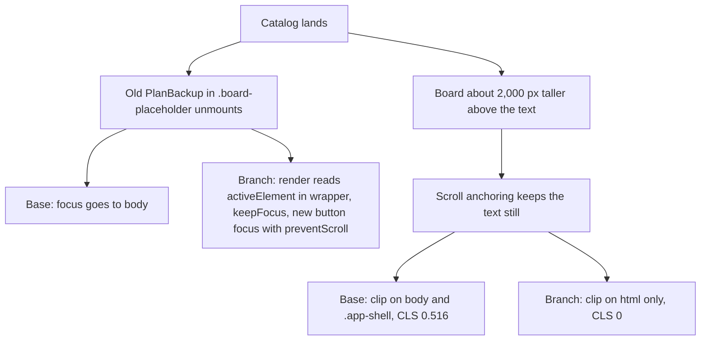

# Issue #147 review: tech lead (round 1)

- Issue: johnyuencm/CoursesPlanner#147. Branch: `fix/147-load-scroll-focus`.
- Diff: `git diff origin/master...0623f7c` (4 commits, 7 files). Product head: `7041865`.
- I did not write this code. I did not change product files.

## Verdict

PASS. No high finding. No medium finding. Both root causes are correct. I reproduced the main CLS number and the two red runs myself.

## Own checks

| Check | Result |
|---|---|
| Focus test, product code with `<PlanBackup />` (no `keepFocus`) in a temporary worktree | Fails: "focus stays on Download backup, not on BODY". |
| Focus test at `0623f7c` | Passes. |
| CSS test with `app/globals.css` from `origin/master` | Fails: "only html clips sideways overflow". |
| Minimal page, no app code, Chromium (Playwright 1.63), wheel scroll past a 844 px placeholder, then a 3,000 px board replaces it | Text stays still in all cases. CLS: no clip 0, `html` clip 0, `body` clip 0, `.shell` clip 1.0, `html,body` clip 1.0. Same at 390 and 1280 px. |
| Live, branch build, `wrangler dev` on 127.0.0.1:3000, Boston planner, 390x844, catalog delayed 3 s | none 0.004; wheel `scrollY` 900 to 2955, CLS 0; focus on Download backup: kept; focus on `main h1`: kept (not stolen). |
| Live, same build, old clips put back with a style tag | wheel CLS 0.5163. Same as the record. |
| Live, sideways overflow, 5 pages (overview, explore, planner, courses, pathways) at 320, 390, 860 px | 0 px on each page. |

The server and the temporary worktree are removed. Scripts stayed in the session scratchpad.

## Root cause review

### Focus (U2)

- Correct. React keeps a component only at the same tree place. The panel is under the loading wrapper, then in the heading. So the focused button leaves the DOM.
- The render-phase read (`components/planner-board.tsx:250-253`) is safe here:
  - On the render where `catalog` first becomes truthy, `waiting.current` still points to the old wrapper. The commit has not detached the ref yet.
  - On later renders, the ref is null, so `keepFocus` is false and the effect does nothing.
  - On the server, `waiting.current` is null. Optional chaining stops before `document.activeElement` is read. The build prerenders with no error.
  - `setCatalog` comes from a promise (`components/app-provider.tsx:205`), not from a transition. So React does not time-slice this render, and focus cannot change between render and commit.
  - `components/app-shell.tsx` already uses the same method (`contains(document.activeElement)`). It is not a new pattern.
- Focus steal: the fix moves focus only when focus was inside the wrapper. The whole wrapper leaves the DOM, so that focus is lost anyway. A live focus outside the wrapper is never moved. My live check with focus on `main h1` (the #145 Try again target) kept focus on `h1`.
- One panel instance for both states would be cleaner. But it changes the #145 layout or the board heading. I agree with the implementer and the project manager: not in this ticket.

### Scroll and CLS (U1)

- Correct. The text did not move on the base. Only the CLS score was wrong.
- My minimal page shows the trigger exactly: Chrome counts the anchoring adjustment as layout shift when an element that is not the viewport has `overflow-x: clip` above the moved content. `body` alone does not trigger it, because `body` overflow goes to the viewport when `html` is `visible`. With `html` clipped, `body` keeps its own clip, so `html,body` triggers it. This matches the record ("clip removed from `html` only" still gives 0.516).
- The fix (`app/globals.css:831-834`) is the smallest one. `html` overflow goes to the viewport, so a user still cannot scroll sideways.

## Regressions

| Area | Result |
|---|---|
| #145 Try again focus to `main h1` | Kept. `h1` is outside the wrapper. Record "retry" rows and my `h1` check. |
| #144 no-input CLS | Same as base (0.004 at 390 px, my run and the record). |
| 1280 px | No clip rule there before or after. Record shows the same values within 0.0006. |

## Findings

### High

None.

### Medium

None.

### Low

- **TL-L1. Focus moves one frame late.** `components/plan-backup.tsx:80-82` uses `useEffect`, which runs after paint. For one frame, focus is on `body`. A screen reader can announce the document before the button. `useLayoutEffect` would move focus before paint. Not checked with a real screen reader (the record also says this).
- **TL-L2. Less protection against sideways overflow.** `app/globals.css:833`. Today no page overflows (record: 9 pages, 6 widths; my run: 5 pages, 3 widths). If a later change makes content wider than the screen, a script or a focus move can scroll the page sideways. iOS Safari before 16 ignores `clip` on the base too, so that is not new. Disclosed in the record and in the CSS comment.
- **TL-L3. The CSS test is a text check and is strict.** `tests/planner-page.test.ts:180-187` forbids `overflow: clip` on any selector. The Chrome defect needs only an ancestor of the moved content, so a clip on an inner card would fail the test with no real CLS. It can never pass falsely, so it is safe. Same as PM L2.
- **TL-L4. Focus target is always "Download backup".** If focus was on another control in the old wrapper, focus goes to "Download backup". Today "Download backup" is the only enabled control while loading (PM evidence: `lib/plan.ts:761-763`). The failed state reaches the board only through Try again, which moves focus to `h1` first. So this has no effect today.

## Debate round 1 (with project_manager, `docs/reviews/2026-11-21-147-project_manager.md`)

| PM finding | My position |
|---|---|
| M1: the close text must say the visible content never jumped, only the CLS score changed, and name the 3 decisions and the not-checked list | Concede. My live run agrees: the text stays still on the base too. This is a close-comment item, not a code item. |
| L1: red runs not repeated | Resolved. I repeated both red runs (see "Own checks"). Both fail on the old code and pass on the branch. |
| L2: CSS test is strict | Agree. Same as TL-L3. Low. |
| L3: 1280 px retry 0.111 | Agree. Same on the base. Outside the 390 px criterion. |

Both seats are PASS. No high finding is open. No more rounds are needed.
