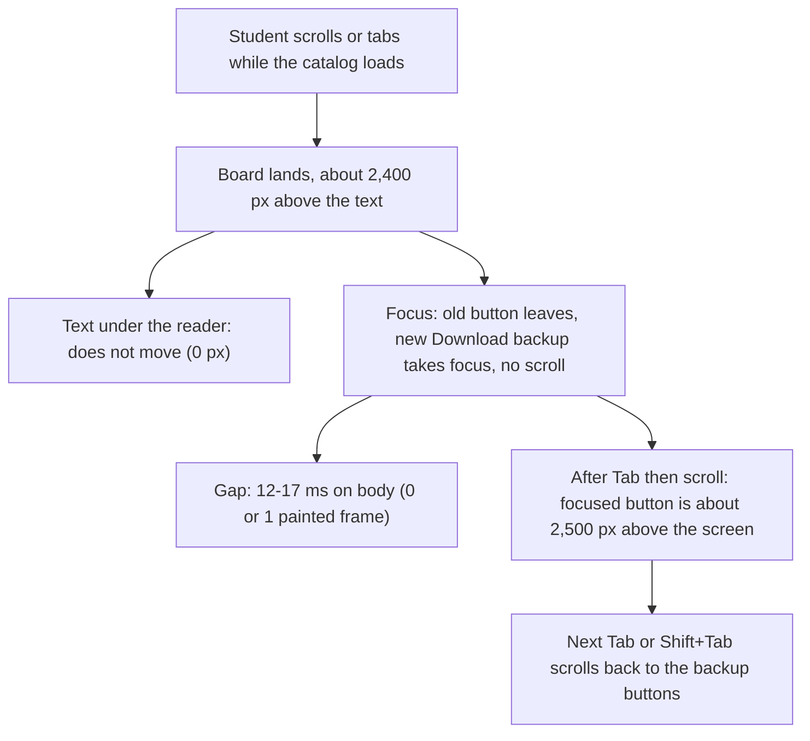

# Issue #147 review: user advocate (phase 2, last seat)

- Issue: johnyuencm/CoursesPlanner#147. Branch: `fix/147-load-scroll-focus`.
- Diff: `git diff origin/master...0623f7c`. Product commit: `7041865`.
- Read: `docs/reviews/2026-11-21-147-tech_lead.md`, `docs/reviews/2026-11-21-147-project_manager.md`, `docs/reviews/2026-11-21-issue147-verification.md`.
- I did not change product files.

## Verdict

PASS. The student keeps the text they read and keeps keyboard focus when the board lands. No high finding. No medium finding. TL-L1 (`useLayoutEffect`) does not need a fix before the PR.

## Live walk

Method:

1. `npm run build` at `0623f7c` product files. Then `wrangler dev --config dist/server/wrangler.json --port 3000 --ip 127.0.0.1`. Local only. No deploy.
2. Playwright Chromium. Fresh context for each run. `isMobile`, touch, scale 3. Seattle planner (`/northeastern/computer-science-mscs-sea-8b0d00dbda/planner`).
3. Route `**/api/catalog**` with a 2.5 s delay. For "retry", abort the first request (`internetdisconnected`), then Enter on "Try again".
4. Log `focusin`, `focusout`, changes in `role=status` and `aria-live` regions, painted frames with focus on `body`, and CLS without recent input.
5. I stopped the server after the walk. Scripts stayed in the session scratchpad.

| Width | Scenario | `scrollY` | Text "How the planner works" on screen | Focus after land | Focused button on screen | CLS |
|---|---|---|---|---|---|---|
| 390x844 | wheel (6 x 150 px) | 900 to 3267 | 315 to 315 | body (not moved, correct) | n/a | 0 |
| 390x844 | tab (12 Tab) | 0 to 0 | below the fold | Download backup | yes (y 306) | 0.004 |
| 390x844 | tabscroll (12 Tab, 3 x 150 px) | 450 to 2817 | 765 to 765 | Download backup | no (y -2511) | 0 |
| 390x844 | retry (#145) | 0 to 0 | below the fold | `main h1` | yes (y 195) | 0.0262 |
| 360x640 | wheel | 900 to 3595 | 127 to 127 | body (not moved, correct) | n/a | 0 |
| 360x640 | tab | 0 to 0 | below the fold | Download backup | yes (y 322) | 0.0065 |
| 360x640 | tabscroll | 450 to 3145 | 577 to 577 | Download backup | no (y -2823) | 0 |
| 360x640 | retry (#145) | 0 to 0 | below the fold | `main h1` | yes (y 211) | 0.0318 |

Other live facts:

- Sideways overflow: 0 px in all 8 runs.
- Focus gap: `focusout` on the old button (`relatedTarget` null) to `focusin` on the new button is 12 to 17 ms. In 1 of 6 Tab runs, one frame painted with focus on `body`.
- After land, the new button matches `:focus-visible`. The focus ring shows. Accessible name: `button "Download backup"` in the group "Plan backup".
- After tabscroll, the next Tab goes to "Restore backup" and Shift+Tab goes back to "Download backup" at y 306, `scrollY` 0. So the keyboard user can find focus again with one key.
- No live region announces "the board loaded". The `role=status` "Loading the course map" region is removed. This is the same on `origin/master`. It is not in the scope of #147.

### Stress walk (`designing-ux-mechanics/stress-walk.mjs`, planner board, 2.5 s delay)

| # | Check | Target | Result | Detail |
|---|---|---|---|---|
| D1 | No empty state before the first answer | Planner board | PASS | skeleton, cache or loading shown |
| M1 | No layout shift when data lands (CLS ≤ 0.1) | Planner board | PASS | CLS 0.004 |
| L1 | At most one layer over a screen | all walked steps | PASS | never more than one |

3 PASS, 0 FAIL. The change has no new screen, no layer and no send, so N2, N3, A1 and A2 have no target.

### Manual checklist (`checklist.md`)

| # | Result | Reason |
|---|---|---|
| N1, N2, N4, N5, N6 | NOT TESTED | The change adds no navigation. |
| N3 | NOT TESTED | No send flow in the change. |
| L1 | PASS | Stress walk. No layer in the change. |
| L2, L3, L4 | NOT TESTED | No layer in the change. |
| D1 | PASS | Stress walk. The loading state shows, not the failure card. |
| D2, D5 | NOT TESTED | No cache or offline change. |
| D3 | PASS | CLS 0 to 0.0065 on scroll and Tab paths. Text moves 0 px. |
| D4 | PASS | Abort path: failure card with "Try again". Focus goes to `main h1` after retry (#145 kept). |
| A1 to A6 | NOT TESTED | No send action in the change. |
| M1 | PASS | Text under the reader moves 0 px at 390 and 360 px. |
| M2 to M5 | NOT TESTED | No count, transition or animation in the change. |

## Screen reader: what the student hears

Not tested with a real screen reader (VoiceOver, TalkBack, NVDA). Evidence is from DOM events only.

- Before the fix, focus fell to `body`. A screen reader then reads from the page top or says nothing. The user loses their place. This is the real defect, and the fix removes it.
- After the fix, focus goes to a new element with the same name. Most screen readers say "Download backup, button" again. That is a small repeat. It is also honest feedback that something changed.
- The 12 to 17 ms on `body` is shorter than the focus-event debounce of common screen readers. An announcement of the document in that gap is possible but unlikely.
- Decision on TL-L1: do not block the PR. `useLayoutEffect` would remove the gap, and it is a one-word change. But the gap is not audible in the evidence I have, and no real screen reader run exists to prove a difference. Keep it as a low item.

## Shneiderman rules

| Rule | Note |
|---|---|
| Consistency | Same method as #145 (focus to a stable element when its control leaves). Same button text in both states. |
| Shortcuts for frequent users | No change. The Tab order is the same. |
| Informative feedback | Focus ring stays on "Download backup". No "board loaded" announcement (base behavior, out of scope). |
| Closure | Loading state ends with the board. The keyboard user ends on the same control. |
| Simple error handling | Abort path keeps "Try again" first and moves focus to `main h1`. |
| Easy reversal | Not affected. |
| Internal locus of control | Good. The page does not scroll the student. It does not steal focus that is outside the loading area. |
| Short-term memory load | Good. The student does not need to remember where they were. Text and focus stay. |
| Clarity, hierarchy | No visual change. |
| Accessibility | Keyboard: focus kept, ring visible. Not color-only. Screen reader: not tested live. |

## Findings

### High

None.

### Medium

None.

### Low

- **UA-L1. Focus after Tab then scroll is far off screen.** Live: 390 px tabscroll, focused button at y -2511 (360 px: y -2823). A sighted keyboard user who scrolls with a wheel or touch does not see the focus ring. One Tab or Shift+Tab brings it back. This is the normal browser rule when content lands above, and scrolling to the button would break the "keep my place" goal. Same as PM decision 2. Name it in the close comment.
- **UA-L2. One painted frame with focus on `body` (TL-L1 confirmed live).** 1 of 6 Tab runs. Gap 12 to 17 ms. `components/plan-backup.tsx:80-82`. Not a blocker. See "Screen reader" above.
- **UA-L3. No announcement when the board lands.** The `role=status` loading region goes away with no "loaded" message. Same on `origin/master`. Out of scope for #147. A screen reader user who stays on "Download backup" gets no cue that the board is there.

## Does it solve the job?

Yes. On a phone at 390 and 360 px, the student who scrolls keeps the text they read. The student who tabs keeps focus on "Download backup". The #145 failure path still works. CLS is 0 on the scroll paths.
