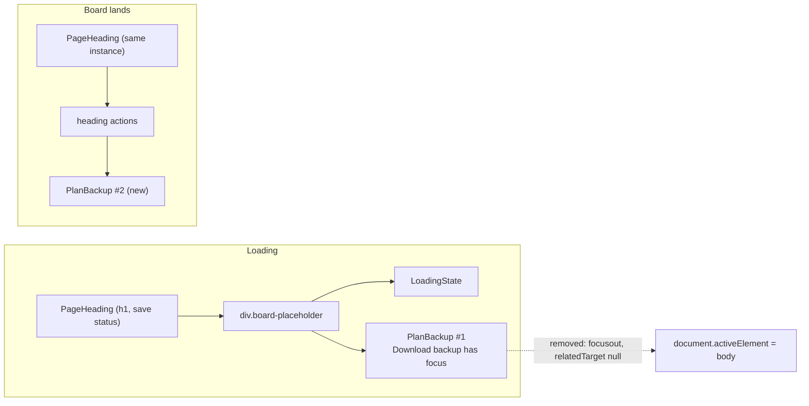

# Issue #147 verification: scroll and focus while the catalog loads

- Issue: #147. Sources: `docs/reviews/2026-11-20-144-user_advocate.md` (U1 scroll jump, U2 focus loss) and the #144 and #145 verification records (method).
- Base: `master` `5feabe7` (#140, #144 and #145 merged). Branch: `fix/147-load-scroll-focus`. Product head: `7041865`.
- Date: 2026-11-21. Node 22.23, Linux cloud container, Playwright 1.63, Chromium 153.

## Result

| Acceptance item (390 px) | Base `5feabe7` | Branch `7041865` |
|---|---|---|
| A student scrolls into the page text while the catalog loads: the text on screen when the board lands | Same place (moves 0 px) | Same place (moves 0 px) |
| CLS in that case | 0.516 (Boston), 0.612 to 0.832 (Seattle) | 0 |
| A student tabs to "Download backup" while the catalog loads: focus when the board lands | `body` | "Download backup" |
| A student tabs 25 times (the #144 walk): CLS | 0.516 (Boston), 0.832 (Seattle) | 0 |
| A test or a recorded live check | none | 2 tests and this record |

The page did not jump on screen on the base either. The #144 walk read `scrollY` (755 to 2964), and `scrollY` grows because Chrome keeps the text in place. Only the CLS score was wrong. See "Cause 2".

## Cause 1: focus goes to the body (U2)

The planner board shows the backup panel in two places. While the catalog loads, the panel is under the loading state (#145). After the board lands, the panel is in the heading. React keeps a component only at the same place in the tree. So React removes the old panel and mounts a new one, and the focused button leaves the page.



Evidence (Boston, 390x844, catalog delayed 2.5 s, 12 Tab presses):

| Time (ms) | Event |
|---|---|
| 276 | `focusin` on "Download backup" in `div.board-placeholder` |
| 2716 | `focusout` on "Download backup", `relatedTarget` null |
| 2719 | `.semester-board` is in the page |
| 2719 + 1800 | `document.activeElement` is `body` |

No app code calls `focus()`, `scrollIntoView()` or `scrollTo()` on a normal load. The probe wrapped these functions and logged no call. The #145 code (focus to `main h1` after Try again) runs only on a Try again press.

## Cause 2: CLS 0.52 to 0.83, but the text does not move (U1)

1. The student scrolls to the page text. Then the board replaces the one-screen placeholder (#144), and the board is about 2,000 px taller.
2. Chrome scroll anchoring keeps the text still: it adds the board height to `scrollY` in the same frame. A sample of each animation frame shows the "How the planner works" heading at the same viewport y in every frame (315, 315, 315).
3. Chrome still reports a layout shift of 0.516. The sources are `div.static-page` and `footer.workspace-footer`, with an empty `previousRect`.
4. At 860 px and less, `html`, `body` and `.app-shell` had `overflow-x: clip`. In the tests below, Chrome counts the anchoring adjustment as layout shift for the boxes under an element with overflow clip. I tested clips on ancestors of the moved text only.

| Test (Boston, 390x844, wheel scroll to the page text) | `scrollY` | Heading on screen | CLS |
|---|---|---|---|
| Base CSS | 900 to 2955 | 315 to 315 | 0.516 |
| `html { overflow-anchor: none }` (anchoring off) | 900 to 900 | 315 to 2370 (a real jump) | 0.516 |
| No `overflow-x: clip` on `html`, `body`, `.app-shell` | 900 to 2955 | 315 to 315 | 0 |
| Clip removed from `html`, `body` or `.app-shell` only, or from `html` and `body` (4 tests) | 900 to 2955 | 315 to 315 | 0.516 |
| Clip on `html` only | 900 to 2955 | 315 to 315 | 0 |
| 860x900, the narrow layout with the clips | 705 to 2204 | 545 to 545 | 0.292 |
| 861x900, the wide layout with no clips | 532 to 1449 | 609 to 609 | 0.0002 |

The same happens on a small page with no app code. A placeholder before the page text is replaced by a 3,000 px board while the reader is at the page text:

| Viewport | Wrapper with `overflow-x: clip` | `scrollY` | Text on screen | CLS |
|---|---|---|---|---|
| 390x844 | no | 848 to 3004 | 328 to 328 | 0 |
| 390x844 | yes | 848 to 3004 | 328 to 328 | 0.649 |
| 1280x900 | no | 848 to 2948 | 384 to 384 | 0 |
| 1280x900 | yes | 848 to 2948 | 384 to 384 | 0.609 |

So the browser keeps the view still, but its CLS score is wrong under an `overflow: clip` ancestor. The trigger is in the app CSS. CLS is the Chromium score that field data (Core Web Vitals) uses, so the false score counts for real users.

The Tab case of the #144 walk is the same cause. At 390 px, 25 Tab presses go through the links in the page text, so the page scrolls to its end. Then focus goes back to the top bar (sticky) and the bottom bar (fixed). The board lands while the page is at its end.

## Fix

| Commit | Change | File |
|---|---|---|
| `638e264` | The board reads focus during render, before the commit removes the old panel. This is the method of the toast in `app-shell.tsx`. A ref on the loading wrapper tells if focus is in it. The new panel gets `keepFocus`. | `components/planner-board.tsx`, `components/plan-backup.tsx`, `tests/planner-load-focus.test.ts`, `tests/fake-dom.ts` |
| `5469c9e` | At 860 px and less, only `html` has `overflow-x: clip`. The viewport takes the overflow of `html`, so a sideways page scroll stays off. `body` and `.app-shell` do not clip. | `app/globals.css`, `tests/planner-page.test.ts` |
| `7041865` | The new panel calls `focus({ preventScroll: true })`, not `autoFocus`. | `components/plan-backup.tsx` |

```mermaid
sequenceDiagram
  participant R as React render
  participant C as React commit
  participant B as Browser
  R->>R: catalog arrives; is document.activeElement in the loading wrapper? yes
  C->>B: remove the old panel (focus goes to body)
  C->>B: add the board and the new panel in the heading
  B->>B: scroll anchoring keeps the page text still (no CLS now)
  C->>B: new panel effect: Download backup.focus({ preventScroll: true })
```

### Judgment calls

1. Same React identity for the panel: not done. The panel would need one place in both states. Under the loading state is the #145 layout (Try again first, the panel does not move at a failure). In the heading is the board layout. To change either is a product decision. The focus hand-off keeps both layouts.
2. No scroll on the focus move. The browser does the same when a focused element moves: focus stays and the view does not move. With `autoFocus` (first version, `638e264`), a student who tabbed to the button and then scrolled to y 450 went back to y 0. Now the view stays, and focus is on "Download backup" in the heading. That button can be out of view. The next Tab goes on from it to "Restore backup", and the browser shows that button (390 px: `scrollY` 2504 to 0, button at y 306).
3. The CSS change works around a Chromium scoring defect. It removes two rules that clip nothing today: 9 pages at 6 widths have 0 px sideways overflow without them. Risk: if a later change makes content wider than the screen, `html` still stops a sideways scroll by the student. But a script or a focus move can then scroll the page sideways, and iOS Safari before 16 can pan it. To keep the old CSS, revert `5469c9e` alone. Then the view still stays still, but Chrome reports CLS 0.52 to 0.83 in this case.

## Method

The #144 and #145 method:

1. `npm run build`. Then `wrangler dev --config dist/server/wrangler.json --port 3000 --ip 127.0.0.1`. Local only, no deploy.
2. Base: a worktree of `5feabe7` in `.worktrees/`, `npm run build`, `wrangler dev` on port 3001.
3. Use a fresh browser context for each run. 390x844 and 360x640 with touch, `isMobile` and scale 3. 1280x900 without.
4. Delay `**/api/catalog**` by 2.5 s with a Playwright route. For "retry", abort the first request (`internetdisconnected`).
5. Wait until "Download backup" is on (the plan is read), then do the scenario. Wait until `.semester-board` is visible, then 1.8 s.
6. CLS: the sum of `layout-shift` entries without recent input (the observer of `stress-walk.mjs`).
7. Also log: `scrollY`, the viewport y of "How the planner works" in each animation frame, `focusin` and `focusout`, and each call of `focus()`, `scrollIntoView()` and `scrollTo()`.
8. Runs: 3 at 390 px, 1 at 360 and 1280 px. The 3 runs at 390 px gave the same CLS each time. The base matrix ran two times (before the change, and with the final probe). The tables show the second run. The two runs agree to 0.0001.
9. The scripts and screenshots stayed in the session scratchpad. I stopped the servers.

| Scenario | What the student does while the catalog loads |
|---|---|
| none | nothing |
| wheel | scrolls 6 x 150 px with the mouse wheel, into the page text |
| bottom | scrolls to the page end |
| tab | presses Tab until "Download backup" has focus (12 presses at 390 and 360 px, 15 at 1280 px) |
| tabscroll | tab, then scrolls 3 x 150 px with the mouse wheel |
| tab25 | presses Tab 25 times (the #144 walk) |
| retry | the first load fails, then Enter on "Try again" (#145) |

## Results

"Text" is the viewport y of the "How the planner works" heading before and after the board lands. "Moves" is the largest change of that y in the frames after the board lands, when the heading was in view.

### 390x844 (3 runs each, same CLS in each run)

| Program | Scenario | `scrollY` | Text (moves) | Focus, base | Focus, branch | CLS, base | CLS, branch |
|---|---|---|---|---|---|---|---|
| Boston | none | 0 to 0 | below the fold | body | body | 0.004 | 0.004 |
| Boston | wheel | 900 to 2955 | 315 to 315 (0) | body | body | 0.5163 | 0 |
| Boston | bottom | 910 to 2965 | 305 to 305 (0) | body | body | 0.5163 | 0 |
| Boston | tab | 0 to 0 | below the fold | body | Download backup | 0.004 | 0.004 |
| Boston | tabscroll | 450 to 2505 | 765 to 765 (0) | body | Download backup | 0.1112 | 0 |
| Boston | tab25 | 900/904/906 to 2965 | 315/311/309 to 305 (4 to 10) | "Paths" link | "Paths" link | 0.5163 | 0 |
| Boston | retry | 0 to 0 | below the fold | h1 | h1 | 0.0262 | 0.0262 |
| Seattle | none | 0 to 0 | below the fold | body | body | 0.004 | 0.004 |
| Seattle | wheel | 900 to 3267 | 315 to 315 (0) | body | body | 0.6116 | 0 |
| Seattle | bottom | 1399 to 3767 | above the view | body | body | 0.8321 | 0 |
| Seattle | tab | 0 to 0 | below the fold | body | Download backup | 0.004 | 0.004 |
| Seattle | tabscroll | 450 to 2817 | 765 to 765 (0) | body | Download backup | 0.1112 | 0 |
| Seattle | tab25 | 1331 to 3767 | above the view | "Courses" nav link | "Courses" nav link | 0.8321 | 0 |
| Seattle | retry | 0 to 0 | below the fold | h1 | h1 | 0.0262 | 0.0262 |

In "tab25", the 4 to 10 px move is the smooth scroll of the last Tab press. It ends while the board lands, on the base too.

### 360x640 and 1280x900 (1 run each)

| Program | Scenario | CLS 360, base | CLS 360, branch | CLS 1280, base | CLS 1280, branch | Focus after the landing, base / branch (360 and 1280) |
|---|---|---|---|---|---|---|
| Boston | none | 0.0065 | 0.0065 | 0.0269 | 0.0268 | body / body |
| Boston | wheel | 0.71 | 0 | 0 | 0 | body / body |
| Boston | bottom | 0.71 | 0 | 0 | 0.0001 | body / body |
| Boston | tab | 0.0065 | 0.0065 | 0.0268 | 0.0274 | body / Download backup |
| Boston | tabscroll | 0.1225 | 0 | 0 | 0 | body / Download backup |
| Boston | tab25 | 0.71 | 0 | 0 | 0 | "Paths" link, "Status overview" link / "Paths" link, "Status overview" link |
| Boston | retry | 0.0318 | 0.0318 | 0.1111 | 0.1111 | h1 / h1 |
| Seattle | none | 0.0065 | 0.0065 | 0.0242 | 0.0242 | body / body |
| Seattle | wheel | 0.7788 | 0 | 0.0001 | 0 | body / body |
| Seattle | bottom | 0.7946 | 0 | 0 | 0 | body / body |
| Seattle | tab | 0.0065 | 0.0065 | 0.0242 | 0.0248 | body / Download backup |
| Seattle | tabscroll | 0.1225 | 0 | 0 | 0 | body / Download backup |
| Seattle | tab25 | 0.7946 | 0 | 0 | 0 | "Courses" nav link, skip link / "Courses" nav link, skip link |
| Seattle | retry | 0.0318 | 0.0318 | 0.1086 | 0.1085 | h1 / h1 |

Notes:

- At 360 and 1280 px, the page text stays at the same viewport y in every scroll scenario, on the base and the branch.
- 1280 px, two runs of the same build differ by up to 0.0001.
- 1280 px "tab", 0.0268 to 0.0274: the shift sources are the same as in the #144 record (heading actions and heading text). With focus, the heading actions are 4 px larger on each side. The focus outline (2 px, offset 2 px) is ink overflow, and Chrome includes it in the shift rect. The layout does not change.
- 1280 px "retry", 0.1111 and 0.1085: the probe adds the shift at the failure (0.084 in the #145 record) and the shift when the board lands (0.027). Each event alone is below 0.1. The values are the same on the base. #147 does not change them.
- After the landing with keyboard focus, "Download backup" is in the heading at y 306 (390 px), 322 (360 px) and 85 (1280 px), in view, with a visible focus ring.
- "tabscroll": on the branch, focus stays on "Download backup", and the page text stays at the same viewport y (765 at 390 px). The button is now in the heading, out of view (judgment call 2).

## Other checks

| Check | Result |
|---|---|
| Sideways overflow, 9 pages (home, Boston overview, explore, planner, courses, a course page, paths; Seattle planner and explore) at 320, 360, 390, 414, 768 and 860 px | 0 px on the base, with the two clips removed by a style tag, with no clip at all, and on the branch build. Also 0 px with the plan menu open. `scrollTo(2000, y)` leaves `scrollX` at 0. |
| Built CSS | Base: `html,body{overflow-x:clip}` and `.app-shell{...;overflow-x:clip}`. Branch: `html{overflow-x:clip}` only. |
| Calls of `focus()`, `scrollIntoView()`, `scrollTo()` by the app on a normal load (base) | none |
| Page errors | 0 in all 140 runs |

## Tests

| Test | What it checks | Red run |
|---|---|---|
| `tests/planner-load-focus.test.ts` | The real provider and the board run in React's client renderer with a stub `fetch`. Focus on "Download backup" while the catalog loads is on "Download backup" after the board lands. | Before `638e264`: "focus stays on Download backup, not on BODY". It fails the same way when the board passes `keepFocus={false}`. |
| `tests/planner-page.test.ts`: "on a phone, only html clips sideways overflow ..." | `globals.css` has `overflow-x: clip` on `html` only. | On the old CSS: `body` and `.app-shell` also clip. |

`tests/fake-dom.ts` now has two more browser parts, so it can render the loaded board: `select.options`, and `setTimeout` and `clearTimeout` on the window (`next/link` waits for an idle moment through `self.setTimeout`). The test sets `self` to the fake window. The fake DOM has no layout, so the live walk checks scroll and CLS.

| Check | Result |
|---|---|
| `npm run typecheck` | exit 0 |
| `npm test` | exit 0, 372 pass, 0 fail (base 370, plus 2 new tests) |
| `npm run build` | exit 0, 387 routes prerendered |

## Not checked

- Real phones, real network throttling, and other browsers. Firefox and Safari do not report `layout-shift` entries, so CLS is a Chromium score.
- iOS Safari panning with sideways overflow. No page has sideways overflow now.
- Real screen reader output. I read focus in the DOM.
- Other programs. Boston (Map tier) and Seattle (Audit tier) are the two tiers.
