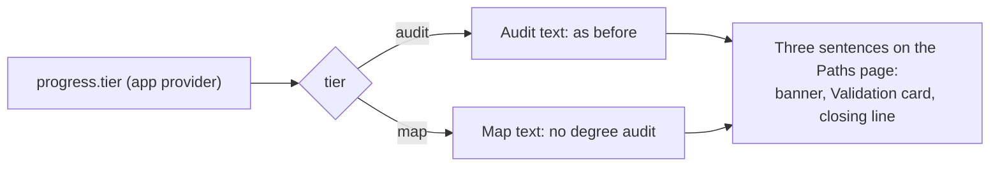

# Issue #138 verification: Paths page text on Map tier

- Issue: #138. Source: `docs/reviews/2026-11-20-126-tech_lead.md` ("I did not check the Paths page (follow-up #138)") and `docs/reviews/2026-11-20-126-project_manager.md`.
- Base: master `5feabe7`. Branch: `fix/138-map-tier-paths-text`.
- Date: 2026-11-27. Node 22.23, Linux cloud container, Chrome 153 through Playwright 1.63.

## Cause

A Map-tier program has no degree audit. The Paths page text did not depend on the tier. So the page told every program that a "credit audit" and a "modeled catalog audit" exist. #126 fixed the planner text only.

## Change

`components/pathways-workspace.tsx` reads `progress` from `useApp()`, as the planner does (#126). One flag, `audit`, picks the text of three sentences. The Audit-tier text does not change.

| Place on master | Before (both tiers) and after (Audit tier) | After (Map tier) |
|---|---|---|
| Banner, line 143 | Recommendations never change your official core, breadth, elective, or credit audit. Confirm course fit and availability with your advisor. | Recommendations never change your official degree requirements. Confirm course fit and availability with your advisor. |
| Validation card, line 170 | These recommendations do not change degree rules. Graduation status still comes only from the modeled catalog audit. | These recommendations do not change degree rules. The planner gives no degree audit for this program, so graduation status comes only from your official university audit. |
| Closing line, line 179 | Use these ideas as a starting point. Degree validation stays grounded in official catalog rules. | Use these ideas as a starting point. Check degree rules in the official catalog. |

After the change, these lines are 145, 172 and 181.

The first two rows are the two lines of the issue. The third row is a neighbor with the same claim: the planner validates a degree. It has its own commit pair (`79a96cd`, `f3c9691`). Revert that pair to keep only the two lines of the issue.

The Map text uses the two phrases that the acceptance allows: "no degree audit" and "official university audit". Both also appear in the planner. The Map-tier status card says "No degree audit". The plan-check notes say "require an official university audit" (`lib/validation.ts:407`).

## Neighbor check

Each user-visible sentence of `components/pathways-workspace.tsx` that names a degree rule, a requirement, a validation or an audit:

| Line on master | Text | Map-tier verdict |
|---|---|---|
| 50 | "These never change official degree rules." | Keep. It names the official rules, not an audit. |
| 108 | "Suggestions saved on this device. Degree requirements did not change." (toast) | Keep. |
| 122 | "Default suggestions restored. Your degree plan did not change." (toast) | Keep. |
| 143 | "Suggested persona — not a degree requirement." | Keep. |
| 143 | "...official core, breadth, elective, or credit audit." | Changed. |
| 170 | "...the modeled catalog audit." | Changed. |
| 179 | "Degree validation stays grounded in official catalog rules." | Changed. It claims a validation that a Map-tier program does not have. |
| 166, 174 | Map overlay and Next recommended courses cards | Keep. They name no rule and no audit. |

Other text on the Paths page, outside that file:

- `PathwayList` (`components/program-summary.tsx`): "It never changes the degree requirements." Keep.
- Page description (`app/[universityId]/[programId]/pathways/page.tsx`): no audit word. Keep.
- The new test reads both, so a new "audit" word in them fails the Map-tier test.

## Test seam

The issue fixes the seam. It is the render of the Paths page for one Map-tier key (MSCS Boston) and one Audit-tier key (MSCS Seattle). `tests/pathways-page.test.ts` renders `PathwaysPage` with a loaded catalog. It adds the page description. It reads the text nodes and the attributes that a person reads or hears, as the planner test does (#126).

- It catches: an "audit" word, or a false audit claim, in the Paths text of a Map-tier program. It also catches a lost Audit-tier text.
- It misses: text that shows only after a click (edit mode, toasts), the per-path pages (`/pathways/<id>`), and the shell footer.

`MAP_KEY` and the text step moved from `tests/planner-page.test.ts` to `tests/page-text.ts`. The two tests share them.

## TDD runs

| Step | Commit | Result |
|---|---|---|
| Shared test helper | `a2c47c9` | `tests/planner-page.test.ts`: 9 pass, 0 fail (same as before) |
| Red 1 | `26f32fc` | Audit test passes. Map test fails: the text still matches `/audit/i` ("credit audit", "modeled catalog audit"). |
| Green 1 | `bab23bb` | `tests/pathways-page.test.ts`: 2 pass, 0 fail |
| Red 2 | `79a96cd` | Audit test passes. Map test fails: the text still matches `/degree validation/i`. |
| Green 2 | `f3c9691` | `tests/pathways-page.test.ts`: 2 pass, 0 fail |

## Mutation checks

The product code was changed on purpose, then restored. Each change fails the right test.

| Mutation | Audit-tier test | Map-tier test |
|---|---|---|
| `audit = true` (every program shows Audit text) | pass | fail |
| `audit = false` (every program shows Map text) | fail | pass |
| Map banner says "official degree audit" | pass | fail |
| Map closing line keeps "Degree validation" | pass | fail |

## Checks

| Check | Result |
|---|---|
| `npm run typecheck` | exit 0 |
| `npm test` | exit 0, 372 pass, 0 fail. The base `5feabe7` has 370 pass, 0 fail. The 2 new tests are the difference. |
| `npm run build` | exit 0, 387 routes prerendered (2 skipped) |
| Lint | The repo has no lint script and no lint config. CI runs typecheck, test and build (`.github/workflows/ci.yml`). |

## Live walk (production runtime)

Method: `npm run build`, then `wrangler dev` on `127.0.0.1:3000` (local, no deploy). The walk used Chrome through Playwright. It aborted every request to a host other than `127.0.0.1`. It made none. It waited for `.recommendation-banner`, which shows after the catalog loads and the tier is known. It loaded the Paths page of each published program at 1280x900 and 390x844 (10 loads).

| Program | Tier | Banner, Validation card, closing line | "audit" in `main` | Console errors and warnings |
|---|---|---|---|---|
| MSCS Seattle | Audit | Same as master at both widths | 2 sentences, both unchanged ("credit audit", "modeled catalog audit") | none |
| MSCS Boston | Map | New text at both widths | 1 sentence: "no degree audit ... official university audit" | none |
| MSCS Align | Map | New text at both widths | 1 sentence, the same | none |
| Cybersecurity | Map | New text at both widths | 1 sentence, the same | none |
| Data Science (Portland) | Map | New text at both widths | 1 sentence, the same | none |

All 10 loads answered 200.

## Not changed on purpose

- #139 ("sources.."): not touched. The Paths page does not show a requirement reason.
- Two disclaimers say that the planner is not an audit. They are true on both tiers:
  - `components/app-shell.tsx:110`, the shell footer on every page: "A planning companion, not an official degree audit."
  - `app/[universityId]/[programId]/pathways/[id]/page.tsx:87`, the per-path pages: "This planner is an advising aid, not an official degree audit."

## Risk

1. The footer disclaimer shows on every Paths page. A strict reading of the acceptance ("does not say audit, except ...") counts the word "audit" in "not an official degree audit". The planner test (#126) does not render the shell either. A change to the footer touches every page of every program. It needs its own decision.
2. The three Map-tier sentences are new product copy. A reviewer may want other words.
3. `progress` is null only while the catalog is null. In that case the component returns before these lines. So the Map text cannot show by mistake while the catalog loads.
4. `tests/planner-page.test.ts` has 8 changed lines (2 added, 6 removed): the import, the removed `MAP_KEY`, and the last lines of `plannerText`. Another branch that edits those lines can conflict.

## Not checked

- Text that shows after a click (edit mode, toasts). None of it has an audit word. The grep of the component shows no other "audit" word (lines 140 to 181 only).
- A screen reader pass.
- A diff of the live Paths page on the base build. The red runs show the base text.
