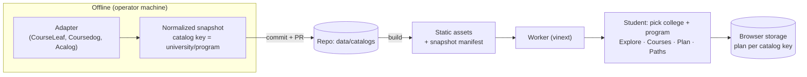

# Spec: expand CoursesPlanner to more programs and major US colleges

- Status: ready for agent. Date: 2026-11-07. Base: `master` `414536b`.
- Source reviews: [multi-program readiness](../reviews/2026-11-06-multi-program-readiness.md), [Workers port evaluation](../reviews/2026-11-06-workers-port-evaluation.md), [PR #54 review](../reviews/2026-11-07-pr54-review.md).
- Tracker: the GitHub issue that holds this spec, and the child tickets under it.

## Problem Statement

A student at a US college wants to see which courses unlock which, and to plan a degree term by term. Today CoursesPlanner only does this for one program: Northeastern MSCS Seattle.

- A student in another Northeastern program gets, at best, a read-only prerequisite map. No program other than MSCS Seattle is published.
- A student at MIT, Georgia Tech, UIUC or another major college gets nothing. 39 of 40 colleges in the university directory are `unverified`.
- The site name, page titles, URLs, saved plans and pathways all assume "NEU MSCS". A student from another program sees the wrong name and the wrong advice.
- The degree audit only understands the MSCS rule shape (core, breadth areas, elective credits). Most programs have other rule shapes.
- The course-code format `SUBJ 1234` is hardcoded. Codes such as MIT `6.1210` or CMU `15-122` are rejected as invalid.

## Solution

A student opens the site, picks a college and a program, and gets the same Explore, Courses, Plan and Paths experience that MSCS Seattle has today.

- Each program has a **support tier**:
  - **Map**: the prerequisite graph and course pages only.
  - **Audit**: Map plus a validated degree audit in Plan.
  
  The UI always shows the tier. It never claims an audit that the data cannot support.
- Plans are saved per program. Switching programs never mixes courses that share a code.
- Each program has its own URLs, titles and metadata. Search engines index real course text for every published program.
- The crawler supports more catalog platforms. It starts with **CourseLeaf**, which covers 8 of the 20 directory colleges, Northeastern included. Coursedog and Acalog come later.
- The site keeps running on Cloudflare Workers Free at $0. Snapshots come from static assets, not from the Worker bundle.

## User Stories

### Students: finding a program

1. As a student, I want to pick my college from a list, so that I see my own catalog.
2. As a student, I want to search colleges by name, so that I find mine fast in a long list.
3. As a student, I want to pick my program inside that college, so that the map shows only the courses my program uses.
4. As a student, I want to search programs by name and degree level, so that I find "Computer Science, BS" quickly.
5. As a student, I want the site to remember my last program, so that I do not pick it again on each visit.
6. As a student, I want each program page to show the catalog year, so that I know which edition the rules come from.
7. As a student, I want each program to show its support tier (Map or Audit), so that I know if the degree audit is real.
8. As a student, I want a clear message when my program is not supported yet, so that I know it is missing on purpose and not by error.
9. As a student, I want a link to the official catalog for every program and course, so that I can check the source.
10. As a student, I want a shareable URL for my program, so that I can send it to a classmate.
11. As a student, I want old Northeastern MSCS links to keep working, so that bookmarks and shared links do not break.

### Students: exploring courses

12. As a student, I want the Explore map to show my program's prerequisite graph, so that I see what each course unlocks.
13. As a student, I want course codes shown in my college's own format (for example `6.1210`, `15-122` or `CS 225`), so that they match my registrar.
14. As a student, I want to search a course by its code in my college's format, so that "15-122" and "15122" both find it.
15. As a student, I want each course page to show the course's prerequisites and corequisites in plain words, so that I understand them without reading catalog prose.
16. As a student, I want unparsed prerequisite text shown as-is and marked uncertain, so that the site never invents a rule.
17. As a student, I want cross-listed courses shown as one course with all of its codes, so that I do not plan the same class twice.
18. As a student, I want courses outside my program that are prerequisites shown as external placeholders, so that the chain is complete.
19. As a student, I want the Courses list to filter by requirement group, credits and eligibility, so that I can find options for a slot.
20. As a student, I want credit units shown the way my college counts them (semester hours, MIT units, quarter units), so that totals make sense.

### Students: planning and audit

21. As a student, I want my plan saved per program, so that switching programs never mixes courses.
22. As a student, I want my existing Northeastern MSCS plan moved over automatically, so that I lose no work after the upgrade.
23. As a student, I want to keep plans for more than one program, so that I can compare a major and a minor or two programs.
24. As a student in an Audit-tier program, I want live checks against my program's real rule groups, so that I know what is still missing.
25. As a student, I want rules such as "all of", "choose N courses from", "choose X credits from" and "at least M areas" to be checked, so that the audit fits my program.
26. As a student, I want a rule that the site cannot model to show as "check with your advisor", so that the audit never says "satisfied" without proof.
27. As a student in a Map-tier program, I want Plan to still check prerequisites and term order, so that I get value before a full audit exists.
28. As a student, I want terms that fit my college's calendar (semester or quarter, co-op or internship), so that my plan has the right shape.
29. As a student, I want to export and import my plan per program, so that I can move it to another device.
30. As a student, I want a clear warning when my plan was made for an older catalog edition, so that I know some rules may have changed.

### Students: pathways

31. As a student, I want career pathways for my program when they exist, so that I get course ideas for my goal.
32. As a student, I want the Paths tab hidden or marked empty when my program has no pathways, so that I do not see another program's advice.

### Visitors and search engines

33. As a visitor from a search engine, I want a real server-rendered page for each course in each published program, so that I land on useful content.
34. As a search engine, I want a sitemap that lists every published program and course page, so that I can index them.
35. As a visitor, I want the site name and titles to name the right college and program, so that the result I clicked matches the page.
36. As a visitor, I want a fast page load on mobile, so that the site is usable on a phone.

### Operator (maintainer)

37. As the operator, I want to add a college by writing one config file for a known platform, so that I do not write new parser code for each CourseLeaf school.
38. As the operator, I want a dry-run that parses fixtures for a new college and reports what it found, so that I check output before I publish.
39. As the operator, I want each program's tier decided by validation, not by hand, so that a weak parse never becomes an Audit program.
40. As the operator, I want crawls to stay bounded, resumable and robots.txt-compliant, so that no college sees abusive traffic.
41. As the operator, I want a crawl to refresh snapshots offline and open a PR, so that production only serves reviewed, committed data.
42. As the operator, I want the build to fail when a published snapshot is missing or invalid, so that the Worker never lists a program that answers 503.
43. As the operator, I want to add a new snapshot with no code change, so that the hand-written bundle list is gone.
44. As the operator, I want the site to stay on Workers Free at $0, so that growth costs nothing.
45. As the operator, I want CPU per request to stay under the Workers Free limit as programs grow, so that the free plan stays reliable.
46. As the operator, I want a per-program parse report (courses, unknown clauses, warnings), so that I can rank which programs need parser work.
47. As the operator, I want the university directory to record each college's catalog platform, so that I know which adapter to use.
48. As the operator, I want to unpublish one program without a code change, so that I can pull bad data fast.

### Advisors

49. As an advisor, I want the site to say clearly that it is not an official degree audit, so that students still come to me.
50. As an advisor, I want to see the raw catalog rule next to each modeled rule, so that I can spot a wrong model.

### Agents (AI contributors)

51. As an AI agent, I want each adapter tested with committed HTML fixtures, so that I can change a parser without network access.
52. As an AI agent, I want to run the production runtime locally (`dev:vinext`), so that my checks match what users get.

## Implementation Decisions

### Identity and storage

- **Catalog key.** Every snapshot, plan, URL and storage entry is keyed by `<universityId>/<programId>`. The catalog key replaces the global `CATALOG_ID` environment default.
- **Course identity.** A course is identified by `(catalog key, code)`. Bare codes stay unique only inside one catalog.
- **Course-code format per adapter.** Each adapter declares a code grammar, which is a pattern plus a normalizer. It produces a display code, a canonical code and a URL slug. All shared validation (catalog trust boundary, plan validation, route parsing, target-path parsing) uses the grammar of the active catalog. The single hardcoded `SUBJ 1234` pattern goes away.
- **Plan storage v2.** Each catalog key has its own versioned plan. A one-time migration moves the v1 Northeastern MSCS plan to the `northeastern/<mscs-seattle id>` key. The migration keeps the v1 data until v2 is saved and read back.
- **Remembered program.** One small preference stores the last catalog key. Pathway edits, career target and course target move under the catalog key.

### Requirement model

- **DegreeRequirement v2 is a tree of rule groups.** Each group has a kind, its children, and the raw catalog text:
  - `all`: complete all children.
  - `choose-courses`: complete N of the listed courses.
  - `choose-credits`: earn X credits from the listed courses or subjects.
  - `choose-areas`: complete N courses across at least M named areas.
  - `total-credits`: earn at least X credits in the program.
  - `unmodeled`: keep the raw text and never mark it satisfied.
- **MSCS Seattle must give the same results as today.** Core, breadth and electives are expressed in v2. Every existing validation test must still pass against the v2 form.
- **Rule order.** One course counts toward one group unless the catalog explicitly allows double counting. Allocation stays deterministic and is explained in the audit output.
- **Support tier.** Tier comes from validation:
  - **Audit**: every top-level group is modeled and the credit sums agree with the program total.
  - **Map**: anything less.
  
  An operator can lower a tier, but never raise it.

### Adapters and crawling

- **Platform adapters.** The Northeastern adapter becomes a generic **CourseLeaf** adapter, and the old adapter id stays as an alias. Each CourseLeaf college gets a config that holds the program roots, the course-description URL pattern, the selectors, the code grammar and the credit unit. Coursedog (Stanford) and Acalog (Purdue) get their own adapters later.
- **Platform evidence, 2026-11-07.** A home-page marker check found CourseLeaf at MIT, CMU, UIUC, Georgia Tech, UT Austin, Columbia, Yale and Northeastern. It found Coursedog at Stanford and Acalog at Purdue. Berkeley, Washington, Princeton, UCSD, Michigan, UCLA and Caltech showed no known marker. Cornell and Penn did not answer. Confirm each college before you enable it.
- **Directory.** `universities.json` gains a `platform` field and a per-college adapter config reference. The `unverified → supported` change stays manual, and it needs a fixture-backed test.
- **Crawling stays offline.** Crawls run on the operator machine. They stay bounded (`--limit`), resumable and robots.txt-checked, with a request delay. Output goes to a branch and a PR. Production never fetches a remote catalog.
- **Parse report.** Each crawl writes a per-program report: course count, unknown clauses, warnings and the computed tier.

### Serving on Workers

- **Snapshots as static assets.** Published snapshots move from bundled JSON imports to static asset files. A build step writes a **snapshot manifest** that lists each published catalog key, its tier, its edition and its file. The Worker reads the manifest and fetches snapshot files through the assets binding. This replaces the hand-written bundle list. It also fixes PR #54 findings 1 and 3.
- **Build guard.** The build fails when the manifest lists a missing or invalid snapshot.
- **CPU budget.** Validation of snapshots happens at build time, not per request. The Worker trusts manifest-listed files that the build validated. Memoization stays for derived response bodies.
- **Page generation.** The site prerenders course pages for published programs only. If the page count nears the Workers Free static-asset file limit, Map-tier programs switch to on-demand rendering with CDN cache.
- **Unpublish.** A program leaves the site when it is removed from the manifest allowlist. No code change is needed.

### Routes and branding

- **URL scheme.** Program pages live at `/<universityId>/<programId>/…` (explore, courses, course, plan, paths). Today's top-level Northeastern MSCS paths answer `308` to the new paths and keep their canonical URLs.
- **Landing page.** `/` becomes the college and program picker, with the remembered program as a shortcut.
- **Branding.** The product name becomes generic ("Course Map"). Titles, descriptions and the header show the college and program from the snapshot. There are no hardcoded "NEU MSCS" strings.
- **Pathways per program.** Pathway files are optional and keyed by catalog key. When a program has none, Paths shows an empty state.

### API contract

- `GET /api/catalog?key=<universityId>/<programId>` returns the snapshot for that key. With no key, it returns the remembered or default catalog. An unknown key gives `404`.
- `GET /api/roadmaps` keeps its current queries. It reads from the manifest, so it lists only programs that it can serve.
- `POST /api/catalog` (refresh) stays a local development tool, and production keeps answering `401`.

## Testing Decisions

- **Seams.** The normalized snapshot is the one contract, and it has two sides. Tests use only these two seams:
  1. **Upstream: fixtures → snapshot.** Committed raw HTML fixtures go into an adapter. Tests compare the normalized output (courses, prerequisite trees, rule groups, tier). Prior art: `tests/scraper.test.ts`, `tests/catalog-service.test.ts` and `tests/roadmaps.test.ts` with `tests/fixtures/`.
  2. **Downstream: snapshot + plan → result.** A snapshot plus a student plan gives eligibility, plan issues and degree progress. Route handlers return the right bodies. Prior art: `tests/validation.test.ts`, `tests/plan.test.ts`, `tests/roadmaps-route.test.ts`, `tests/catalog-route.test.ts` and `tests/course-pages.test.ts`.
- **Good tests check external behavior only:** a snapshot's shape, the audit result, the HTTP response, and the migrated plan. They do not check private helpers or the order of internal calls.
- **Equivalence test.** The MSCS Seattle audit must give identical results under v1 and v2 for every existing validation scenario. Run this test before v1 is deleted.
- **Per-college fixture test.** Each enabled college has at least one program fixture and one course-page fixture, plus a test that pins course count, a known prerequisite chain and the tier.
- **Code grammar tests.** Each adapter's grammar has parse and round-trip tests for display code → canonical code → slug, using real codes from its fixtures.
- **Migration test.** A v1 plan migrates to v2 with no loss. A corrupt v1 plan keeps the current recovery behavior.
- **Build guard test.** A manifest that names a missing or invalid file fails the build step.
- **Runtime check.** Before merge, run route-level checks on the built Worker (`npm run build` then `npm start`), not only on `next dev`.

## Out of Scope

- Official degree audits, transcript import, GPA or grade checks, and advisor approvals.
- Term offerings, seat counts and section times. These are not in the catalogs.
- Accounts, login, server databases and cross-device sync. Plans stay in browser storage, with export and import.
- Colleges outside the US. The 20 world colleges stay listed but disabled.
- Live crawling in production, and any paid Cloudflare product (Workers Paid, Paid Observability, D1 or KV above the free tier).
- Transfer-credit mapping between colleges.

## Further Notes

- **Seams to confirm.** This spec proposes the two snapshot seams above. If the owner wants a different seam, change the Testing Decisions before the first ticket starts.
- **Rollout order.** Do the work in this order:
  1. Catalog key and code grammar.
  2. Requirement model v2.
  3. Snapshots as static assets.
  4. Routes and branding.
  5. More Northeastern programs (Map tier).
  6. The CourseLeaf generic adapter and a first new college (Georgia Tech or UIUC).
  7. Coursedog and Acalog.
- **Robots and politeness.** Each college's robots.txt and terms apply. Never crawl disallowed search paths. Keep the request delay at 750 ms or more.
- **Cost.** All work stays on Workers Free and GitHub at $0. Any step that could bill needs the owner's approval first.
